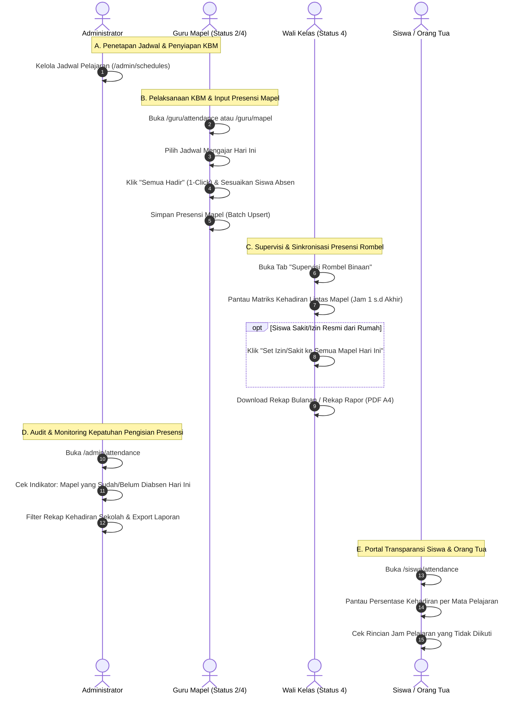
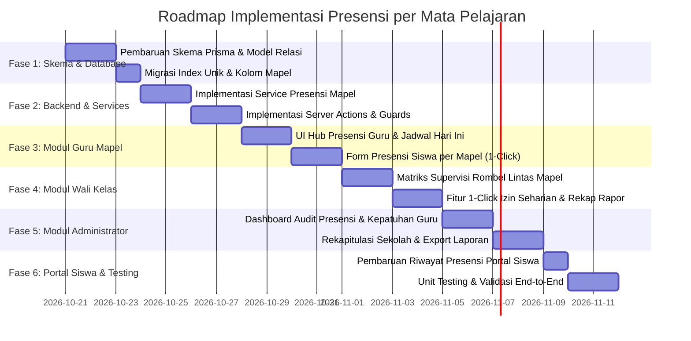

# Rencana Implementasi & Blueprint Arsitektur: Transformasi Sistem Presensi Siswa Berbasis Mata Pelajaran (Per-Mapel)
### SD - SMP Islam Al-Azhar Cairo Palembang
*Sistem Informasi Akademik & Portal Pembelajaran Digital (Student Apps)*

---

## 📌 1. Pendahuluan & Latar Belakang Transformasi

Sistem presensi kehadiran siswa di **SD & SMP Islam Al-Azhar Cairo Palembang** saat ini menggunakan model **Presensi Harian Terpusat Rombel Kelas** yang hanya diisi sekali per hari oleh **Wali Kelas (Status `"4"`)**. Model ini memiliki beberapa keterbatasan operasional di lapangan:

1. **Ketiadaan Akses bagi Guru Mata Pelajaran (Status `"2"`)**:
   Guru bidang studi yang mengajar KBM setiap jam pelajaran tidak memiliki hak dan instrumen untuk mencatat kehadiran siswa di kelasnya. Guru mapel tidak dapat memverifikasi apakah seluruh siswa yang hadir di sekolah benar-benar mengikuti jam pelajarannya.
2. **Keterbatasan Deteksi Disiplin KBM (*Subject Skipping / Bolos Mapel Tertentu*)**:
   Jika seorang siswa hadir saat apel pagi/sholat dhuha bersama wali kelas, namun kemudian meninggalkan kelas atau tidak hadir pada mata pelajaran tertentu di siang hari, sistem saat ini tetap mencatat siswa tersebut berstatus "Hadir" penuh.
3. **Ketidaksediaan Rekapitulasi Kehadiran Akademik per Bidang Studi**:
   Guru mapel kesulitan menentukan kelayakan siswa mengikuti asesmen akhir (syarat minimal kehadiran 80-85% per mata pelajaran) karena data absensi tidak dirinci per mapel.
4. **Ketiadaan Modul Presensi untuk Administrator Sekolah (Status `"3"`)**:
   Admin tidak memiliki dashboard pemantauan absensi terpadu untuk mengaudit kepatuhan dewan guru dalam mengisi jurnal dan presensi KBM setiap jam pelajaran.

**Tujuan Transformasi**:
Mentransformasikan sistem presensi dari model **1 Hari 1 Absensi Rombel** menjadi model **Presensi per Mata Pelajaran (Berbasis Jadwal & Pertemuan KBM)** yang melibatkan **Guru Mapel**, **Guru & Wali Kelas**, serta **Administrator**, dengan tetap mempertahankan kemudahan input (tombol *1-Click Set All Hadir*) dan menjaga kompatibilitas data historis yang sudah ada.

---

## 🔍 2. Analisis Kritis Kondisi Saat Ini vs Sistem Baru (Gap Analysis)

| Dimensi Analisis | Kondisi Saat Ini (Current State) | Sistem Baru (Target State: Per Mata Pelajaran) |
| :--- | :--- | :--- |
| **Model Relasi Database** | `tbl_absen` memiliki constraint `@@unique([user_id, date])`. 1 siswa hanya dapat memiliki 1 status per hari. Tidak ada kolom `mapel_id` atau `guru_id`. | Menghapus constraint `[user_id, date]`. Menambahkan relasi ke `tbl_mata_pelajaran`, `tbl_jadwal_pelajaran`, dan `tbl_pertemuan`. Unik per `[user_id, mapel_id, date]`. |
| **Peran Guru Mapel (Status `"2"`)** | **Diblokir total**. Tidak ada menu di sidebar, halaman `/guru/attendance` menampilkan kartu edukasi penolakan wewenang, server guard melempar error. | **Akses Penuh Pengisian Presensi Mapel**. Menu aktif di sidebar & terintegrasi di `/guru/mapel`. Guru mengisi presensi siswa di setiap jam pelajarannya sesuai jadwal mengajar. |
| **Peran Guru & Wali Kelas (Status `"4"`)** | Memonopoli input presensi harian rombel binaan. Menghabiskan waktu pagi untuk mengabsen seluruh siswa di kelasnya. | **Peran Ganda Holistik**: (1) Mengabsen mapel yang diampunya, (2) Dashboard Supervisi Wali Kelas: Memantau matriks kehadiran siswa binaannya di seluruh mapel pada hari tersebut. Fitur *1-Click Sinkronkan Izin/Sakit Seharian*. |
| **Peran Administrator (Status `"3"`)** | Tidak memiliki menu presensi di sidebar. Tidak ada antarmuka audit atau laporan absensi terpadu tingkat sekolah. | **Pusat Audit & Kontrol Presensi Sekolah (`/admin/attendance`)**: Memantau kepatuhan guru mengisi absen, melihat persentase kehadiran per kelas/mapel, koreksi administratif, dan cetak rekapitulasi dinas/yayasan. |
| **Peran Siswa & Orang Tua (Status `"1"`)** | Hanya melihat 4 angka akumulasi global (Hadir, Sakit, Izin, Alpha) tanpa mengetahui di pelajaran apa mereka tidak hadir. | **Transparansi Per Mapel**: Siswa melihat riwayat kehadiran terinci per mata pelajaran, persentase kehadiran per mapel, dan catatan kehadiran dari guru mapel. |
| **Integrasi Jadwal KBM** | Terputus. Absensi tidak mengenal jadwal pelajaran (`tbl_jadwal_pelajaran`). | **Terintegrasi Otomatis**. Presensi hari ini menampilkan daftar rombel & mapel sesuai hari berjalan (Senin-Jumat) berdasarkan jadwal guru. |

---

## 🏗️ 3. Arsitektur Basis Data (Database Schema & Migration Strategy)

### 3.1. Pembaruan Skema Prisma ORM (`prisma/schema.prisma`)

Tabel `tbl_absen` dimutakhirkan agar terhubung langsung dengan mata pelajaran, jadwal KBM, sesi pertemuan, dan guru pengampu:

```prisma
model Absen {
  id             BigInt          @id @default(autoincrement()) @db.UnsignedBigInt
  user_id        BigInt          @db.UnsignedBigInt
  kelas          String          @db.VarChar(255)
  kelas_id       BigInt?         @db.UnsignedBigInt
  mapel_id       BigInt?         @db.UnsignedBigInt
  jadwal_id      BigInt?         @db.UnsignedBigInt
  guru_id        BigInt?         @db.UnsignedBigInt
  pertemuan_id   BigInt?         @db.UnsignedBigInt
  keterangan     String?         @db.VarChar(255) // "Hadir" | "Sakit" | "Izin" | "Alpha"
  catatan        String?         @db.VarChar(500) // Catatan guru mapel (opsional: izin ke UKS, terlambat, dll)
  date           String?         @db.VarChar(255) // Format ISO YYYY-MM-DD
  month          String?         @db.VarChar(255) // "1" sampai "12"
  jam_ke         String?         @db.VarChar(50)  // Contoh: "Jam ke 1-2 (07.30 - 08.50)"
  created_at     DateTime?       @db.Timestamp(0)
  updated_at     DateTime?       @updatedAt @db.Timestamp(0)

  // Relasi
  user           User            @relation(fields: [user_id], references: [id], onDelete: Cascade, onUpdate: NoAction, map: "tbl_absen_user_id_foreign")
  mapel          MataPelajaran?  @relation(fields: [mapel_id], references: [id], onDelete: SetNull)
  jadwal         JadwalPelajaran? @relation(fields: [jadwal_id], references: [id], onDelete: SetNull)
  guru           User?           @relation("GuruPengabsen", fields: [guru_id], references: [id], onDelete: SetNull)
  pertemuan      Pertemuan?      @relation(fields: [pertemuan_id], references: [id], onDelete: SetNull)

  // Indeks & Constraint Unik Baru
  // Satu siswa hanya memiliki 1 catatan absensi per mapel per tanggal KBM
  @@unique([user_id, mapel_id, date], map: "tbl_absen_user_mapel_date_unique")
  @@index([user_id], map: "tbl_absen_user_id_foreign")
  @@index([kelas, date])
  @@index([kelas, month])
  @@index([mapel_id, date])
  @@index([guru_id])
  @@index([jadwal_id])
  @@index([date])
  @@map("tbl_absen")
}
```

> [!IMPORTANT]
> **Pencegahan Error Database & Migrasi Data Historis**:
> 1. Pada database MySQL saat ini, terdapat indeks unik `tbl_absen_user_id_date_unique` pada `(user_id, date)`. Indeks ini **wajib di-drop** terlebih dahulu sebelum menerapkan constraint baru `(user_id, mapel_id, date)`.
> 2. Kolom `mapel_id` dibuat **nullable (`BigInt?`)** agar data presensi historis (yang dibuat sebelum migrasi) tetap utuh dan valid tanpa menimbulkan *foreign key violation*.
> 3. Untuk data lama yang nilai `mapel_id` bernilai `NULL`, sistem akan mengenalinya sebagai *Presensi Harian Umum / Pembiasaan Pagi (Legacy)*.

---

## 👥 4. Blueprint Workflow Komprehensif Berdasarkan Peran

### 4.1. Diagram Interaksi Antar-Peran (Sequence Diagram)



---

### 4.2. Workflow Guru Mata Pelajaran (Status `"2"` & `"4"`)

Dewan guru mengampu KBM berdasarkan mata pelajaran yang ditugaskan kepadanya:

1. **Jadwal Mengajar Harian Interaktif (*Today's Teaching Schedule*)**:
   - Saat membuka `/guru/attendance`, guru langsung disajikan kartu jadwal mengajarnya pada hari berjalan (contoh: *Hari Selasa: 07.30 - 08.50 Matematika di Kelas 7A*, *09.15 - 10.35 Matematika di Kelas 8B*).
   - Setiap kartu jadwal memiliki status visual:
     - 🟢 **Sudah Diabsen**: Menampilkan ringkasan (contoh: 28 Hadir, 1 Sakit) beserta tombol "Koreksi Presensi".
     - 🟠 **Belum Diabsen**: Tombol aksi mencolok **"Mulai Presensi Kelas"**.
2. **Form Presensi Mapel Cepat**:
   - Menampilkan daftar siswa rombel yang diajar berurutan abjad.
   - Tombol **"Semua Hadir"** untuk menghemat waktu guru di awal jam KBM (selesai dalam < 20 detik).
   - Opsi status baku: **Hadir (H)**, **Sakit (S)**, **Izin (I)**, **Alpha (A)**.
   - Kolom opsional: **Catatan KBM** (misal: *"Izin ke UKS pukul 08.15"*, *"Terlambat 15 menit"*).
3. **Rekapitulasi Presensi per Mata Pelajaran**:
   - Guru dapat memilih kelas dan melihat matriks kehadiran siswa khusus pada mata pelajarannya selama satu semester/bulan.
   - Perhitungan otomatis persentase kehadiran per siswa untuk syarat asesmen dan nilai rapor.

---

### 4.3. Workflow Guru & Wali Kelas (Status `"4"` — Supervisi Rombel)

Wali Kelas tidak hanya mengabsen mata pelajarannya sendiri, melainkan juga memegang kendali atas ketertiban rombel binaannya:

1. **Dashboard Monitoring Matriks Rombel Hari Ini (*Live Class Attendance Board*)**:
   - Menampilkan tabel matriks seluruh siswa binaan terhadap jadwal mata pelajaran hari itu:
     | No | Nama Siswa | Jam 1 (PAI) | Jam 2 (Matematika) | Jam 3 (B. Arab) | Jam 4 (IPA) | Status Akhir |
     | :--- | :--- | :---: | :---: | :---: | :---: | :---: |
     | 1 | Ahmad Rayhan | Hadir | Hadir | Hadir | Hadir | 🟢 Lengkap |
     | 2 | Khalid Basalamah | Hadir | **Alpha** | Hadir | Hadir | 🔴 **Bolos Jam 2** |
     | 3 | Siti Zahra | **Sakit** | **Sakit** | **Sakit** | **Sakit** | 🔵 Sakit (Izin Resmi) |
   - **Fitur Deteksi Bolos (*Subject Truancy Alert*)**: Jika ada siswa yang hadir di satu mapel namun Alpha di mapel lain tanpa keterangan, sistem memberikan badge peringatan agar wali kelas segera melakukan pembinaan kedisiplinan.
2. **Otomasi Sinkronisasi Surat Izin / Sakit Resmi (*Apply to All Subjects*)**:
   - Jika orang tua siswa mengirimkan surat dokter atau pemberitahuan izin sebelum KBM dimulai, Wali Kelas dapat menandai siswa tersebut sebagai **Sakit** atau **Izin** untuk **seluruh mata pelajaran pada tanggal tersebut** hanya dengan 1 kali klik.
   - Hal ini mencegah guru mapel jam ke-1 hingga jam terakhir menandai siswa tersebut sebagai Alpha secara keliru.
3. **Ekspor Rekapitulasi Presensi Resmi Rombel (PDF A4 Landscape)**:
   - Menyediakan 2 tipe dokumen cetak resmi Al-Azhar:
     - **Tipe A: Rekap Presensi Rombel Bulanan** (Kehadiran umum hari efektif sekolah).
     - **Tipe B: Rekapitulasi Kehadiran per Mata Pelajaran** (Persentase kehadiran siswa di seluruh bidang studi untuk lampiran buku rapor).

---

### 4.4. Workflow Administrator (Status `"3"`)

Administrator memiliki kendali pengawasan operasional dan integritas data sekolah:

1. **Dashboard Monitoring Presensi Sekolah Real-Time (`/admin/attendance`)**:
   - **Kartu Metrik Utama Harian**:
     - *Total Jam Pelajaran Terjadwal Hari Ini*
     - *Jumlah Sesi KBM yang Sudah Diabsen* (Persentase Kepatuhan Guru)
     - *Jumlah Sesi KBM yang Belum Diabsen*
     - *Total siswa Alpha / Tidak Hadir di Seluruh Sekolah*
2. **Tabel Kepatuhan Pengisian Presensi Guru (*Teacher Attendance Compliance Tracker*)**:
   - Menampilkan daftar guru dan jadwal mengajarnya hari ini beserta status apakah guru telah mengabsen siswa atau belum.
   - Admin dapat mengirimkan pengingat atau menegur guru yang terlambat mengisi presensi kelas.
3. **Filter Komprehensif & Audit Data**:
   - Admin dapat memfilter data presensi berdasarkan: Jenjang (`SD`/`SMP`), Tingkat (`4`-`9`), Kelas, Mata Pelajaran, dan Rentang Tanggal.
   - Admin berwenang mengoreksi data presensi jika terjadi kendala teknis atau pengaduan kesalahan input oleh guru.
4. **Export Master Rekap Presensi Sekolah**:
   - Unduh rekapitulasi data presensi seluruh kelas dalam format Excel spreadsheet (.xlsx) dan PDF resmi ber-kop Yayasan Pesantren Islam Al-Azhar.

---

### 4.5. Workflow Siswa & Orang Tua (Status `"1"`)

1. **Dashboard Presensi Personal Transparan (`/siswa/attendance`)**:
   - Menampilkan persentase kehadiran per mata pelajaran dalam bentuk *progress bar* visual:
     - Matematika: 96% (24/25 Pertemuan)
     - Pendidikan Agama Islam: 100% (25/25 Pertemuan)
     - Bahasa Arab: 88% (22/25 Pertemuan)
2. **Riwayat Detail Ketidakhadiran**:
   - Siswa dan orang tua dapat melihat tanggal dan mata pelajaran apa saja yang tercatat Sakit, Izin, atau Alpha, lengkap dengan catatan guru jika ada.

---

## 🗺️ 5. Rancangan Antarmuka & Struktur Rute Halaman (Routing Structure)

```
src/app/(dashboard)/
├── guru/
│   └── attendance/
│       ├── page.tsx                     # Hub Utama Presensi Guru (Jadwal Hari Ini & Menu Presensi)
│       ├── [mapelId]/                   # Sub-rute berbasis Mapel
│       │   └── [kelasId]/
│       │       └── [date]/
│       │           ├── page.tsx         # Form Presensi Siswa per Mapel (Daily Subject Form)
│       │           └── _components/     # Form komponen, 1-Click Hadir, Live Counter
│       ├── recap/                       # Rekapitulasi Presensi per Mapel (Tabel & PDF)
│       │   └── page.tsx
│       ├── class-matrix/                # Khusus Wali Kelas: Matriks Monitoring Rombel Lintas Mapel
│       │   └── page.tsx
│       └── _components/                 # Komponen kalender, jadwal card, filter
│
├── admin/
│   └── attendance/                      # Modul Baru untuk Administrator
│       ├── page.tsx                     # Dashboard Audit & Monitoring Presensi Sekolah Harian
│       ├── audit/
│       │   └── page.tsx                 # Tabel Kepatuhan Pengisian Presensi oleh Guru
│       ├── recap/
│       │   └── page.tsx                 # Rekap Komprehensif Seluruh Rombel & Mapel (Excel/PDF)
│       └── _components/                 # Filter jenjang/kelas/mapel, status indicator
│
└── siswa/
    └── attendance/
        ├── page.tsx                     # Riwayat Presensi Siswa (Agregat & Tab Rincian per Mapel)
        └── _components/                 # Kartu persentase per mapel, timeline ketidakhadiran
```

### 5.1. Pembaruan Navigasi Sidebar (`src/components/layouts/sidebar.tsx`)

1. **Untuk Guru (Semua Guru: Status `"2"` dan `"4"`)**:
   - Menu **"Presensi KBM"** (`/guru/attendance`) ditampilkan untuk **seluruh dewan guru** (bukan hanya Wali Kelas!).
   - Sub-menu atau badge khusus bagi Wali Kelas: **"Supervisi Rombel"**.
2. **Untuk Administrator (Status `"3"`)**:
   - Menambahkan menu baru pada `adminMenu`:
     ```typescript
     { label: "Presensi Siswa", href: "/admin/attendance", icon: ClipboardListIcon, iconColor: "text-orange-500" }
     ```

---

## ⚙️ 6. Arsitektur Backend, Services, & Server Actions

### 6.1. Pembaruan `AttendanceService` (`src/services/attendance.service.ts`)

Menambahkan metode-metode mutakhir yang dioptimalkan untuk database berlatensi jaringan (TiDB Cloud):

1. **`recordSubjectAttendance(params)`**:
   - Menerima parameter: `date`, `kelasId`, `kelasNama`, `mapelId`, `guruId`, `jadwalId`, dan array `records: { userId, keterangan, catatan }`.
   - Menggunakan mekanisme batch upsert yang efisien: memeriksa data yang sudah ada berdasarkan `(user_id, mapel_id, date)` lalu melakukan `createMany` dan pengelompokan `updateMany` berdasarkan status keterangan.
2. **`getTeacherTodaySchedulesWithStatus(guruId, date)`**:
   - Mengambil seluruh jadwal mengajar guru pada hari tersebut dari `tbl_jadwal_pelajaran`.
   - Menghubungkan (*join/lookup*) dengan `tbl_absen` pada tanggal berjalan untuk menandai apakah setiap sesi mengajar sudah diisi absensinya atau belum.
3. **`getWaliKelasDailyMatrix(kelasNama, date)`**:
   - Mengambil seluruh siswa di kelas binaan.
   - Mengambil seluruh jadwal mata pelajaran pada tanggal tersebut.
   - Mengambil seluruh data absensi siswa di kelas tersebut pada tanggal tersebut.
   - Menyusun matriks data: Siswa $\times$ Mata Pelajaran.
4. **`applyFullDayStatusByWaliKelas(date, kelasNama, studentId, keterangan, catatan)`**:
   - Mengisi status presensi (misal: Sakit/Izin) pada seluruh mata pelajaran yang terjadwal di kelas binaan pada tanggal tersebut untuk siswa bersangkutan.
5. **`getAdminAttendanceDashboard(date, filters)`**:
   - Menghitung statistik kehadiran sekolah, persentase sesi yang sudah diabsen vs belum diabsen, serta daftar rombel yang belum lengkap presensinya.

### 6.2. Pembaruan Server Actions (`src/actions/guru.ts` & `src/actions/admin-attendance.ts`)

1. **Penyesuaian Hak Akses Guard**:
   - Fungsi pengisian presensi mapel menggunakan guard `checkGuruPengampuOrAdmin(mapelId, kelasId)`:
     - Administrator memiliki wewenang penuh di semua kelas & mapel.
     - Guru dapat mengabsen jika memiliki jadwal mengajar pada mapel & kelas tersebut, ATAU ditugaskan sebagai guru mapel terkait.
   - Fungsi supervisi rombel menggunakan guard `checkWaliKelasOrAdmin(kelas)`.

---

## 🛡️ 7. Penanganan Kasus Khusus & Edge Cases Lapangan

| Skenario Lapangan | Permasalahan Teknis | Solusi Desain Sistem |
| :--- | :--- | :--- |
| **Siswa Sakit/Izin dengan Surat Resmi dari Rumah** | Jika tidak disinkronkan, setiap guru mapel dari jam 1 sampai 6 harus menandai siswa tersebut satu per satu. Rawan tertandai Alpha. | **Fitur 1-Click Wali Kelas**: Wali kelas dapat menetapkan status Sakit/Izin siswa tersebut untuk seluruh jadwal KBM hari itu sekaligus (*Batch Broadcast*). |
| **Siswa Bolos di Jam Tengah (Cabut Pelajaran)** | Siswa hadir di jam PAI pagi, tetapi kabur saat jam Matematika siang. | Presensi per mapel mencatat **Hadir di PAI** dan **Alpha di Matematika**. Dashboard Wali Kelas langsung memunculkan notifikasi merah *Discrepancy Detected*. |
| **Guru Berhalangan Hadir (Guru Piket / Guru Inval)** | Guru mapel asli berhalangan hadir sehingga kelas diampu oleh guru pengganti. | Sistem mengizinkan Administrator atau Guru Pengganti (dengan izin Admin) memilih mapel & kelas tersebut untuk melakukan pengisian presensi KBM atas nama sesi KBM berjalan. |
| **Mata Pelajaran Blok Jam Ganda (2-3 JP)** | Jadwal KBM berlangsung dari jam ke-1 sampai ke-3 untuk satu mata pelajaran yang sama. | Cukup diabsensi **1 kali per sesi KBM mapel pada hari tersebut** (`@@unique([user_id, mapel_id, date])`), sehingga guru tidak perlu mengabsen berulang kali di setiap jam pelajaran yang sama. |
| **Siswa Pindah Rombel Kelas (*Mutasi Siswa*)** | Siswa pindah kelas di pertengahan semester. | Record absensi masa lalu tetap terikat pada `kelas` dan `mapel_id` saat presensi diambil, tidak terhapus saat kolom `users.kelas` diperbarui. |

---

## 🚀 8. Roadmap & Tahapan Rencana Eksekusi (Implementation Phases)



### Rincian Tiap Tahapan:

#### 🔹 Fase 1: Pembaruan Basis Data & Migrasi Skema
- [ ] Ubah `prisma/schema.prisma` untuk menambahkan kolom `mapel_id`, `jadwal_id`, `guru_id`, `pertemuan_id`, `catatan`, `jam_ke` pada model `Absen`.
- [ ] Sesuaikan relasi `MataPelajaran`, `JadwalPelajaran`, `Pertemuan`, dan `User`.
- [ ] Eksekusi migrasi skema database (hapus indeks lama `[user_id, date]`, buat indeks unik baru `[user_id, mapel_id, date]`).
- [ ] Jalankan `npx prisma generate` untuk memperbarui Prisma Client.

#### 🔹 Fase 2: Pembangunan Core Service & Server Actions
- [ ] Perbarui `AttendanceService` di `src/services/attendance.service.ts`:
  - `recordSubjectAttendance()`
  - `getTeacherTodaySchedulesWithStatus()`
  - `getWaliKelasDailyMatrix()`
  - `applyFullDayStatusByWaliKelas()`
  - `getAdminAttendanceDashboard()`
- [ ] Buat Server Actions di `src/actions/guru.ts` dan server action admin baru.
- [ ] Perbarui schema validasi Zod di `src/lib/validators/attendance.schema.ts`.

#### 🔹 Fase 3: Antarmuka Presensi Guru Mata Pelajaran (Status `"2"` & `"4"`)
- [ ] Rancang ulang `/guru/attendance/page.tsx` menjadi **Hub Presensi Guru**:
  - Kartu ringkasan jadwal mengajar hari ini (Sudah / Belum Diabsen).
  - Navigasi cepat ke form presensi mapel berjalan.
- [ ] Buat form presensi mapel `/guru/attendance/[mapelId]/[kelasId]/[date]`:
  - Informasi judul mapel, nama kelas, jam ke, dan tanggal.
  - Tombol sakti "Semua Hadir", counter real-time (Hadir/Sakit/Izin/Alpha).
  - Input catatan per siswa.
- [ ] Buka hak akses sidebar di `src/components/layouts/sidebar.tsx` agar menu Presensi muncul untuk seluruh guru (baik status `"2"` maupun `"4"`).

#### 🔹 Fase 4: Antarmuka Supervisi & Rekapitulasi Wali Kelas (Status `"4"`)
- [ ] Buat tab / halaman **"Supervisi Rombel Binaan"** di `/guru/attendance`:
  - Tabel matriks kehadiran siswa lintas mapel hari ini (Jam 1 s.d akhir).
  - Indikator peringatan jika terdeteksi siswa bolos di jam pelajaran tertentu.
- [ ] Implementasikan tombol modal **"Terapkan Izin/Sakit Seharian"** untuk siswa yang mengirim surat dokter ke wali kelas.
- [ ] Perbarui halaman rekapitulasi `/guru/attendance/recap` agar mendukung rekap persentase kehadiran per mata pelajaran dan rekap umum rombel (PDF A4 Landscape).

#### 🔹 Fase 5: Modul Monitoring & Audit Presensi Administrator (Status `"3"`)
- [ ] Tambahkan menu **"Presensi Siswa"** di sidebar admin (`src/components/layouts/sidebar.tsx`).
- [ ] Buat halaman utama `/admin/attendance`:
  - Metrik persentase kepatuhan guru mengisi absen hari ini.
  - Daftar rombel/mapel yang belum diabsen.
  - Filter interaktif: Jenjang, Kelas, Mapel, Guru, Tanggal.
- [ ] Buat fitur export laporan absensi komprehensif tingkat sekolah (Excel / PDF).

#### 🔹 Fase 6: Antarmuka Portal Siswa (Status `"1"`)
- [ ] Perbarui `/siswa/attendance/page.tsx` dan `attendance-history-client.tsx`:
  - Tampilkan kartu persentase kehadiran per mata pelajaran.
  - Tampilkan detail mata pelajaran mana yang berstatus tidak hadir jika ada.
- [ ] Perbarui endpoint API riwayat presensi `/api/attendance/history/route.ts` agar menyertakan relasi mapel.

#### 🔹 Fase 7: Pengujian, Verifikasi, & Standarisasi
- [ ] Tambahkan unit test untuk logika presensi mapel di `test/unit/`.
- [ ] Uji skenario multi-mapel per hari (1 siswa absen di mapel A, B, C pada hari yang sama).
- [ ] Uji verifikasi hak akses guard: Guru Mapel hanya dapat mengabsen kelasnya, Wali Kelas dapat mensupervisi rombelnya, Admin dapat mengaudit semua.
- [ ] Uji cetak PDF dan responsivitas antarmuka di perangkat iPad guru.

---

*Rencana implementasi ini dirancang secara komprehensif sebagai panduan baku arsitektur dan pengembangan fitur presensi per mata pelajaran di SD - SMP Islam Al-Azhar Cairo Palembang.*
