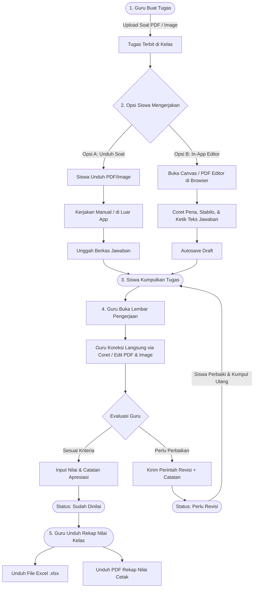
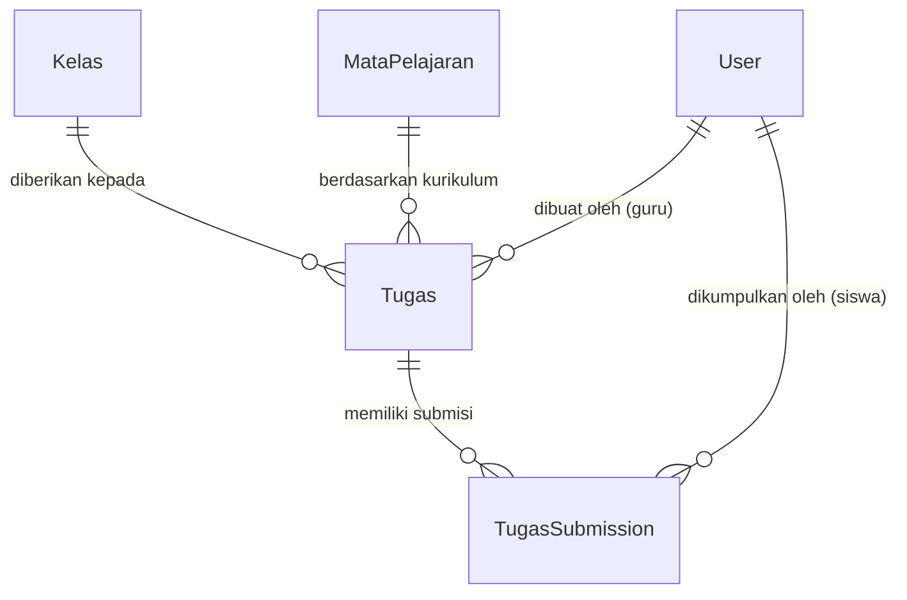
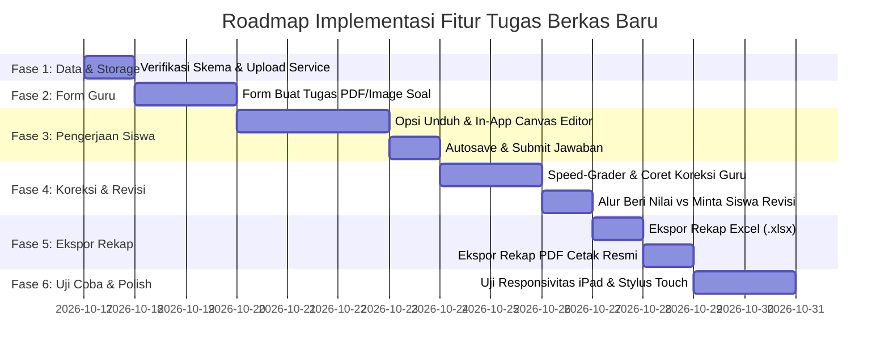

# 📋 Rencana Implementasi & Spesifikasi Fitur: Penugasan Lembar Kerja Berkas (PDF & Image)
### SD - SMP Islam Al-Azhar Cairo Palembang
*Sistem Informasi Akademik & Portal Pembelajaran Digital (Student Apps)*

---

## 📌 1. Pendahuluan & Ringkasan Eksekutif

Dokumen ini memuat perencanaan lengkap, arsitektur teknis, dan panduan implementasi untuk moda penugasan baru pada modul Tugas di **Student Apps SD & SMP Islam Al-Azhar Cairo Palembang**:

> **Fitur: Penugasan Lembar Kerja Berkas Interaktif (Worksheet PDF & Image)**
> Memungkinkan dewan guru mengunggah soal dalam format dokumen PDF atau gambar (LKS/worksheet), memberikan pilihan fleksibel bagi santri untuk mengerjakan baik secara luring (unduh lalu unggah berkas) maupun langsung di dalam aplikasi melalui *In-App Canvas & PDF Annotation Editor* (coret-coret digital & pengetikan teks), koreksi interaktif oleh guru, alur revisi tugas, serta pengunduhan rekap nilai per kelas dalam format Excel (.xlsx) dan PDF resmi.

Fitur ini melengkapi moda **Kuis Interaktif CBT** yang sudah ada sebelumnya, sehingga sistem memiliki dua opsi penugasan utama:
1. **Moda Ujian CBT Interaktif (Pilihan Ganda, Isian, & Esai Online)** — *Sudah Aktif*
2. **Moda Penugasan Lembar Kerja Berkas (PDF/Image dengan In-App Annotation & Koreksi Digital)** — *Fitur Baru yang Direncanakan*

---

## 🎯 2. Analisis Kebutuhan & Alur Pengguna (User Stories & Workflow)

Siklus penugasan ini mencakup 5 tahapan utama:

### A. Alur Guru: Pembuatan Tugas Berkas Baru
1. Guru masuk ke menu `/guru/tugas` lalu menekan tombol **"Buat Tugas Baru"**.
2. Guru memilih tipe tugas: **"Lembar Kerja Berkas (PDF / Gambar)"**.
3. Guru mengunggah file lembar soal dalam format **PDF** atau **Image (JPG, PNG, WebP)**.
4. Guru mengisi informasi tugas:
   - Judul Tugas & Mata Pelajaran.
   - Rombel Kelas sasaran.
   - Tautan Silabus Pertemuan KBM (opsional).
   - Tenggat Waktu (*Deadline*).
   - Poin Maksimal (skala penilaian, misal: 100).
   - Petunjuk Pengerjaan untuk siswa.
   - Opsi izin pengerjaan: Izinkan Unduh (aktif) & Izinkan Coret In-App (aktif).
5. Sistem menyimpan file soal ke direktori publik `/uploads/tugas/soal/` dan menerbitkan tugas ke rombel kelas terkait.

### B. Alur Santri: Pilihan Moda Pengerjaan
Santri membuka `/siswa/tugas/[id]` dan disambut dua opsi pengerjaan fleksibel:
- **Opsi 1 — Unduh & Kerjakan Mandiri (Download & Offline Submission)**:
  - Santri menekan tombol **"Unduh Lembar Soal"**.
  - File soal PDF/Image diunduh melalui `/api/download?file=...`.
  - Santri dapat mencetak lembar soal, mengerjakannya di buku catatan/kertas, atau mengeditnya di aplikasi stylus pihak ketiga (seperti GoodNotes / Apple Notes).
  - Santri memotret / memindai berkas jawaban dan mengunggahnya (*upload file*) kembali ke aplikasi.
- **Opsi 2 — Kerjakan Langsung di Aplikasi (In-App Canvas & PDF Editor)**:
  - Santri menekan tombol **"Kerjakan Langsung di Aplikasi"**.
  - Lembar soal terbuka di kanvas interaktif layar penuh (*iPad-optimized*).
  - Santri memanfaatkan peralatan digital:
    - ✏️ **Pena Digital (Pen)**: Untuk menulis tangan atau menggambar jawaban dengan beragam pilihan warna dan ketebalan goresan.
    - 🖍️ **Stabilo (Highlighter)**: Untuk menandai teks atau poin penting pada soal.
    - 🔤 **Tambahkan Teks (Text Box)**: Mengetuk area manapun pada soal untuk mengetikkan jawaban dengan teks rapi.
    - 🧹 **Penghapus (Eraser)**: Menghapus goresan yang keliru.
    - ↩️ / ↪️ **Undo & Redo**: Membatalkan atau mengulang aksi coretan.
    - 🔍 **Zoom & Pan**: Memperbesar dan menggeser lembar kerja agar penulisan lebih presisi.
    - 📄 **Navigasi Multi-Halaman**: Berpindah halaman jika soal berbentuk PDF multi-halaman.
  - Sistem secara berkala menjalankan **Autosave Draft** menyimpan data coretan (*strokes & text layer*) sehingga pekerjaan aman meskipun koneksi terputus.
- **Pengumpulan Akhir**:
  - Santri meninjau hasil pekerjaannya, menyertakan catatan siswa jika diperlukan, lalu menekan **"Kumpulkan Tugas"**.
  - Sistem merender hasil kanvas dan menyimpannya sebagai file submission santri. Status pengerjaan berubah menjadi `menunggu_penilaian`.

### C. Alur Guru: Koreksi Berkas Digital (Speed-Grader)
1. Guru membuka `/guru/tugas/[id]` dan melihat daftar submisi santri.
2. Guru memilih santri yang berstatus `menunggu_penilaian` dan masuk ke halaman koreksi `/guru/tugas/[id]/review/[subId]`.
3. Guru memeriksa lembar pengerjaan siswa langsung di kanvas interaktif:
   - Guru mengaktifkan alat coreksi:
     - 🔴 **Pena Merah**: Memberikan garis bawah atau catatan perbaikan.
     - 🟢 **Stempel Centang (✓) & Silang (✗)**: Menandai nomor soal yang benar atau salah secara visual.
     - 💬 **Catatan Sticky / Teks Komentar**: Menuliskan pesan bimbingan tepat di sebelah jawaban santri.
4. Coretan dan catatan guru disimpan ke sistem sebagai `annotated_file_url` dan `annotated_data`.

### D. Alur Guru: Keputusan Evaluasi (Nilai vs Revisi)
Pada panel evaluasi di sisi kanan layar, guru memiliki 2 opsi tindakan:
- **Tindakan A — Beri Nilai Final**:
  - Guru menginput skor angka (0 - Poin Maksimal).
  - Guru menuliskan komentar umum apresiasi.
  - Menekan tombol **"Simpan & Beri Nilai"**.
  - Status berubah menjadi `sudah_dinilai`. Santri menerima nilai dan dapat melihat lembar hasil koreksi lengkap dengan coretan guru.
- **Tindakan B — Minta Siswa Revisi**:
  - Jika tugas belum memenuhi kriteria kelulusan minimal, guru menekan **"Minta Siswa Revisi"**.
  - Guru menuliskan instruksi revisi spesifik (*"Perbaiki nomor 3 dan lengkapi cara perhitungannya ya nak"*).
  - Status berubah menjadi `perlu_revisi`.
  - Santri menerima notifikasi revisi di dasbor, membuka kembali lembar pengerjaan yang sudah berisi coretan panduan dari guru, memperbaikinya, dan mengumpulkan ulang (*re-submit*).

### E. Alur Guru: Unduh Rekap Nilai per Kelas
1. Pada halaman daftar tugas `/guru/tugas/[id]`, guru memiliki tombol dropdown **"Unduh Rekap Nilai"**.
2. Guru dapat memilih format:
   - 📊 **Unduh File Excel (.xlsx)**:
     - Berisi identitas tugas, rombel kelas, dan mata pelajaran.
     - Tabel komprehensif: No, NIS, Nama Lengkap Siswa, Status Pengumpulan (Tepat Waktu / Terlambat / Belum Mengumpulkan / Perlu Revisi), Waktu Pengumpulan, Nilai Tugas, dan Catatan Guru.
     - Ringkasan statistik di baris akhir: Nilai Rata-rata Kelas, Nilai Tertinggi, Nilai Terendah, dan Persentase Tuntas KKM.
   - 📑 **Unduh Rekap Dokumen PDF (.pdf)**:
     - Dokumen berformat standar resmi SD - SMP Islam Al-Azhar Cairo Palembang.
     - Memuat kop surat sekolah, judul tugas, kelas, guru pengampu, tabel nilai rapi (*jspdf-autotable*), tanggal cetak, dan kolom tanda tangan guru pengampu.

---

## 🏗️ 3. Arsitektur Data & Model Database (Prisma Schema)

Struktur tabel `tbl_tugas` dan `tbl_tugas_submission` yang ada pada schema Prisma telah siap mendukung penambahan fitur ini dengan pemanfaatan atribut yang telah disediakan:

### 1. Model `Tugas` (`tbl_tugas`)
Penggunaan kolom untuk tipe penugasan lembar kerja berkas:
- `tipe_pengerjaan`: Menggunakan nilai enum/string `"LEMBAR_KERJA"` (atau `"UPLOAD"` yang disempurnakan).
- `file_petunjuk`: Menyimpan path URL berkas soal utama yang diunggah guru (misal: `/uploads/tugas/soal/soal-matematika-bab1.pdf` atau `.webp`).
- `poin_maksimal`: Nilai acuan maksimum (default `100`).
- `deadline`: Batas waktu penyerahan tugas.
- `judul` & `deskripsi`: Narasi petunjuk umum pengerjaan tugas.
- `status`: `"aktif"` / `"draft"` / `"closed"`.

### 2. Model `TugasSubmission` (`tbl_tugas_submission`)
Menyimpan riwayat berkas pengerjaan, layer anotasi coretan, nilai, dan status revisi:
- `file_url`: URL lembar jawaban santri (berkas hasil upload siswa atau hasil ekspor kanvas awal).
- `file_name` & `file_type`: Metadata berkas (misal: `"jawaban-ananda.pdf"`, `"image/webp"`).
- `catatan_siswa`: Pesan pengantar dari santri saat mengumpulkan tugas.
- `status`:
  - `"belum_mengumpulkan"`: Siswa belum mengumpulkan tugas.
  - `"sedang_mengerjakan"`: Siswa sedang membuka kanvas editor (ada draft pengerjaan tersimpan).
  - `"menunggu_penilaian"`: Siswa telah menyelesaikan dan mengumpulkan lembar tugas.
  - `"perlu_revisi"`: Guru mengembalikan lembar tugas untuk diperbaiki siswa.
  - `"sudah_dinilai"`: Tugas telah dievaluasi dan nilai telah dirilis.
- `nilai`: Nilai final evaluasi dari guru (skala 0 - Poin Maksimal).
- `catatan_guru`: Komentar evaluasi atau instruksi revisi dari dewan guru.
- `annotated_file_url`: URL berkas visual yang telah dibubuhi coretan guru (merah/centang/catatan).
- `annotated_data`: Data vektor koordinat anotasi dalam format JSON string (*strokes path, text bounding boxes, stamps*), memungkinkan kanvas dimuat ulang dan diedit kembali tanpa penurunan kualitas gambar.
- `submitted_at`, `graded_at`, `graded_by`: Rekam jejak waktu pengumpulan dan penilai.

---

## 🎨 4. Desain Komponen Antarmuka Pengguna (UI/UX)

Antarmuka dirancang modern, responsif, dan optimal untuk layar sentuh iPad (*Apple Pencil friendly*) maupun desktop PC:

### A. Form Buat Tugas Baru — Pilihan Moda Fleksibel
Lokasi: `src/app/(dashboard)/guru/tugas/create/page.tsx`
- Tab Pemilihan Moda:
  - **Kuis CBT Interaktif**: Butir soal pilihan ganda, isian, dan esai (engine yang telah ada).
  - **Lembar Kerja Berkas (PDF/Image)**: Dropzone unggah file soal (PDF, PNG, JPG, WebP) dengan batas ukuran hingga 25MB.
- Pratinjau Lembar Soal Instan: Guru dapat melihat file yang diunggah langsung di peramban sebelum diterbitkan.
- Konfigurasi Tugas: Judul, Kelas, Mapel, Deadline, Nilai Maksimal, dan Catatan Panduan.

### B. Dasbor Siswa — Opsi Pengerjaan Ganda
Lokasi: `src/app/(dashboard)/siswa/tugas/[tugasId]/page.tsx`
- Kartu Tugas menampilkan status:
  - Jika belum dikerjakan: Muncul 2 tombol aksi:
    - 📥 **Unduh Soal** (Download file soal asli untuk dicetak atau dikerjakan manual).
    - ✏️ **Kerjakan Langsung di Aplikasi** (Membuka In-App Canvas Editor).
  - Jika ada tombol **"Unggah Berkas Pengerjaan"** untuk santri yang memilih pengerjaan manual luring.
  - Jika status `perlu_revisi`: Muncul banner peringatan oranye (*"Ustadz/Ustadzah meminta revisi pada tugas ini"*), menampilkan catatan perbaikan, serta tombol **"Perbaiki Tugas Sekarang"**.

### C. Komponen Inti: In-App Document & Canvas Editor
Lokasi baru: `src/components/features/assignment/canvas/document-canvas-editor.tsx`
- **Fitur Toolbar Atas**:
  - 🖌️ **Alat Gambar Bebas (Pena)**: Pilihan ketebalan goresan (2px, 4px, 8px) dan palet warna (Hitam, Biru, Merah, Hijau).
  - 🖍️ **Stabilo (Highlighter)**: Goresan transparan 40% warna kuning/hijau.
  - 🔤 **Teks Jawaban**: Klik pada lembar soal untuk menambahkan kotak teks, ketik jawaban dengan keyboard fisik atau keyboard sentuh iPad.
  - 🧹 **Penghapus**: Hapus goresan coret atau hapus elemen teks.
  - ↩️ / ↪️ **Undo & Redo**: Riwayat aksi 30 langkah.
  - 🔍 **Zoom (50% - 300%) & Pan**: Memperbesar bagian soal tertentu agar santri leluasa menulis.
  - 📄 **Navigasi Halaman PDF**: Tombol panah Sebelumnya / Selanjutnya dengan indikator Halaman X dari Y.
  - 💾 **Status Penyimpanan**: Indikator *"Tersimpan otomatis"* / *"Menyimpan..."*.
  - 🚀 **Tombol Aksi**: *"Kumpulkan Tugas"* (untuk siswa) atau *"Simpan Koreksi"* (untuk guru).
- **Fitur Khusus Mode Guru (Teacher Correction Toolbar)**:
  - 🔴 **Pena Merah Koreksi**: Default pena berwarna merah terang untuk mengoreksi lembar santri.
  - ✔️ **Stempel Centang Hijau** & ❌ **Stempel Silang Merah**: Sekali ketuk untuk menaruh tanda benar/salah pada lembar.
  - 💬 **Catatan Koreksi Cepat**: Bubble teks koreksi guru.

### D. Lembar Penilaian Guru (Speed-Grader Panel)
Lokasi: `src/app/(dashboard)/guru/tugas/[tugasId]/review/[subId]/page.tsx`
- Tampilan berdampingan (*Side-by-Side View*):
  - **Sisi Kiri (70%)**: Lembar kerja pengerjaan santri dengan In-App Canvas Editor aktif untuk dicoret langsung oleh guru.
  - **Sisi Kanan (30%)**: Panel input penilaian:
    - Informasi santri (Nama, NIS, Waktu Kumpul, Keterangan Tepat Waktu/Terlambat).
    - Input Nilai (skala 0 - Poin Maksimal).
    - Textarea Catatan Guru.
    - Tombol Hijau: **"Beri Nilai & Selesaikan"** (Status -> `sudah_dinilai`).
    - Tombol Oranye: **"Minta Siswa Revisi"** (Status -> `perlu_revisi`).
    - Tombol Navigasi Santri Berikutnya / Sebelumnya.

---

## 📊 5. Fitur Unduh Rekap Nilai Kelas (Excel & PDF)

Fitur ini disematkan pada bilah kontrol di halaman `/guru/tugas/[tugasId]`.

### A. Ekspor Spreadsheet Excel (.xlsx)
Menggunakan library `xlsx` yang telah terpasang di project:
- Nama file otomatis: `Rekap_Nilai_{NamaKelas}_{NamaMapel}_{Tanggal}.xlsx`.
- Susunan Header & Kolom:
  1. No
  2. Nomor Induk Siswa (NIS)
  3. Nama Lengkap Siswa
  4. Jenis Kelamin (L/P)
  5. Status Pengumpulan (Tepat Waktu / Terlambat / Belum Mengumpulkan / Perlu Revisi)
  6. Waktu Pengumpulan (Tanggal & Jam WIB)
  7. Nilai Tugas (Angka 0 - 100)
  8. Status Ketuntasan (Tuntas / Belum Tuntas berdasarkan KKM 75)
  9. Catatan Dewan Guru
- Baris Ringkasan Kelas di bagian bawah:
  - Nilai Rata-Rata Kelas
  - Nilai Tertinggi
  - Nilai Terendah
  - Jumlah Siswa Tuntas & Persentase Kelulusan Tugas

### B. Ekspor Dokumen Resmi PDF (.pdf)
Menggunakan library `jspdf` dan `jspdf-autotable` yang telah terpasang:
- Format dokumen berorientasi **Landscape A4**.
- Layout Dokumen Resmi:
  - **Kop Surat Resmi**: *"YAYASAN ASUH ASOSIASI ISLAM AL-AZHAR CAIRO PALEMBANG"* beserta alamat, nomor kontak, dan garis pembatas ganda.
  - **Judul Rekap**: *"REKAPITULASI EVALUASI PENUGASAN SANTRI"*.
  - **Metadata Identitas**: Mata Pelajaran, Rombel Kelas, Tanggal Tugas Diterbitkan, Tenggat Waktu, dan Nama Guru Pengampu.
  - **Tabel Nilai Rapi**: Diformat dengan tema hijau emerald Al-Azhar, nomor urut teratur, nilai tebal, dan catatan guru.
  - **Statistik Nilai**: Kotak ringkasan rata-rata kelas, total siswa dinilai, dan siswa yang belum mengumpulkan.
  - **Kolom Pengesahan Tanda Tangan**: Tempat dan tanggal pembuatan rekap, serta kolom tanda tangan basah / digital Dewan Guru Pengampu.

---

## 💻 6. Rincian Teknis & Server Actions yang Dibutuhkan

Berikut adalah daftar fungsi *Server Actions* baru atau penyempurnaan yang perlu diimplementasikan:

| Nama Fungsi Server Action | Berkas Target | Deskripsi & Peran Teknis |
| :--- | :--- | :--- |
| `createDocumentTaskAction` | `src/actions/assignment.ts` | Menyimpan tugas baru bertipe `LEMBAR_KERJA`, mengunggah file soal PDF/gambar guru via `saveUploadedFile`, dan mendistribusikan ke kelas. |
| `saveStudentDraftAnnotationAction` | `src/actions/assignment.ts` | Menyimpan autosave draft coretan pengerjaan santri (`annotated_data` JSON) sebelum dikumpulkan. |
| `submitDocumentTaskAction` | `src/actions/assignment.ts` | Finalisasi pengerjaan santri, mengunggah berkas render jawaban, mengubah status menjadi `menunggu_penilaian`. |
| `gradeDocumentTaskAction` | `src/actions/assignment.ts` | Guru menyimpan nilai angka, catatan evaluasi, dan berkas lembar teranotasi (`annotated_file_url`), status menjadi `sudah_dinilai`. |
| `requestTaskRevisionAction` | `src/actions/assignment.ts` | Guru mengirimkan instruksi revisi dan berkas coretan perbaikan, mengubah status submission menjadi `perlu_revisi`. |
| `resubmitTaskRevisionAction` | `src/actions/assignment.ts` | Siswa mengumpulkan ulang hasil perbaikan revisi, status kembali menjadi `menunggu_penilaian`. |
| `exportTaskRecapAction` (atau Client Export) | `src/lib/export-task-recap.ts` | Logika pengolahan data agregat kelas menjadi workbook `xlsx` dan dokumen `jsPDF`. |

---

## 🗺️ 7. Rencana Tahapan Eksekusi (Implementation Roadmap)

Rencana pengerjaan dibagi menjadi 6 tahap terstruktur:

### Rincian Tiap Fase:

#### 🔹 Fase 1: Penyiapan Storage & Validasi Model
- Memastikan direktori upload `/uploads/tugas/soal/` dan `/uploads/tugas/jawaban/` siap digunakan.
- Memastikan dukungan format berkas PDF dan Gambar (JPG/PNG/WebP) pada fungsi `saveUploadedFile`.
- Menyiapkan endpoint `/api/download` untuk mengunduh berkas soal secara aman tanpa eror CORS.

#### 🔹 Fase 2: Form Pembuatan Tugas Guru (Upload PDF/Image)
- Menambahkan tab pemilihan jenis tugas di `/guru/tugas/create`:
  - **Tugas Interaktif CBT** (sudah ada).
  - **Tugas Berkas / Lembar Kerja** (baru).
- Menyediakan komponen Dropzone file soal dengan validasi format dan ukuran file.
- Menyimpan tugas dengan tipe `LEMBAR_KERJA` dan merekam tautan file soal ke kolom `file_petunjuk`.

#### 🔹 Fase 3: Antarmuka Siswa (Unduh Soal & In-App Canvas Editor)
- Memperbarui halaman lobby tugas santri `/siswa/tugas/[tugasId]`:
  - Menampilkan tombol **"Unduh Lembar Soal"** (mengarah ke `/api/download`).
  - Menampilkan form upload berkas jawaban untuk santri yang memilih pengerjaan offline/manual.
  - Menampilkan tombol **"Kerjakan Langsung di Aplikasi"**.
- Membangun komponen **Document Canvas Editor**:
  - Render background lembar soal (gambar atau halaman PDF).
  - Peralatan: Pena Digital, Stabilo, Kotak Teks Jawaban, Penghapus, Undo/Redo.
  - Dukungan sentuhan iPad / Apple Pencil (*pointer events & pressure support*).
  - Mekanisme *Auto-Save Draft* ke database.
  - Tombol pengumpulan akhir tugas.

#### 🔹 Fase 4: In-App Correction Guru & Alur Revisi
- Memperbarui halaman review `/guru/tugas/[tugasId]/review/[subId]`:
  - Mengintegrasikan In-App Canvas Editor versi koreksi guru (Pena Merah, Stempel Centang/Silang, Bubble Catatan).
  - Menyediakan dua tombol keputusan: **"Beri Nilai"** atau **"Minta Revisi"**.
- Menyempurnakan status `perlu_revisi`:
  - Menampilkan badge oranye dan catatan revisi guru di sisi siswa.
  - Siswa dapat membuka kembali lembar pengerjaan yang sudah berisi catatan coretan guru dan memperbaikinya.
  - Siswa mengumpulkan ulang hasil perbaikan.

#### 🔹 Fase 5: Ekspor Rekap Nilai Kelas (Excel & PDF)
- Menambahkan tombol **"Unduh Rekap Nilai"** pada halaman `/guru/tugas/[tugasId]`.
- Mengimplementasikan ekspor **Excel (.xlsx)** dengan pustaka `xlsx`:
  - Menghasilkan daftar nilai seluruh santri di kelas beserta ringkasan statistik kelas.
- Mengimplementasikan ekspor **PDF Resmi (.pdf)** dengan `jspdf` dan `jspdf-autotable`:
  - Desain layout resmi ber-kop sekolah Al-Azhar Cairo Palembang dengan tabel rapi dan kolom tanda tangan guru.

#### 🔹 Fase 6: Uji Coba, Optimasi Performa, & Dokumentasi
- Uji coba di perangkat iPad (Safari Mobile) untuk memastikan kelancaran goresan stylus Apple Pencil tanpa lag (*latency < 16ms*).
- Validasi penyimpanan data anotasi JSON agar hemat ukuran database.
- Melakukan verifikasi komprehensif seluruh alur dari guru membuat tugas, siswa mengerjakan, guru mengoreksi, revisi, hingga unduh rekap nilai.

---

## 🔒 8. Keamanan & Hak Akses (Security & Role Matrix)

Tabel matriks hak akses pada fitur penugasan lembar kerja berkas:

| Tindakan / Aksi Fitur | Guru Pengampu | Santri / Siswa | Wali Kelas | Administrator |
| :--- | :---: | :---: | :---: | :---: |
| **Upload Soal PDF/Image & Buat Tugas** | ✅ Ya (Kelas Ampuan) | ❌ Tidak | ❌ Tidak | ✅ Ya |
| **Unduh Berkas Lembar Soal** | ✅ Ya | ✅ Ya (Kelas Terdaftar) | 👁️ Pratinjau | ✅ Ya |
| **Pengerjaan In-App Canvas & Add Teks** | ❌ (Mode Guru) | ✅ Ya (Lembar Pribadi) | ❌ Tidak | ❌ Tidak |
| **Kumpulkan & Submit Berkas Jawaban** | ❌ Tidak | ✅ Ya (Sebelum Deadline) | ❌ Tidak | ❌ Tidak |
| **Coret Koreksi Langsung di Lembar Siswa** | ✅ Ya | ❌ Tidak | 👁️ Lihat Hasil | ✅ Ya |
| **Input Nilai Final (0 - 100)** | ✅ Ya | ❌ Tidak | 👁️ Lihat Nilai | ✅ Ya |
| **Menginstruksikan Siswa Revisi Tugas** | ✅ Ya | ❌ Tidak | 👁️ Lihat Status | ✅ Ya |
| **Kumpulkan Ulang Lembar Revisi** | ❌ Tidak | ✅ Ya (Status Perlu Revisi) | ❌ Tidak | ❌ Tidak |
| **Unduh Rekap Nilai Kelas (Excel / PDF)** | ✅ Ya (Kelas Ampuan) | ❌ Tidak | ✅ Ya (Kelas Asuhan) | ✅ Ya |

---

## 💡 9. Kesimpulan & Nilai Tambah

Dengan diimplementasikannya fitur **Penugasan Lembar Kerja Berkas (PDF/Image) Interaktif** ini:
1. **Guru Lebih Efisien & Fleksibel**: Guru tidak lagi terbebani mengetik ulang ratusan butir soal ke form CBT bila sudah memiliki materi LKS PDF atau foto buku paket. Cukup unggah dokumen soal sekali klik.
2. **Koreksi Digital Paperless**: Guru dapat mengoreksi lembar jawaban santri secara visual layaknya mencoret buku tugas fisik menggunakan pena merah dan stempel digital di atas iPad tanpa perlu mencetak kertas (*zero paper waste*).
3. **Pengalaman Santri yang Menyenangkan**: Santri dapat memilih cara pengerjaan yang paling nyaman bagi mereka—apakah mencetak lembar soal atau langsung mencoret dan mengetik jawaban di layar iPad.
4. **Siklus Pembelajaran Berkelanjutan melalui Revisi**: Fitur revisi memastikan proses evaluasi bersifat formatif dan mendidik, membimbing santri hingga benar-benar memahami materi.
5. **Kemudahan Administrasi**: Rekapitulasi nilai otomatis per kelas dalam format Excel dan PDF resmi menghemat waktu dewan guru dalam penyusunan laporan penilaian ke wali kelas dan pimpinan sekolah.

---

*Dokumen spesifikasi dan rencana implementasi ini siap dijadikan acuan eksekusi teknis pada tahap pengembangan modul tugas Student Apps SD - SMP Islam Al-Azhar Cairo Palembang.*
