# 📘 Panduan Lengkap Penggunaan Student Apps — Role **Guru & Wali Kelas**

> **Aplikasi**: Student Apps — Portal Sistem Sekolah Terpadu (SD – SMP Islam Al-Azhar Cairo Palembang)  
> **Sasaran Pengguna**: Pendidik dengan peran **Guru Mata Pelajaran** (`status = "2"`), **Guru & Wali Kelas** (`status = "4"`), serta **Guru Lintas Jenjang** (`jenjang = "ALL"`)  
> **Cakupan Dokumen**: Arsitektur hak akses (Guru Mapel vs Wali Kelas), peta rute lengkap `/guru/*`, panduan langkah demi langkah semua fitur mengajar dan perwalian, **Diagram UML** (Use Case Map, Class Diagram, ERD, 5 Sequence Diagram, State Machine Diagram), **Flowchart** alur kerja lengkap, tabel batasan sistem, serta FAQ Troubleshooting.

---

## 📑 Daftar Isi

1. [Gambaran Umum & Arsitektur Peran (Guru Mapel vs Wali Kelas)](#1-gambaran-umum--arsitektur-peran-guru-mapel-vs-wali-kelas)
   - [1.1 Pembagian Status & Jenjang Pendidik](#11-pembagian-status--jenjang-pendidik)
   - [1.2 Matriks Perbedaan Hak Akses (Guru Mapel vs Guru & Wali Kelas vs Lintas Jenjang)](#12-matriks-perbedaan-hak-akses-guru-mapel-vs-guru--wali-kelas-vs-lintas-jenjang)
2. [Peta Rute & Fitur Lengkap Guru & Wali Kelas](#2-peta-rute--fitur-lengkap-guru--wali-kelas)
3. [Panduan Penggunaan Setiap Fitur](#3-panduan-penggunaan-setiap-fitur)
   - [3.1 Registrasi Guru Baru, Login, Mode Demo, & Keluar Sistem](#31-registrasi-guru-baru-login-mode-demo--keluar-sistem)
   - [3.2 Antarmuka Utama (Sidebar, Navbar, Pengalih Jenjang, Tema, & Mode Offline)](#32-antarmuka-utama-sidebar-navbar-pengalih-jenjang-tema--mode-offline)
   - [3.3 Dashboard Guru & Wali Kelas](#33-dashboard-guru--wali-kelas)
   - [3.4 Mata Pelajaran & Manajemen Materi Pertemuan](#34-mata-pelajaran--manajemen-materi-pertemuan)
   - [3.5 Pembuatan & Pengeditan Tugas (Lembar Kerja Berkas & Kuis CBT 3-Langkah)](#35-pembuatan--pengeditan-tugas-lembar-kerja-berkas--kuis-cbt-3-langkah)
   - [3.6 Pemantauan Pengumpulan, Speed-Grader, Permintaan Revisi, & Ekspor Nilai](#36-pemantauan-pengumpulan-speed-grader-permintaan-revisi--ekspor-nilai)
   - [3.7 Presensi KBM, Supervisi Matrix (Wali Kelas), & Rekap Cetak PDF](#37-presensi-kbm-supervisi-matrix-wali-kelas--rekap-cetak-pdf)
   - [3.8 Kelas Saya — Manajemen Rombel Binaan (Khusus Wali Kelas)](#38-kelas-saya--manajemen-rombel-binaan-khusus-wali-kelas)
   - [3.9 Prestasi Siswa & Leaderboard (Khusus Wali Kelas)](#39-prestasi-siswa--leaderboard-khusus-wali-kelas)
   - [3.10 Pengumuman Sekolah & Pengumuman Guru](#310-pengumuman-sekolah--pengumuman-guru)
   - [3.11 Kalender Kegiatan Sekolah & Agenda Guru](#311-kalender-kegiatan-sekolah--agenda-guru)
   - [3.12 Buku Kedisiplinan & Pelanggaran Siswa](#312-buku-kedisiplinan--pelanggaran-siswa)
   - [3.13 Chat Siswa Real-Time](#313-chat-siswa-real-time)
   - [3.14 Kelas Online (Sesi Mapel, Sesi Pembinaan Wali Kelas, & Monitoring)](#314-kelas-online-sesi-mapel-sesi-pembinaan-wali-kelas--monitoring)
   - [3.15 Profil Guru & Kartu Pengenal Digital 3D (Lanyard)](#315-profil-guru--kartu-pengenal-digital-3d-lanyard)
4. [Diagram UML (Unified Modeling Language)](#4-diagram-uml-unified-modeling-language)
   - [4.1 Use Case Diagram (Peta Hak Akses Guru Mapel & Wali Kelas)](#41-use-case-diagram-peta-hak-akses-guru-mapel--wali-kelas)
   - [4.2 Class Diagram (Model Domain Perspektif Guru & Wali Kelas)](#42-class-diagram-model-domain-perspektif-guru--wali-kelas)
   - [4.3 Entity Relationship Diagram (ERD)](#43-entity-relationship-diagram-erd)
   - [4.4 Sequence Diagram Alur Utama](#44-sequence-diagram-alur-utama)
   - [4.5 State Machine Diagram (Siklus Status Akun, Materi, Tugas, & Kelas Online)](#45-state-machine-diagram-siklus-status-akun-materi-tugas--kelas-online)
5. [Flowchart (Diagram Alir) Cara Penggunaan](#5-flowchart-diagram-alir-cara-penggunaan)
   - [5.1 Flowchart Utama Aktivitas Mengajar Harian Guru & Wali Kelas](#51-flowchart-utama-aktivitas-harian-guru--wali-kelas)
   - [5.2 Flowchart Pembuatan Materi, Tugas, & Penilaian Speed-Grader](#52-flowchart-pembuatan-materi-tugas--penilaian-speed-grader)
   - [5.3 Flowchart Presensi KBM, Deteksi Bolos Mapel, & Rekap Rombel](#53-flowchart-presensi-kbm-deteksi-bolos-mapel--rekap-rombel)
   - [5.4 Flowchart Kelas Online & Monitoring Wali Kelas](#54-flowchart-kelas-online--monitoring-wali-kelas)
6. [Ringkasan Batasan Teknis, Keamanan RBAC, & FAQ Troubleshooting](#6-ringkasan-batasan-teknis-keamanan-rbac--faq-troubleshooting)

---

## 1. Gambaran Umum & Arsitektur Peran (Guru Mapel vs Wali Kelas)

**Student Apps** memisahkan ruang kerja pendidik di jalur `/guru/*` (`role = "guru"`), terisolasi oleh *Edge & Server RBAC* dari jalur `/siswa/*` dan `/admin/*`. Di dalam jalur `/guru/*`, sistem mengenali dua tingkat kewenangan utama berdasarkan kolom **`status`** akun serta satu cakupan jenjang berdasarkan kolom **`jenjang`**.

### 1.1 Pembagian Status & Jenjang Pendidik

| Atribut Akun | Nilai | Sebutan Peran | Penjelasan Perilaku Sistem |
|---|---|---|---|
| `status` | **`"0"`** | **Akun Belum Diverifikasi** | Dihasilkan otomatis saat guru mendaftar lewat `/register`. Sistem menolak akses ke `/guru` dan mengarahkan ke `/login?error=unverified` sampai Admin menyetujui akun. |
| `status` | **`"2"`** | **Guru Mata Pelajaran** | Memiliki akses penuh KBM (jadwal mapel, materi pertemuan, buat & koreksi tugas, presensi KBM per mapel), Chat Siswa, Pengumuman, Kalender, Kedisiplinan, Kelas Online (mode Mapel), dan Profil. **Tidak** melihat menu perwalian khusus. |
| `status` | **`"4"`** | **Guru & Wali Kelas** | Mewarisi seluruh fitur Guru Mata Pelajaran, **ditambah** kewenangan penuh atas satu **Kelas Binaan** (`user.kelas`), mencakup menu **Kelas Saya**, **Prestasi Siswa**, **Supervisi Kelas (Matrix)**, **Presensi Harian Rombel & Rekap Rombel**, serta **Sesi & Monitoring Kelas Online Wali Kelas**. |
| `jenjang` | `"SD"` / `"SMP"` | **Guru Satu Jenjang** | Data pelanggaran, pilihan siswa, dan pengelompokan mapel terfokus pada jenjang SD atau SMP sesuai penugasan Admin. |
| `jenjang` | **`"ALL"`** | **Guru Lintas Jenjang** | Mengajar di kedua jenjang (SD dan SMP). Navbar menampilkan widget **`JenjangSwitcher`** (`Semua` / `SD` / `SMP`) untuk mengganti konteks tampilan lintas jenjang secara cepat. |

---

### 1.2 Matriks Perbedaan Hak Akses (Guru Mapel vs Guru & Wali Kelas vs Lintas Jenjang)

| Fitur / Menu | Guru Mapel (`status="2"`) | Guru & Wali Kelas (`status="4"`) | Catatan Keamanan & Batasan |
|---|---|---|---|
| **Dashboard Guru** (`/guru`) | ✅ Pintasan khusus Guru Mapel | ✅ Pintasan khusus Wali Kelas + info Rombel Binaan | Kartu Pintasan & Badge peran menyesuaikan `isWaliKelas` |
| **Mata Pelajaran & Materi Pertemuan** (`/guru/mapel*`) | ✅ Mapel & kelas yang diampu | ✅ Mapel & kelas yang diampu | Bisa duplikasi materi ke kelas paralel yang sama-sama diajar |
| **Buat, Edit, Koreksi Tugas & Ekspor Nilai** (`/guru/tugas*`) | ✅ Penuh untuk mapel/kelas ajar | ✅ Penuh untuk mapel/kelas ajar | Speed-Grader Kanvas, Nilai Esai, & Permintaan Revisi |
| **Presensi KBM Per Mapel & Rekap Mapel** (`/guru/attendance/[mapelId]/[kelasId]/[date]`) | ✅ Penuh untuk jadwal ajar | ✅ Penuh untuk jadwal ajar | Dilengkapi tombol cepat `Semua Hadir` & ekspor PDF |
| **Supervisi Kelas Matrix (Lintas Mapel)** (`/guru/attendance/matrix`) | ❌ Otomatis redirect ke `/guru/attendance` | ✅ Khusus kelas binaan | Deteksi alert **"Bolos Mapel"** & **"Atur Izin / Status Seharian"** |
| **Presensi Harian & Rekap Rombel** (`/guru/attendance/daily/[date]`, `mapelId=ROMBEL`) | ❌ Redirect / khusus Wali Kelas | ✅ Khusus kelas binaan | `/guru/attendance/table/[date]` otomatis menuju Matriks Bulanan `ROMBEL` |
| **Kelas Saya & Detail Siswa Binaan** (`/guru/my-class*`) | ❌ Tampil pemberitahuan akses terbatas | ✅ Enroll & keluarkan siswa di kelas binaan | Tidak bisa menambah/mengeluarkan siswa milik kelas wali lain |
| **Prestasi Siswa & Leaderboard** (`/guru/achievements`) | ❌ Otomatis redirect ke `/guru` | ✅ Input, edit, hapus prestasi siswa binaan saat ini | Tidak dapat mengubah histori prestasi siswa dari kelas sebelumnya |
| **Pengumuman Sekolah & Guru** (`/guru/announcements*`) | ✅ Baca resmi + CRUD pengumuman buatan sendiri | ✅ Baca resmi + CRUD pengumuman buatan sendiri | Target audiens guru otomatis ke `SISWA` kelas ajar / kelas binaan |
| **Kalender Kegiatan** (`/guru/calendar`) | ✅ Baca agenda sekolah + CRUD agenda kelas/pribadi | ✅ Baca agenda sekolah + CRUD agenda kelas/pribadi | Tidak dapat mengubah/menghapus agenda resmi buatan Admin |
| **Kedisiplinan & Pelanggaran** (`/guru/violations`) | ✅ Catat `RINGAN`/`SEDANG` pada jenjangnya | ✅ Default scope **"Kelas Saya"**, bisa buka **"Semua"** | Hanya guru pembuat (atau Admin) yang bisa edit/hapus catatannya sendiri |
| **Chat Siswa Real-Time** (`/guru/chat`) | ✅ Siswa di kelas yang diajar | ✅ Siswa kelas binaan + kelas yang diajar | Tidak ada chat antar sesama guru; edit pesan dibatasi **12 jam** |
| **Kelas Online — Sesi Mapel** (`/guru/kelas-online*`) | ✅ Buat & pimpin video call mapel | ✅ Buat & pimpin video call mapel | Mendukung PiP, Screen Share, & rekap durasi peserta |
| **Kelas Online — Sesi & Monitoring Wali Kelas** (`/guru/kelas-online*`) | ❌ Tidak tersedia | ✅ Mode `WALI_KELAS` + Tab **Monitoring Perwalian** | Memantau sesi online mapel lain yang diikuti siswa binaannya |
| **Profil Saya & Lanyard 3D** (`/guru/profile`) | ✅ Edit biodata, NIP, Apple ID, & foto | ✅ Edit biodata (+ sinkron nama Wali Kelas ke `tbl_kelas`) | `Bidang Studi`, `Kelas`, & `Status` dikunci (hanya diubah Admin) |
| **Pengalih Jenjang di Navbar** (`JenjangSwitcher`) | ✅ Jika `jenjang = "ALL"` | ✅ Jika `jenjang = "ALL"` | Pilihan: `Semua`, `SD`, atau `SMP` |

---

## 2. Peta Rute & Fitur Lengkap Guru & Wali Kelas

Berikut daftar seluruh halaman/rute yang dapat diakses oleh akun **Guru** & **Wali Kelas**:

| No | Menu / Halaman | Rute URL | Keterangan Akses | Fungsi Utama |
|---|---|---|---|---|
| 1 | **Pendaftaran Guru** | `/register` | Publik | Pendaftaran akun guru baru (`status = "0"` menunggu verifikasi Admin) |
| 2 | **Masuk Akun** | `/login` | Publik | Autentikasi email/username & password (+ Mode Demo 5 varian guru) |
| 3 | **Dashboard** | `/guru` | Semua Guru | Beranda sambutan, 6 kartu pintasan adaptif, timeline pengumuman, *Best Student* |
| 4 | **Mata Pelajaran** | `/guru/mapel` | Semua Guru | Daftar jadwal mengajar (urut hari & jam), tampilan Kartu/Tabel, antrean koreksi |
| 5 | **Ruang Mapel & Materi** | `/guru/mapel/[mapelId]` | Semua Guru | Kelola **Materi Pertemuan** (Terbit/Draft, salin paralel) & **Tugas Siswa** per kelas |
| 6 | **Tugas Per Mapel** | `/guru/mapel/[mapelId]/tugas` | Semua Guru | Pengalih cepat ke tab **Tugas Siswa** di halaman ruang mapel |
| 7 | **Pusat Tugas** | `/guru/tugas` | Semua Guru | Pusat akses daftar tugas (mengalihkan ke `/guru/mapel`) |
| 8 | **Buat Tugas Baru** | `/guru/tugas/create` | Semua Guru | Buat **Tugas Lembar Kerja Berkas** atau **Tugas Interaktif CBT (3 Langkah)** |
| 9 | **Detail & Rekap Tugas** | `/guru/tugas/[tugasId]` | Semua Guru | Monitoring pengumpulan siswa, filter status, ekspor **Excel** & **Rekap PDF** |
| 10 | **Edit Tugas CBT** | `/guru/tugas/[tugasId]/edit` | Semua Guru | Memperbarui informasi, pengaturan, dan butir soal **Tugas Interaktif** |
| 11 | **Speed-Grader Review** | `/guru/tugas/[tugasId]/review/[subId]` | Semua Guru | Koreksi kanvas merah/stempel (Dokumen), nilai esai (CBT), catatan & permintaan **Revisi** |
| 12 | **Pusat Presensi KBM** | `/guru/attendance` | Semua Guru | Pemilihan kelas/mapel hari ini & akses cepat Supervisi serta Rekap PDF |
| 13 | **Form Presensi Mapel** | `/guru/attendance/[mapelId]/[kelasId]/[date]` | Semua Guru | Pengisian presensi KBM per jam pelajaran (`Semua Hadir`, Hadir/Sakit/Izin/Alpha, catatan) |
| 14 | **Supervisi Kelas Matrix** | `/guru/attendance/matrix` | **Wali Kelas (`4`)** | Matriks kehadiran lintas mapel kelas binaan, alert **"Bolos Mapel"**, & **Izin Seharian** |
| 15 | **Presensi Harian Rombel** | `/guru/attendance/daily/[date]` | **Wali Kelas (`4`)** | Form presensi harian rombel binaan berdasarkan tanggal |
| 16 | **Rekap & Cetak Presensi** | `/guru/attendance/recap` | Semua Guru (+ Rombel `4`) | Rekap presensi bulanan/semester per mapel (+ **Rekap Rombel** khusus Wali Kelas) & PDF |
| 17 | **Tabel Matriks Bulanan** | `/guru/attendance/table/[date]` | **Wali Kelas (`4`)** | Pengalih otomatis menuju tampilan Matriks Bulanan `ROMBEL` pada bulan tanggal terkait |
| 18 | **Kelas Saya** | `/guru/my-class` | **Wali Kelas (`4`)** | Daftar siswa kelas binaan, tambah siswa (`enroll`), keluarkan siswa, pintasan Kelas Wali |
| 19 | **Detail Siswa Binaan** | `/guru/my-class/[id]` | **Wali Kelas (`4`)** | Profil lengkap siswa (NIS, Email, Apple ID, Alamat) & riwayat kedisiplinan siswa |
| 20 | **Prestasi Siswa** | `/guru/achievements` | **Wali Kelas (`4`)** | Input/edit/hapus piagam prestasi siswa binaan, kalkulasi poin 1–16, & Leaderboard |
| 21 | **Pengumuman** | `/guru/announcements` | Semua Guru | Baca pengumuman resmi sekolah & buat/kelola pengumuman guru untuk siswa |
| 22 | **Detail Pengumuman** | `/guru/announcements/[id]` | Semua Guru | Tampilan penuh isi pengumuman beserta pratinjau/unduhan lampiran gambar atau PDF |
| 23 | **Kalender Kegiatan** | `/guru/calendar` | Semua Guru | Agenda kegiatan sekolah + CRUD agenda buatan guru sendiri |
| 24 | **Kedisiplinan Siswa** | `/guru/violations` | Semua Guru | Pantau pelanggaran sesuai jenjang/kelas binaan & catat pelanggaran baru (`RINGAN`/`SEDANG`) |
| 25 | **Chat Siswa** | `/guru/chat` | Semua Guru | Pesan 1-on-1 real-time dengan siswa kelas ajar/binaan (lampiran 10 MB, edit ≤ 12 jam) |
| 26 | **Lobi Kelas Online** | `/guru/kelas-online` | Semua Guru (+ Monitoring `4`) | Buat sesi `MAPEL` / `WALI_KELAS`, riwayat sesi, & Tab **Monitoring Perwalian** |
| 27 | **Ruang Video Call** | `/guru/kelas-online/[roomId]` | Pembuat Room | Tatap muka video live sebagai Host (Mic, Kamera, Share Screen, PiP, Akhiri Kelas) |
| 28 | **Profil Guru** | `/guru/profile` | Semua Guru | Kelola biodata, NIP, foto profil, keterampilan, & Kartu Pengenal Digital 3D (*Lanyard*) |

---

## 3. Panduan Penggunaan Setiap Fitur

### 3.1 Registrasi Guru Baru, Login, Mode Demo, & Keluar Sistem

#### A. Pendaftaran Akun Guru Baru (`/register`)
Halaman registrasi publik hanya melayani pembuatan akun **Guru/Pendidik baru** (akun siswa dibuat oleh Admin).
1. Buka `/register` atau tekan tautan pindah mode **Registrasi Guru** di halaman `/login`.
2. Lengkapi seluruh data pendaftaran wajib dan opsional:
   - **Nama Lengkap** (beserta gelar jika diperlukan)
   - **Email** (digunakan untuk login)
   - **Apple ID** (akun ekosistem perangkat sekolah bila ada)
   - **Password** & **Password Apple ID**
   - **Bidang Studi** (`guru_bidang`, misal: Matematika, Bahasa Indonesia, PAI)
   - **Jenis Kelamin** (`L` / `P`)
   - **NIP** (Nomor Induk Pegawai)
   - **Kelas** (diisi bila ditugaskan sebagai calon Wali Kelas)
3. Klik tombol daftar. Sistem menyimpan akun dengan **`status = "0"` (Pending Verifikasi)**.
4. Hubungi **Administrator/Tim IT Sekolah** agar akun diaktifkan menjadi `status = "2"` (Guru Mapel) atau `status = "4"` (Guru & Wali Kelas) beserta penugasan jadwal mengajarnya.

#### B. Cara Masuk Akun (`/login`)
1. Masukkan **Email / Username** dan **Password** pada formulir login (gunakan ikon **Mata** untuk mengecek ketikan password).
2. Klik **Masuk**. Jika berhasil, sistem mengarahkan ke `/guru` dengan sesi cookie (`sisfo_session`) aktif selama **7 hari**.
3. **Proteksi Keamanan**:
   - **Rate Limiting**: Sistem membatasi percobaan login maksimal **10 kali dalam 60 detik** per email.
   - **Status Unverified (`status = "0"`)**: Login ditolak dan muncul pesan akun belum diverifikasi Admin.

#### C. Mode Demo Guru (Jika Diaktifkan Admin)
Jika Admin mengaktifkan *Demo Mode*, tersedia 5 akun simulasi di kategori **Guru**:
- **Guru SD** (`guru_sd`) — Guru Mapel jenjang SD (`status = "2"`).
- **Wali Kelas SD** (`walas_sd`) — Guru & Wali Kelas SD (`status = "4"`).
- **Guru SMP** (`guru_smp`) — Guru Mapel jenjang SMP (`status = "2"`).
- **Wali Kelas SMP** (`walas_smp`) — Guru & Wali Kelas SMP (`status = "4"`).
- **Guru Lintas Jenjang** (`guru_lintas`) — Mengajar SD & SMP dengan `jenjang = "ALL"`.

#### D. Keluar Sistem (Logout)
1. Buka **Sidebar** di sebelah kiri (di layar ponsel/iPad kecil, klik tombol menu **Garis Tiga** di pojok kanan atas).
2. Gulir ke bagian terbawah sidebar lalu klik **Keluar Sistem** berwarna merah.

---

### 3.2 Antarmuka Utama (Sidebar, Navbar, Pengalih Jenjang, Tema, & Mode Offline)

Seluruh halaman `/guru/*` menggunakan kerangka kerja terpadu:

- **Sidebar Navigasi Adaptif**:
  - Menampilkan daftar menu yang otomatis menyesuaikan status akun:
    - **Guru Mapel (`status = "2"`)**: Dashboard, Mata Pelajaran, Presensi KBM, Chat Siswa, Pengumuman, Kalender Kegiatan, Kedisiplinan Siswa, Kelas Online.
    - **Guru & Wali Kelas (`status = "4"`)**: Seluruh menu di atas **ditambah** **Kelas Saya** dan **Prestasi Siswa** (total 10 tautan menu + Keluar Sistem).
  - Pada sisi atas/profil mini di sidebar tertera nama, peran (`Guru Mapel` / `Guru & Wali Kelas`), serta badge kelas binaan bagi Wali Kelas.
- **Navbar Atas**:
  - Menampilkan **Jam Real-Time** (*Navbar Clock*), **Pemantau Kelas Online PiP** (bila guru sedang meminimalkan video kelas), serta **Pengalih Tema (Terang / Gelap)**.
  - **Khusus Guru Lintas Jenjang (`jenjang = "ALL"`)**: Muncul dropdown **`JenjangSwitcher`** (`Semua`, `SD`, `SMP`) untuk memfilter konteks jenjang yang sedang dikerjakan.
- **Deteksi Koneksi Offline (`OfflineModal`)**:
  - Jika koneksi Wi-Fi/internet guru terputus saat menginput nilai atau presensi, muncul modal peringatan koneksi terputus yang dapat diminimalkan menjadi indikator kapsul (*pill*) di sudut layar hingga internet kembali normal.

---

### 3.3 Dashboard Guru & Wali Kelas

Halaman `/guru` menyajikan ringkasan cepat sebelum mulai mengajar:
1. **Header Sambutan & Badge Peran**:
   - Menampilkan sapaan nama guru beserta badge **`Guru & Wali Kelas`** (dilengkapi nama kelas binaan) atau **`Guru Mata Pelajaran`**.
2. **6 Kartu Pintasan Fitur (Adaptif Peran)**:
   - **Untuk Wali Kelas (`status = "4"`)**: Pintasan langsung menuju **Kelas Saya**, **Prestasi Siswa**, **Presensi KBM**, **Chat Siswa**, **Mata Pelajaran**, dan **Kelas Online**.
   - **Untuk Guru Mapel (`status = "2"`)**: Pintasan berfokus pada **Mata Pelajaran**, **Presensi KBM**, **Chat Siswa**, **Kedisiplinan Siswa**, **Kalender Kegiatan**, dan **Kelas Online**.
3. **Timeline Pengumuman Terbaru**:
   - Memuat pengumuman resmi sekolah maupun pengumuman guru terbaru lengkap dengan tombol cepat ke `/guru/announcements`.
4. **Kartu Sertifikat *Best Student***:
   - Menampilkan sorotan siswa terbaik periode berjalan.

---

### 3.4 Mata Pelajaran & Manajemen Materi Pertemuan

Halaman `/guru/mapel` adalah pusat seluruh jadwal mengajar dan kelas yang ditugaskan oleh Admin kepada Anda.

#### A. Melihat Daftar Jadwal & Mata Pelajaran (`/guru/mapel`)
1. Daftar mata pelajaran diurutkan otomatis berdasarkan **hari mengajar dan jam pelajaran**.
2. Gunakan tombol sakelar tampilan di kanan atas untuk beralih antara **Tampilan Kartu (*Cards*)** dan **Tampilan Tabel (*Table*)**.
3. Setiap kartu/baris menampilkan:
   - Nama Mata Pelajaran, Kode Mapel, Jenjang (`SD`/`SMP`), serta daftar kelas/rombel yang diajar.
   - Jadwal hari dan jam mengajar.
   - Indikator jumlah **tugas siswa yang menunggu koreksi/penilaian**.
4. Klik kartu/nama mapel untuk masuk ke **Ruang Mengajar Mapel (`/guru/mapel/[mapelId]`)**.

#### B. Navigasi di Ruang Mapel (`/guru/mapel/[mapelId]`)
Pada bagian header ruang mapel tersedia:
1. **Dropdown Pemilih Kelas (`Pilih Kelas`)**: Jika Anda mengajar mapel yang sama di beberapa kelas paralel (misal `4A`, `4B`, `4C`), pilih kelas dari dropdown di kanan atas untuk berpindah daftar pertemuan dan tugas kelas tersebut.
2. **Tombol Pintasan Cepat**:
   - **`Kelas Online`** (atau **`Masuk Kelas Live`** berwarna hijau jika ruangan Anda sedang aktif) → langsung membuka atau menyiapkan sesi video kelas mapel ini.
   - **`Presensi KBM Hari Ini`** → langsung menuju formulir presensi `/guru/attendance/[mapelId]/[kelasId]/[tanggalHariIni]`.
   - **`Tambah Pertemuan Baru`** (saat di tab *Materi Pertemuan*) atau **`Buat Tugas Baru`** (saat di tab *Tugas Siswa*).
3. **Dua Tab Utama**:
   - Tab **Materi Pertemuan**
   - Tab **Tugas Siswa**

#### C. Mengelola Materi Pertemuan (Tab `Materi Pertemuan`)
1. Klik tombol **`Tambah Pertemuan Baru`**.
2. Isi formulir dialog pertemuan:
   - **Pertemuan Ke-** (angka pertemuan, misal `1`, `2`, dst.)
   - **Judul Materi** & **Deskripsi / Ringkasan**
   - **Tanggal Pertemuan**
   - **Unggah File Bahan Ajar (Opsional)**: Maksimal **35 MB** per berkas (`material`). Format yang didukung: `PDF`, `PPT`, `PPTX`, `DOC`, `DOCX`, `XLS`, `XLSX`, `TXT`, Gambar (`JPG`/`PNG`/`WEBP`), dan Video (`MP4`/`WebM`).
   - **URL Video YouTube (Opsional)**: Tempel tautan video pembelajaran untuk diputar langsung siswa.
   - **Tautan Eksternal (Opsional)**: Tautan ke sumber belajar luar (misal simulasi interaktif/drive).
   - **Tautkan Tugas yang Sudah Dibuat (Opsional)**: Pilih tugas yang sudah ada di kelas & mapel tersebut agar muncul terintegrasi di dalam modul pertemuan siswa.
   - **Status Publikasi**: Pilih **Terbit (`Published`)** agar langsung terlihat siswa, atau **Draft** jika masih disiapkan.
3. Setelah tersimpan, pada setiap baris pertemuan tersedia kontrol:
   - **Buka Semua / Tutup Semua** & **Kolom Pencarian** (`Cari materi pertemuan...`).
   - **Sakelar Draft / Terbit** (`togglePublishPertemuanAction`): Sembunyikan sementara atau terbitkan materi ke layar siswa.
   - **Salin ke Kelas Lain / Duplikasi** (`duplicatePertemuanToKelasAction`): Pilih satu atau beberapa kelas paralel target sekaligus sehingga Anda tidak perlu mengunggah ulang materi untuk kelas paralel lain.
   - **Edit & Hapus**: Menghapus pertemuan hanya menghapus modul pertemuannya; tugas yang tertaut **otomatis dilepas tautannya tanpa ikut terhapus**.

---

### 3.5 Pembuatan & Pengeditan Tugas (Lembar Kerja Berkas & Kuis CBT 3-Langkah)

Guru dapat membuat dua jenis tugas melalui `/guru/tugas/create` (dapat diakses dari tombol **`Buat Tugas Baru`** di Ruang Mapel agar kelas & mapel terisi otomatis).

#### A. Pilihan Jenis Tugas (`TaskCreateTabs`)
Di bagian atas halaman pembuatan tugas terdapat 2 tab metode:
1. **Tugas Lembar Kerja Berkas (PDF / Gambar)**
2. **Tugas Interaktif (Kuis / Ujian CBT)**

#### B. Cara Membuat Tugas Lembar Kerja Berkas
Cocok untuk LKS, soal uraian di lembar PDF, latihan mewarnai/mencoret di iPad siswa:
1. Isi **Judul Tugas**, **Instruksi/Deskripsi**, **Mata Pelajaran**, **Kelas Target**, serta tautkan ke **Pertemuan** (opsional).
2. Atur **Poin Maksimal** (misal `100`) dan **Batas Waktu (Deadline)**.
3. Unggah **Berkas Soal (`PDF` atau `Gambar`)** dengan ukuran maksimal **25 MB** (`task_worksheet`).
4. Klik simpan/terbitkan. Siswa akan mengerjakannya langsung di Kanvas Interaktif iPad/Laptop atau mengunggah foto/PDF hasil kerjanya.

#### C. Cara Membuat Tugas Interaktif CBT (Builder 3 Langkah)
Sistem memandu guru melalui 3 tahapan terstruktur:

- **Langkah 1 — Informasi Dasar Tugas**:
  1. Isi **Judul**, **Deskripsi/Petunjuk**, pilih **Kelas**, **Mata Pelajaran**, **Pertemuan Terkait** (opsional), dan **Deadline Pengumpulan**.
  2. Klik lanjut ke tahap penyusunan soal.

- **Langkah 2 — Penyusunan Butir Soal**:
  1. Tambahkan soal satu per satu dan pilih **Tipe Soal**:
     - **Pilihan Ganda (`PILIHAN_GANDA`)**: Masukkan teks pertanyaan, daftar opsi pilihan (A, B, C, D, dst.), dan tandai **1 kunci jawaban benar** (dikoreksi otomatis oleh sistem).
     - **Pilihan Gambar (`PILIHAN_GAMBAR`)**: Soal dengan opsi bergambar (misal pengenalan bangun datar, aksara, alat laboratorium), dikoreksi otomatis.
     - **Isian Singkat (`ISIAN_SINGKAT`)**: Masukkan pertanyaan dan kunci jawaban teks singkat untuk koreksi otomatis.
     - **Esai (`ESAI`)**: Soal uraian bebas; dikoreksi manual oleh guru melalui Speed-Grader dengan bobot poin masing-masing butir.
  2. Atur **Bobot Poin** per soal, atau gunakan tombol **pemerata poin otomatis** untuk membagi total poin (misal `100`) secara merata ke seluruh butir soal.

- **Langkah 3 — Pengaturan Pengerjaan & Konfirmasi (`BuilderStepSettings`)**:
  1. **Batas Waktu (Timer)**: Centang kotak **Batas Waktu (Timer)** bila ingin ujian berdurasi. Isi durasi antara **5 hingga 180 menit** atau klik tombol preset cepat (`15m`, `30m`, `45m`, `60m`, `90m`). Jika tidak dicentang, siswa dapat mengerjakan tanpa timer hingga *deadline*.
  2. **Opsi Pengerjaan**:
     - `Acak Urutan Soal`: Urutan nomor soal diacak berbeda pada perangkat tiap siswa.
     - `Acak Opsi Pilihan Jawaban`: Urutan A, B, C, D diacak per siswa.
     - `Tampilkan Nilai Langsung`: Skor langsung tampil di halaman hasil siswa begitu selesai mengumpulkan (untuk soal PG/Gambar/Isian).
  3. Periksa panel **Ringkasan Tugas Interaktif** (Judul, Jumlah Soal, Total Skor, Durasi, Status Acak), lalu klik **`Terbitkan Tugas Sekarang`**.

#### D. Mengedit Tugas Interaktif (`/guru/tugas/[tugasId]/edit`)
Buka detail tugas → pilih menu edit untuk membuka kembali *Interactive Task Builder* dengan soal dan pengaturan sebelumnya, lalu klik **`Simpan Perubahan`**.

---

### 3.6 Pemantauan Pengumpulan, Speed-Grader, Permintaan Revisi, & Ekspor Nilai

#### A. Memantau Daftar Pengumpulan Siswa (`/guru/tugas/[tugasId]`)
1. Dari Tab **Tugas Siswa** di Ruang Mapel, klik judul tugas atau tombol **Detail / Nilai**.
2. Anda melihat ringkasan progres kelas:
   - Siswa yang **Sudah Mengumpulkan / Menunggu Koreksi**, **Sudah Dinilai**, **Perlu Revisi**, dan **Belum Mengumpulkan**.
3. Gunakan kontrol **Ekspor Data**:
   - **Ekspor Excel** untuk mengunduh rekap nilai kelas ke format spreadsheet.
   - **Ekspor Rekap PDF** untuk laporan nilai siap cetak.
4. Klik tombol **Periksa / Nilai** pada baris siswa untuk masuk ke ruang **Speed-Grader (`/guru/tugas/[tugasId]/review/[subId]`)**.

#### B. Speed-Grader Tugas Lembar Kerja Berkas (`TeacherDocumentTaskReview`)
1. **Navigasi Cepat Antarsiswa**: Di bagian atas terdapat tombol panah **Sebelumnya (`Prev`)** dan **Berikutnya (`Next`)** untuk berpindah dari satu siswa ke siswa lain tanpa kembali ke tabel daftar.
2. **Kanvas Koreksi Interaktif (`DocumentCanvasEditor`)**:
   - Guru dapat mencoret atau memberi tanda langsung di atas lembar kerja/foto unggahan siswa menggunakan:
     - **Pena Koreksi** (pena merah/warna lain) & **Stabilo**
     - **Teks Komentar** langsung di posisi soal
     - **Penghapus**
     - **Stempel Koreksi Cepat**: Centang (`✓`), Silang (`✗`), dan Bintang (`★`)
     - **Undo / Redo**, **Zoom In / Out**, serta navigasi antar halaman PDF.
3. **Mode Layar Penuh + Kartu Nilai Melayang**:
   - Tekan ikon **Perbesar (Fullscreen)** untuk mengoreksi di area kanvas maksimal. Di mode layar penuh muncul kapsul **`Nilai: XX/YY`** di pojok layar yang dapat diklik untuk membuka **Kartu Koreksi Melayang** (*Floating Grading Card*).
4. **Memberi Nilai vs Meminta Revisi**:
   - **Memberi Nilai Final**: Pilih tombol skor cepat (`100`, `90`, `80`, `75` sesuai batas poin maksimal) atau ketik nilai manual, isi **Catatan Bimbingan Guru** (opsional), lalu klik **`Beri Nilai (XX)`**. Coretan guru otomatis diratakan (*flattened*) menjadi gambar/anotasi koreksi yang bisa dilihat siswa.
   - **Meminta Revisi (`Revisi`)**: Jika jawaban siswa masih keliru atau berkas buram, **wajib isi instruksi perbaikan di kolom Catatan Guru**, lalu klik tombol **`Revisi`** (`requestTaskRevisionAction`). Status tugas siswa berubah menjadi **`perlu_revisi`** sehingga siswa dapat memperbaiki dan mengirim ulang.

#### C. Speed-Grader Tugas Interaktif CBT (`TeacherInteractiveTaskReview`)
1. Header menampilkan **skor sementara/akhir**, **jumlah benar & jumlah salah** otomatis dari soal PG/Pilihan Gambar/Isian Singkat, serta **durasi pengerjaan siswa**.
2. Gulir daftar **Lembar Pengerjaan Siswa**:
   - Soal otomatis (PG/Gambar/Isian) sudah bertanda Benar/Salah dan poinnya terhitung.
   - Khusus soal **Esai (`ESAI`)**, masukkan **Poin (0 s.d. bobot maksimal)** dan **Catatan Koreksi per butir soal**, lalu simpan per soal (`gradeInteractiveEssayAction`). Total nilai akhir siswa otomatis terhitung ulang dan status berubah ke `sudah_dinilai`.
3. Gunakan panel **Review Actions** di bagian atas untuk menulis **Catatan Umum Guru** atau menekan tombol **Minta Revisi** (dengan arahan perbaikan wajib diisi) bila siswa perlu mengulang bagian tertentu.

---

### 3.7 Presensi KBM, Supervisi Matrix (Wali Kelas), & Rekap Cetak PDF

#### A. Hub Presensi (`/guru/attendance`)
Menampilkan pusat kontrol kehadiran sesuai hak akses:
- Daftar jadwal mata pelajaran hari ini dengan tombol cepat menuju **Form Presensi Mapel**.
- Pintasan menuju **Rekap & Export PDF** (`/guru/attendance/recap`).
- **Khusus Wali Kelas (`status = "4"`)**: Muncul kartu/tombol khusus **Supervisi Kelas (Matrix)** (`/guru/attendance/matrix`) dan akses **Presensi Harian Rombel** (`/guru/attendance/daily/[date]`).

#### B. Mengisi Presensi KBM Per Mata Pelajaran (`/guru/attendance/[mapelId]/[kelasId]/[date]`)
1. Buka form presensi dari `/guru/attendance` atau dari tombol **`Presensi KBM Hari Ini`** di dalam Ruang Mapel.
2. Pada bagian atas tersedia tombol 1-klik **`Semua Hadir`** untuk menandai seluruh siswa `Hadir` secara cepat.
3. Ubah status hanya bagi siswa yang berhalangan:
   - **`Hadir`**
   - **`Sakit`**
   - **`Izin`**
   - **`Alpha`**
4. Tambahkan **catatan opsional** pada baris siswa tertentu (misal: *"Terlambat 10 menit"* atau *"Izin lomba"*).
5. Klik **Simpan Presensi** (`createSubjectAttendanceAction`). Data langsung memperbarui statistik di dashboard siswa terkait dan tercatat di matriks Wali Kelas.

#### C. Supervisi Kelas Matrix — Khusus Wali Kelas (`/guru/attendance/matrix`)
Fitur pengawasan harian khusus **Wali Kelas (`status = "4"`)** (Guru Mapel yang mencoba membuka URL ini otomatis dialihkan kembali ke `/guru/attendance`):
1. Pilih **Tanggal** yang ingin dipantau pada header Supervisi Kelas.
2. Tabel matriks menampilkan seluruh **siswa di kelas binaan** (baris) melawan **seluruh mata pelajaran pada hari tersebut** (kolom).
3. **Deteksi Otomatis `"Bolos Mapel"`**:
   - Jika pada hari yang sama seorang siswa tercatat `Hadir` di Mapel Jam 1–2 namun tiba-tiba `Alpha` (atau tidak tercatat) di Mapel Jam 3–4, sistem menyorot siswa tersebut dengan alert peringatan **`Bolos Mapel`** agar Wali Kelas dapat segera menindaklanjuti.
4. **Aksi `"Atur Izin / Status Seharian"` (`applyWaliKelasFullDayAction`)**:
   - Bila orang tua melapor siswa Sakit/Izin sejak pagi, Wali Kelas cukup menekan tombol **Atur Status Seharian** pada baris siswa tersebut, memilih **`Sakit` / `Izin` / `Alpha` / `Hadir`** + catatan keterangan (misal *"Surat dokter terlampir"*), dan menyimpannya.
   - Sistem langsung menyamakan status kehadiran siswa tersebut ke **seluruh sesi mata pelajaran di hari itu** tanpa perlu menghubungi guru mapel satu per satu.

#### D. Presensi Harian Rombel (`/guru/attendance/daily/[date]`) & Rekap PDF (`/guru/attendance/recap`)
1. **Presensi Harian Rombel (`/guru/attendance/daily/[date]`)**: Khusus Wali Kelas untuk mengisi presensi harian rombel pada tanggal tertentu (mendukung filter pencarian nama/NIS dan tombol atur semua ke `Hadir`/`Sakit`/`Izin`/`Alpha`). Setelah disimpan, sistem langsung mengarahkan ke tampilan **Matriks Bulanan `ROMBEL`**.
2. **Rekap & Cetak PDF (`/guru/attendance/recap`)**:
   - Filter berdasarkan **Mata Pelajaran** (atau **`ROMBEL — Rekap Harian Kelas Rombel`** khusus Wali Kelas), **Kelas**, serta periode **Bulan / Semester** (`Ganjil` / `Genap`).
   - Tersedia tombol ekspor **Cetak / Unduh PDF** rekap presensi yang siap dilaporkan ke pihak sekolah atau orang tua.
   - Rute pintasan `/guru/attendance/table/[date]` (khusus Wali Kelas) otomatis mengarahkan langsung ke Rekap Matriks Bulanan `ROMBEL` pada bulan dari tanggal tersebut.

---

### 3.8 Kelas Saya — Manajemen Rombel Binaan (Khusus Wali Kelas)

Menu **Kelas Saya** (`/guru/my-class`) tersedia eksklusif untuk **Guru & Wali Kelas (`status = "4"`)**. Apabila Guru Mapel (`status = "2"`) mengakses URL ini secara langsung, sistem menampilkan pesan pemberitahuan pembatasan akses.

#### A. Mengelola Daftar Siswa Kelas Binaan (`/guru/my-class`)
1. Di bagian atas tersedia ringkasan jumlah siswa binaan dan tombol pintasan **`Mulai Kelas Wali`** untuk langsung membuka ruang Kelas Online mode Wali Kelas.
2. **Mendaftarkan Siswa ke Kelas (`enrollStudentAction`)**:
   - Klik tombol **Tambah Siswa**.
   - Pilih satu atau beberapa siswa sekaligus dari daftar siswa yang belum masuk kelas binaan ini, lalu simpan untuk memasukkan mereka ke rombel Anda.
3. **Mengeluarkan Siswa dari Kelas (`removeStudentsAction`)**:
   - Centang satu atau beberapa siswa pada tabel **Kelas Saya**, lalu tekan tombol **Keluarkan dari Kelas**.
   - Validasi server memastikan Anda hanya dapat mengeluarkan siswa yang memang terdaftar di kelas binaan Anda sendiri.
4. **Cari & Akses Cepat**:
   - Gunakan kotak pencarian nama/NIS, lalu klik nama/tombol detail untuk membuka profil lengkap siswa (`/guru/my-class/[id]`).

#### B. Melihat Profil & Histori Kedisiplinan Siswa (`/guru/my-class/[id]`)
Halaman detail satu siswa binaan menampilkan dua bagian utama:
1. **Kartu Identitas & Perangkat Siswa**:
   - Foto profil (dapat diklik untuk *preview*), Nama Lengkap, **NIS**, **Kelas**, **Jenis Kelamin**, **Email Akun**, **Apple ID (iPad)**, dan **Alamat Tempat Tinggal**.
2. **Riwayat Catatan Kedisiplinan Siswa**:
   - Menampilkan badge **`Rekam Jejak Bersih`** bila belum ada pelanggaran, atau daftar kronologis setiap catatan pelanggaran lengkap dengan kategori, tingkat (`RINGAN`/`SEDANG`/`BERAT`), semester, tanggal, uraian, dan nama guru pencatat.
   - Tersedia tombol pintasan **`Buku Kedisiplinan`** menuju `/guru/violations`.

---

### 3.9 Prestasi Siswa & Leaderboard (Khusus Wali Kelas)

Menu **Prestasi Siswa** (`/guru/achievements`) hanya muncul dan dapat diakses oleh **Wali Kelas (`status = "4"`)** (Guru Mapel yang membuka rute ini otomatis diarahkan ke `/guru`).

#### A. Menambah, Mengedit, & Menghapus Prestasi Siswa Binaan
1. Klik tombol **Tambah Prestasi**.
2. Pilih **Nama Siswa** (hanya siswa aktif di **kelas binaan Wali Kelas** yang dapat dipilih), isi **Nama Lomba / Prestasi**, **Tahun Ajaran**, **Tanggal Prestasi**, pilih **Tingkat** dan **Peringkat**.
3. **Sistem Kalkulasi Poin Otomatis (Skala 1 – 16)**:
   - Setiap kombinasi **Tingkat × Peringkat** otomatis menghasilkan skor poin baku (**skala 1 hingga 16**) melalui fungsi `calculateAchievementPoints`, contohnya prestasi tingkat Internasional/Nasional Juara 1 memberi poin maksimal dibanding tingkat Dalam Sekolah/Harapan.
4. **Unggah Foto Piagam / Dokumentasi (Opsional)**:
   - Unggah foto sertifikat/piala (`achievement`, maks **10 MB**, rate limit **10 unggahan/5 menit**). Jika tidak diunggah, sistem memakai ikon piala default.
5. **Batasan Pengelolaan**:
   - Wali Kelas hanya dapat menambah, mengedit, atau menghapus catatan prestasi untuk siswa yang berada di **kelas binaannya saat ini** (bukan data historis prestasi saat siswa berada di tingkat/kelas sebelumnya).

#### B. Melihat Papan Peringkat (*Leaderboard*)
- Selain mengelola data prestasi kelas, Wali Kelas dapat melihat tab/tampilan **Leaderboard Podium Top 3** dan daftar peringkat akumulasi poin seluruh siswa berprestasi, serta mengklik nama siswa untuk membuka dialog riwayat kejuaraannya.

---

### 3.10 Pengumuman Sekolah & Pengumuman Guru

Halaman `/guru/announcements` berfungsi sebagai papan informasi dua arah: membaca surat/pengumuman resmi dari Pimpinan/Admin sekaligus menyebarkan pengumuman kelas kepada siswa.

1. **Membaca Pengumuman**:
   - Pengumuman diurutkan dari yang terbaru, dibedakan antara pengumuman resmi dari Admin/Sekolah dan pengumuman buatan Guru.
   - Klik judul atau kartu pengumuman untuk membuka `/guru/announcements/[id]` berisi teks lengkap serta pratinjau/tautan unduh lampiran (gambar atau dokumen PDF).
2. **Membuat, Mengedit, & Menghapus Pengumuman Guru**:
   - Klik tombol **Buat Pengumuman**.
   - Isi **Judul**, **Isi Pengumuman**, pilih **Kelas Target** (otomatis dibatasi ke `SISWA` pada kelas yang diajar atau kelas binaan Anda), serta lampiran berkas jika diperlukan.
   - Anda dapat **mengedit** atau **menghapus** pengumuman yang Anda buat sendiri langsung dari daftar pengumuman (pengumuman resmi buatan Admin bersifat baca saja bagi guru).

---

### 3.11 Kalender Kegiatan Sekolah & Agenda Guru

Halaman `/guru/calendar` menampilkan seluruh jadwal sekolah sekaligus memungkinkan guru menambahkan agenda belajar atau ulangan kelas.

1. **Mode Tampilan**:
   - Beralih antara **Kalender Bulanan Interaktif** (*Modern Calendar Grid*) dan **Daftar Agenda**.
2. **Membuat & Mengelola Agenda Guru (`/api/events`)**:
   - Klik tanggal pada kalender atau tombol **Tambah Kegiatan**.
   - Isi **Judul Kegiatan**, **Tanggal Mulai & Selesai**, **Kategori / Label Warna**, **Deskripsi**, dan **Target Kelas**.
   - Agenda yang Anda buat sendiri memiliki hak kelola penuh (**Edit** dan **Hapus**), sedangkan agenda resmi sekolah buatan Admin ditampilkan untuk informasi bersama.

---

### 3.12 Buku Kedisiplinan & Pelanggaran Siswa

Halaman `/guru/violations` digunakan guru untuk memantau perilaku serta mencatat pembinaan kedisiplinan siswa.

#### A. Membaca & Menyaring Catatan Pelanggaran
- **Scope Tampilan Khusus Wali Kelas**: Wali Kelas secara default berada pada tab **`Kelas Saya (<Nama Kelas>)`** agar fokus pada kelas binaannya, namun dapat beralih ke tab **`Semua`** untuk melihat seluruh kelas di jenjangnya. Guru Mapel langsung melihat daftar kelas sesuai jenjangnya.
- **Filter Lengkap**: Tersedia filter berdasarkan **Kelas Spesifik**, **Semester**, **Kategori** (5 kategori kedisiplinan resmi), dan **Tingkat** (`RINGAN`, `SEDANG`, `BERAT`), serta pengubah tampilan **Kartu / Tabel**.

#### B. Mencatat, Mengedit, & Menghapus Pelanggaran
1. Klik tombol **Catat Pelanggaran**.
2. **Batasan Jenjang (Isolasi SD vs SMP)**:
   - Guru berjenjang `SD` **hanya dapat** mencatat pelanggaran siswa SD, dan guru `SMP` hanya untuk siswa SMP (guru `jenjang = "ALL"` dapat mencatat di kedua jenjang).
3. Isi formulir:
   - Pilih **Siswa**, **Tanggal Kejadian** (semester & tahun pelajaran diisi otomatis oleh sistem).
   - Pilih **Kategori Pelanggaran** dan **Tingkatan** (`RINGAN` atau `SEDANG` — catatan level `BERAT` merupakan wewenang tingkat Admin/kesiswaan).
   - Isi **Poin**, **Deskripsi Pelanggaran**, dan **Tindakan Pembinaan** yang diberikan.
4. **Hak Edit & Hapus**:
   - Berdasarkan verifikasi `canManageViolationRecord`, guru **hanya diperbolehkan mengedit atau menghapus catatan yang dibuat oleh dirinya sendiri** (tidak dapat mengubah/menghapus catatan yang diinput guru lain atau Admin).

---

### 3.13 Chat Siswa Real-Time

Halaman `/guru/chat` menyediakan saluran konsultasi akademik dan pembinaan **1-on-1** langsung antara Guru dan Siswa.

1. **Daftar Kontak Terfilter Otomatis**:
   - Sistem hanya menampilkan siswa yang berada di **kelas yang Anda ajar** dan/atau **kelas binaan Anda**.
   - Ruang chat dirancang khusus komunikasi **Guru ↔ Siswa** (percakapan antar sesama guru tidak tersedia pada modul ini).
2. **Mengirim Pesan & Lampiran**:
   - Cari nama siswa pada bilah pencarian, pilih ruang percakapan, lalu ketik pesan atau kirim gambar/berkas lampiran (ukuran maks **10 MB** per berkas, rate limit **10 unggahan per 5 menit**).
   - Indikator jumlah **pesan belum dibaca (*unread*)** muncul pada daftar kontak.
3. **Mengedit & Menghapus Pesan Terkirim**:
   - **Edit Pesan**: Pesan teks yang sudah dikirim masih dapat diedit dengan **batas waktu maksimal 12 jam** sejak waktu pengiriman.
   - **Hapus Pesan**: Tersedia opsi hapus pesan agar ditarik dari tampilan guru dan siswa.

---

### 3.14 Kelas Online (Sesi Mapel, Sesi Pembinaan Wali Kelas, & Monitoring)

Halaman `/guru/kelas-online` menggunakan infrastruktur video real-time terintegrasi (*Daily.co*) dengan kontrol penuh di tangan guru sebagai Host (*is_owner: true*).

#### A. Membuka Ruang Kelas Online Baru (`/guru/kelas-online`)
1. Pada formulir **Buat Ruang Kelas Online** (`CreateRoomForm`), pilih jenis sesi:
   - **Mode `MAPEL` (Semua Guru)**: Pilih **Mata Pelajaran**, pilih **Kelas**, opsional tautkan dengan **Pertemuan ke-n**, isi **Topik Pembahasan**, lalu mulai kelas.
   - **Mode `WALI_KELAS` (Khusus Wali Kelas `status = "4"`)**: Otomatis tertuju ke **Kelas Binaan** untuk sesi pembinaan pagi/rapat kelas/konseling tanpa perlu memilih mata pelajaran.
2. **Deteksi Konflik Room Aktif**:
   - Jika Anda masih memiliki kelas online berstatus `active`, sistem memperingatkan agar masuk kembali ke room tersebut atau mengakhirinya terlebih dahulu sebelum membuka room baru.
3. **Jadwal Hari Ini (`GuruTodaySchedule`)**:
   - Klik pintasan **Mulai Kelas Online** langsung pada jadwal pelajaran hari ini agar nama mapel dan kelas terisi otomatis.

#### B. Tab Monitoring Perwalian — Khusus Wali Kelas
Pada `/guru/kelas-online`, **Wali Kelas (`status = "4"`)** mendapatkan tab tambahan **Monitoring Perwalian** untuk memantau kelas online yang sedang berlangsung oleh guru mata pelajaran lain bagi siswa kelas binaannya, termasuk melihat daftar topik dan jumlah siswa yang sedang bergabung.

#### C. Kontrol di Dalam Ruang Video Live (`/guru/kelas-online/[roomId]`)
1. **Perangkat Host**: Nyalakan/matikan **Mikrofon** dan **Kamera**, serta gunakan tombol **Bagikan Layar (*Screen Share*)** untuk presentasi materi PDF/PPT.
2. **Mode Tampilan & *Picture-in-Picture (PiP)***:
   - Beralih antara mode normal, **Theater**, **Layar Penuh (*Fullscreen*)**, atau tekan tombol **Minimize / Picture-in-Picture**.
   - Dalam mode **PiP (`PersistentVideoHost`)**, jendela video guru tetap mengambang di pojok layar sementara Anda berpindah ke halaman **Presensi KBM**, **Ruang Mapel**, atau **Speed-Grader Tugas** tanpa memutus panggilan video!
3. **Bilah Atas Ruangan (`ClassroomTopBar`) & Mengakhiri Kelas**:
   - Menampilkan badge jenis sesi (`Sesi Wali Kelas` atau nama mapel), kelas, timer durasi live, dan jumlah **peserta aktif**.
   - Klik tombol **`Akhiri Kelas`** (`/api/kelas-online/end-room`) setelah selesai mengajar. Server otomatis:
     1. Mengubah status room menjadi `ended` dan mencatat `ended_at`.
     2. Menghitung otomatis `duration_minutes` untuk seluruh siswa yang masih berada di dalam room dan mengisi `left_at`.
     3. Menghapus room aktif pada layanan Daily sehingga siswa tidak dapat masuk ulang.

#### D. Riwayat Sesi (`GuruHistorySection`)
Di bagian bawah `/guru/kelas-online` terdapat daftar riwayat seluruh kelas online yang pernah Anda pimpin beserta catatan waktu mulai/selesai dan daftar kehadiran siswa per durasi menit.

---

### 3.15 Profil Guru & Kartu Pengenal Digital 3D (Lanyard)

Halaman `/guru/profile` mengelola identitas pendidik sekaligus menghasilkan Kartu Pengenal Digital 3D interaktif.

1. **Data yang Dapat Diperbarui Guru**:
   - **Nama Lengkap** — *Sinkronisasi Otomatis*: Jika Anda berstatus **Wali Kelas (`status = "4"`)** dan mengubah Nama Lengkap di profil, sistem **otomatis memperbarui kolom `wali_kelas` pada tabel data kelas (`tbl_kelas`)** sehingga nama Anda langsung berubah di profil seluruh siswa binaan!
   - **NIP** (Nomor Induk Pegawai)
   - **Jenis Kelamin** (`L` / `P`)
   - **Apple ID**
   - **Alamat, Keterampilan (`skills`), & Catatan**
   - **Foto Profil**: Unggah foto baru (batas UI **5 MB**, batas server `avatar` **10 MB**, rate limit 10 unggahan/5 menit) atau tekan **Hapus Foto**.
2. **Data yang Sengaja Dikunci (Hanya Admin)**:
   - **Bidang Studi (`guru_bidang`)**, **Kelas Wali (`kelas`)**, dan **Status Peran (`status`)** ditampilkan bersifat baca-saja (*locked*) untuk mencegah perubahan kewenangan tanpa izin Administrator.
3. **Kartu Pengenal Digital 3D (*Lanyard Badge*)**:
   - Di sisi halaman profil terdapat kartu pengenal 3D interaktif dengan badge peran (**Wali Kelas** / **Guru Mapel**), foto, NIP, serta detail identitas guru yang dapat digerakkan/ditinjau langsung di browser.

---

## 4. Diagram UML (Unified Modeling Language)

### 4.1 Use Case Diagram (Peta Hak Akses Guru Mapel & Wali Kelas)

Diagram berikut menggambarkan batasan hak akses fitur antara **Guru Mapel (`status = "2"`)**, **Guru & Wali Kelas (`status = "4"`)**, serta **Guru Lintas Jenjang (`jenjang = "ALL"`)**.

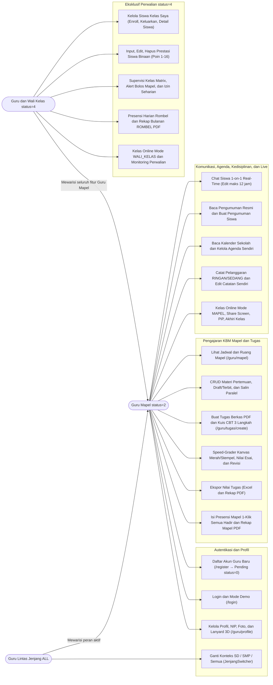

---

### 4.2 Class Diagram (Model Domain Perspektif Guru & Wali Kelas)

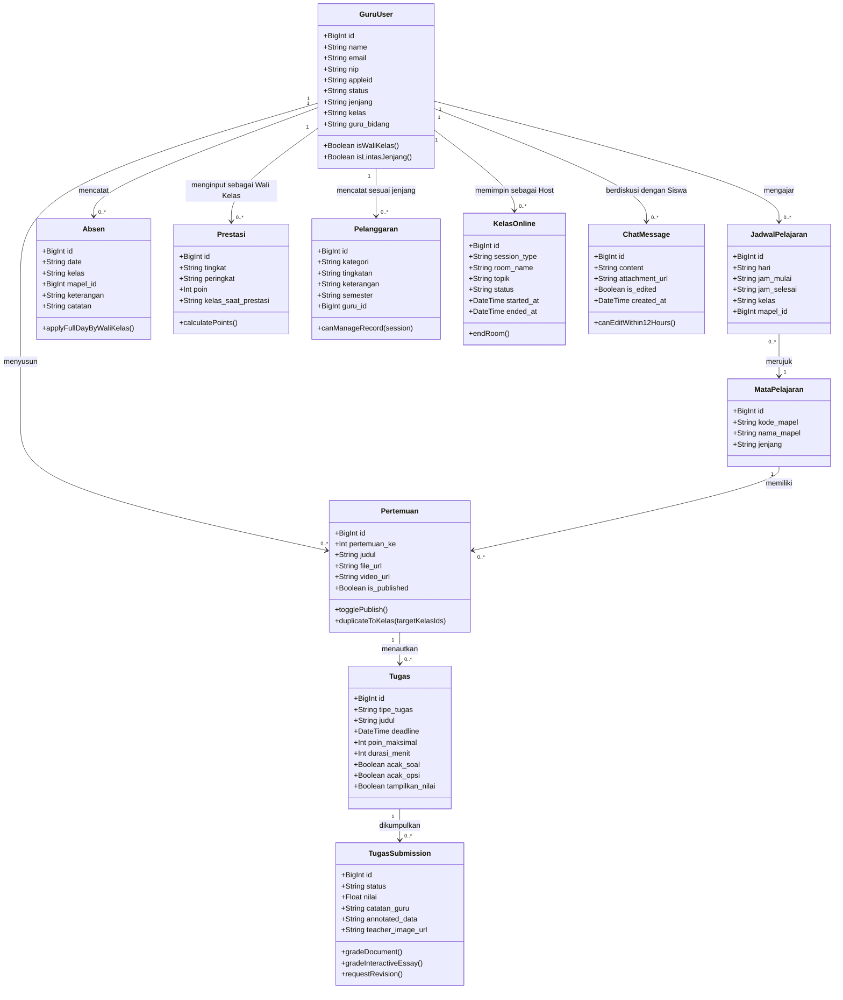

---

### 4.3 Entity Relationship Diagram (ERD)

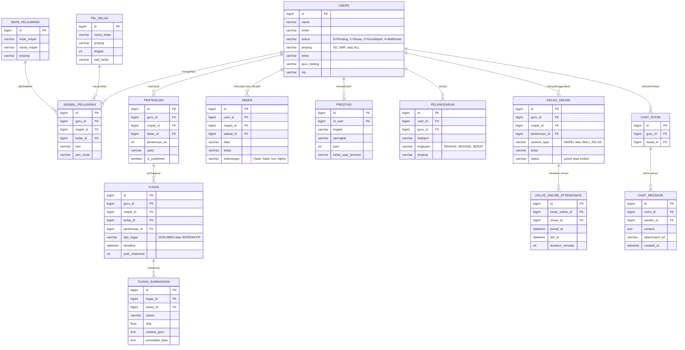

---

### 4.4 Sequence Diagram Alur Utama

#### 1. Alur Registrasi Guru, Verifikasi Admin, & Login

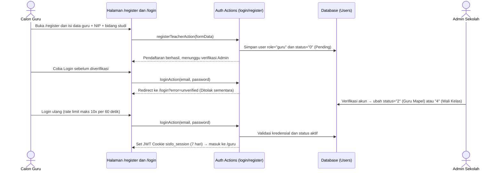

#### 2. Alur Pembuatan Materi Pertemuan & Salin ke Kelas Paralel

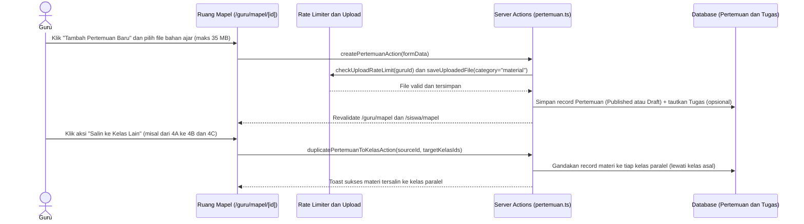

#### 3. Alur Pembuatan Tugas, Penilaian Speed-Grader, & Revisi

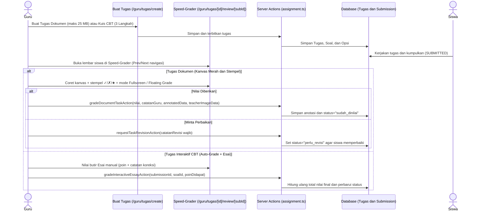

#### 4. Alur Presensi Mapel & Supervisi Matrix + Izin Seharian Wali Kelas

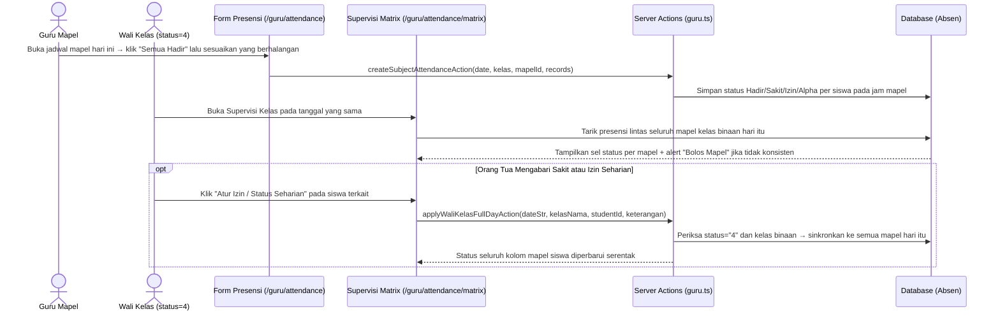

#### 5. Alur Kelas Online Guru, Monitoring Perwalian, & Akhiri Room

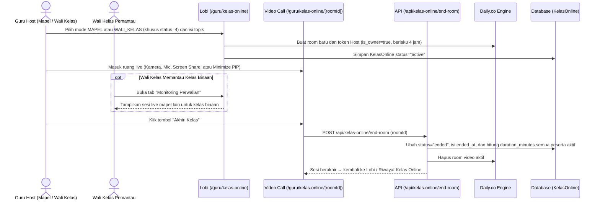

---

### 4.5 State Machine Diagram (Siklus Status Akun, Materi, Tugas, & Kelas Online)

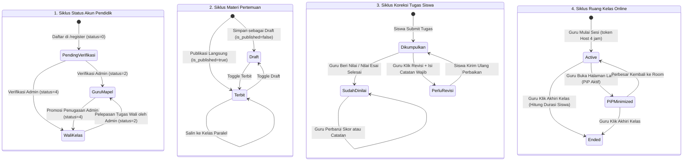

---

## 5. Flowchart (Diagram Alir) Cara Penggunaan

### 5.1 Flowchart Utama Aktivitas Mengajar Harian Guru & Wali Kelas

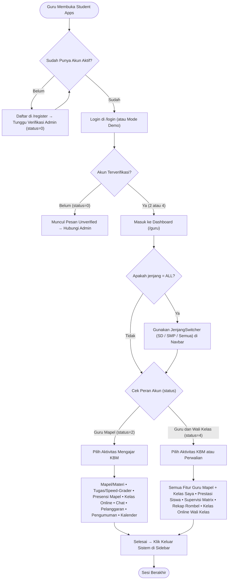

---

### 5.2 Flowchart Pembuatan Materi, Tugas, & Penilaian Speed-Grader

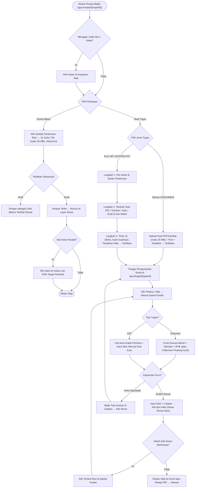

---

### 5.3 Flowchart Presensi KBM, Deteksi Bolos Mapel, & Rekap Rombel

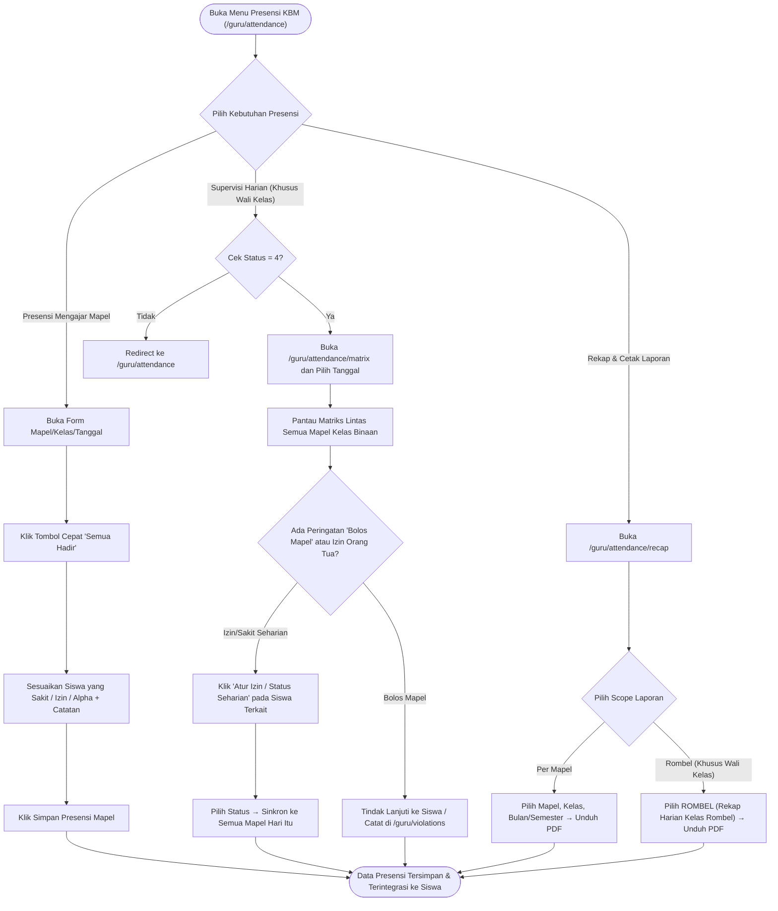

---

### 5.4 Flowchart Kelas Online & Monitoring Wali Kelas

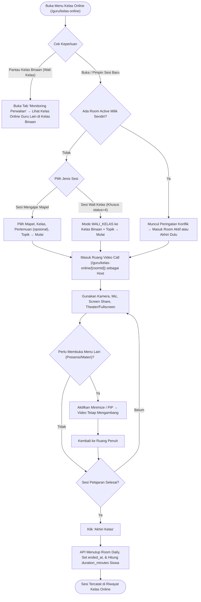

---

## 6. Ringkasan Batasan Teknis, Keamanan RBAC, & FAQ Troubleshooting

### 6.1 Tabel Batasan Unggahan Berkas, Rate Limit, & Aturan Sistem

| Fitur / Parameter | Batasan / Nilai Resmi di Sistem | Keterangan |
|---|---|---|
| **Login Rate Limit** | Maks **10 percobaan per 60 detik** per email | Proteksi brute-force; tunggu sebentar jika terkena batas |
| **Masa Berlaku Sesi Login** | **7 hari** (`sisfo_session` HTTP-only JWT) | Otomatis wajib login ulang setelah kedaluwarsa |
| **Upload Umum (`avatar`, `chat`, `achievement`)** | Maks **10 MB** di server (UI Profil membatasi foto **5 MB**) | Rate limit `upload`: **10 berkas / 5 menit** per pengguna |
| **Upload Materi Pertemuan (`material`)** | Maks **35 MB** | Format: PDF, PPT/PPTX, DOC/DOCX, XLS/XLSX, TXT, Gambar, MP4, WebM |
| **Upload Tugas Berkas & Koreksi (`task_worksheet` / `task_submission`)** | Maks **25 MB** | Format PDF & Gambar; rate limit `task_media`: **60 berkas / 5 menit** |
| **Timer Kuis CBT** | Opsional **5 – 180 menit** | Tersedia preset cepat `15m`, `30m`, `45m`, `60m`, `90m` |
| **Batas Edit Pesan Chat Siswa** | Maks **12 jam** sejak dikirim | Pesan teks lewat dari 12 jam tidak bisa diubah (masih bisa dihapus) |
| **Skala Poin Prestasi Siswa** | **1 – 16 poin** otomatis | Dihitung dari tabel kombinasi Tingkat × Peringkat |
| **Masa Berlaku Token Host Kelas Online** | **4 jam** per pembukaan room | Diperbarui setiap guru masuk ke `/guru/kelas-online/[roomId]` |

---

### 6.2 FAQ & Pemecahan Masalah (Troubleshooting)

1. **Saya baru mendaftar di `/register`, mengapa tidak bisa masuk ke dashboard guru?**  
   Akun pendaftaran guru baru otomatis berstatus **`"0"` (Belum Terverifikasi)**. Hubungi **Administrator / Tim IT Sekolah** untuk memverifikasi akun Anda menjadi Guru Mapel (`"2"`) atau Guru & Wali Kelas (`"4"`).

2. **Mengapa menu `Kelas Saya`, `Prestasi Siswa`, atau `Supervisi Kelas` tidak muncul di Sidebar saya?**  
   Menu tersebut eksklusif untuk akun berstatus **Guru & Wali Kelas (`status = "4"`)**. Jika Anda berstatus Guru Mata Pelajaran (`status = "2"`) namun sebenarnya ditugaskan menjadi Wali Kelas di tahun ajaran ini, mintalah Admin memperbarui status serta nama kelas binaan pada akun Anda.

3. **Mengapa saya tidak bisa mengubah `Bidang Studi`, `Kelas Wali`, atau `Status` di halaman `/guru/profile`?**  
   Demi integritas data akademik dan keamanan RBAC, ketiga kolom tersebut sengaja **dikunci di sisi server dan antarmuka**. Guru hanya diperbolehkan memperbarui nama, NIP, jenis kelamin, Apple ID, foto, alamat, serta catatan/keterampilan pribadi. Perubahan mapel atau penugasan kelas dilakukan oleh Admin.

4. **Mengapa saya tidak menemukan seorang siswa tertentu di daftar Chat Siswa atau di form Catat Pelanggaran?**  
   - Di **Chat Siswa (`/guru/chat`)**: Sistem hanya menampilkan siswa yang berada di **kelas yang Anda ajar** (sesuai jadwal pelajaran) atau **kelas binaan** Anda.
   - Di **Pelanggaran (`/guru/violations`)**: Guru berjenjang `SD` hanya dapat mencatat pelanggaran siswa `SD`, dan guru `SMP` hanya untuk siswa `SMP` (kecuali guru dengan `jenjang = "ALL"`).

5. **Mengapa tombol Edit atau Hapus tidak bisa digunakan pada salah satu catatan pelanggaran?**  
   Sistem menerapkan validasi kepemilikan catatan (`canManageViolationRecord`). Hanya **guru pembuat catatan tersebut** (atau Administrator) yang berhak mengubah maupun menghapus catatan pelanggaran yang bersangkutan.

6. **Saat menilai di Speed-Grader, saya menekan tombol `Revisi` tetapi sistem menolak menyimpan?**  
   Permintaan revisi **mewajibkan guru mengisi arahan perbaikan pada kolom Catatan Guru** agar siswa tahu bagian mana yang harus diperbaiki sebelum statusnya diubah ke `perlu_revisi`.

7. **Apa maksud label peringatan `"Bolos Mapel"` di halaman Supervisi Matrix Wali Kelas?**  
   Peringatan tersebut muncul secara otomatis apabila seorang siswa tercatat `Hadir` pada satu atau beberapa mata pelajaran di hari yang sama, tetapi tercatat `Alpha` atau absen di mata pelajaran lain pada hari tersebut. Wali Kelas dapat mengklarifikasi langsung atau memperbarui izin seharian bila ternyata siswa izin pulang di tengah hari.

8. **Saya tidak bisa membuat ruang Kelas Online baru karena pesan ruangan masih aktif?**  
   Setiap guru hanya diizinkan memiliki satu room aktif pada satu waktu untuk mencegah bentrok jadwal dan tagihan sesi. Klik tombol masuk ke room aktif tersebut lalu tekan **`Akhiri Kelas`** agar room ditutup dengan rapi (sekaligus menyimpan durasi kehadiran siswa sebelumnya) sebelum membuat sesi baru.

---

> **Catatan Akhir**: Untuk sinkronisasi jadwal mengajar baru, penugasan sebagai Wali Kelas (`status = "4"`), pengaktifan akun lintas jenjang (`jenjang = "ALL"`), atau perubahan data kelas/mapel, silakan berkoordinasi dengan **Administrator / Operator Sistem Sekolah**.
