# 📘 Panduan Lengkap Penggunaan Student Apps — Role **Guru Mata Pelajaran**

> **Aplikasi**: Student Apps — Portal Sistem Sekolah Terpadu (SD – SMP Islam Al-Azhar Cairo Palembang)  
> **Sasaran Pengguna**: Pendidik dengan peran **Guru Mata Pelajaran** (`status = "2"`), termasuk **Guru Lintas Jenjang** (`jenjang = "ALL"`) yang mengajar di jenjang SD maupun SMP tanpa tugas perwalian kelas  
> **Cakupan Dokumen**: Karakteristik hak akses Guru Mata Pelajaran, peta rute `/guru/*` yang tersedia (serta pembatasan rute khusus Wali Kelas), panduan langkah demi langkah seluruh fitur pengajaran KBM, **Diagram UML** (Use Case Diagram, Class Diagram, ERD, 5 Sequence Diagram, State Machine Diagram), **Flowchart** alur kerja lengkap, tabel batasan sistem, serta FAQ Troubleshooting.

---

## 📑 Daftar Isi

1. [Gambaran Umum & Ruang Lingkup Guru Mata Pelajaran](#1-gambaran-umum--ruang-lingkup-guru-mata-pelajaran)
   - [1.1 Karakteristik Akun Guru Mata Pelajaran (`status = "2"`)](#11-karakteristik-akun-guru-mata-pelajaran-status--2)
   - [1.2 Pembagian Lingkup Jenjang (`SD`, `SMP`, & `ALL`)](#12-pembagian-lingkup-jenjang-sd-smp--all)
   - [1.3 Rute Eksklusif Wali Kelas yang Tidak Aktif di Akun Guru Mapel](#13-rute-eksklusif-wali-kelas-yang-tidak-aktif-di-akun-guru-mapel)
2. [Peta Rute & Fitur Lengkap Guru Mata Pelajaran](#2-peta-rute--fitur-lengkap-guru-mata-pelajaran)
3. [Panduan Penggunaan Setiap Fitur](#3-panduan-penggunaan-setiap-fitur)
   - [3.1 Registrasi Guru Baru, Masuk Akun (Login), Mode Demo, & Keluar Sistem](#31-registrasi-guru-baru-masuk-akun-login-mode-demo--keluar-sistem)
   - [3.2 Antarmuka Utama (Sidebar, Navbar, Tema, & Mode Offline)](#32-antarmuka-utama-sidebar-navbar-tema--mode-offline)
   - [3.3 Dashboard Guru Mata Pelajaran](#33-dashboard-guru-mata-pelajaran)
   - [3.4 Jadwal Mengajar & Manajemen Materi Pertemuan](#34-jadwal-mengajar--manajemen-materi-pertemuan)
   - [3.5 Pembuatan & Pengeditan Tugas (Lembar Kerja Berkas & Kuis CBT Online)](#35-pembuatan--pengeditan-tugas-lembar-kerja-berkas--kuis-cbt-online)
   - [3.6 Monitoring Pengumpulan, Speed-Grader, Permintaan Revisi, & Ekspor Nilai](#36-monitoring-pengumpulan-speed-grader-permintaan-revisi--ekspor-nilai)
   - [3.7 Presensi KBM Per Mata Pelajaran & Rekap Cetak PDF](#37-presensi-kbm-per-mata-pelajaran--rekap-cetak-pdf)
   - [3.8 Chat Siswa Real-Time](#38-chat-siswa-real-time)
   - [3.9 Pengumuman Sekolah & Pengumuman Kelas Ajar](#39-pengumuman-sekolah--pengumuman-kelas-ajar)
   - [3.10 Kalender Kegiatan Akademik & Agenda Mapel](#310-kalender-kegiatan-akademik--agenda-mapel)
   - [3.11 Buku Kedisiplinan & Catatan Pelanggaran Siswa](#311-buku-kedisiplinan--catatan-pelanggaran-siswa)
   - [3.12 Kelas Online (Sesi Mapel Live, Share Screen, & Mode Picture-in-Picture)](#312-kelas-online-sesi-mapel-live-share-screen--mode-picture-in-picture)
   - [3.13 Profil Guru & Kartu Pengenal Digital 3D (Lanyard)](#313-profil-guru--kartu-pengenal-digital-3d-lanyard)
4. [Diagram UML (Unified Modeling Language)](#4-diagram-uml-unified-modeling-language)
   - [4.1 Use Case Diagram (Peta Hak Akses Guru Mata Pelajaran)](#41-use-case-diagram-peta-hak-akses-guru-mata-pelajaran)
   - [4.2 Class Diagram (Model Domain Pengajaran Mapel)](#42-class-diagram-model-domain-pengajaran-mapel)
   - [4.3 Entity Relationship Diagram (ERD)](#43-entity-relationship-diagram-erd)
   - [4.4 Sequence Diagram Alur Utama](#44-sequence-diagram-alur-utama)
   - [4.5 State Machine Diagram (Siklus Status Akun, Materi, Tugas, & Kelas Online)](#45-state-machine-diagram-siklus-status-akun-materi-tugas--kelas-online)
5. [Flowchart (Diagram Alir) Cara Penggunaan](#5-flowchart-diagram-alir-cara-penggunaan)
   - [5.1 Flowchart Utama Aktivitas Mengajar Harian Guru Mapel](#51-flowchart-utama-aktivitas-mengajar-harian-guru-mapel)
   - [5.2 Flowchart Penyusunan Materi, Tugas, & Koreksi Speed-Grader](#52-flowchart-penyusunan-materi-tugas--koreksi-speed-grader)
   - [5.3 Flowchart Pengisian Presensi Mapel & Rekap KBM PDF](#53-flowchart-pengisian-presensi-mapel--rekap-kbm-pdf)
   - [5.4 Flowchart Kelas Online Mode Mapel & Picture-in-Picture](#54-flowchart-kelas-online-mode-mapel--picture-in-picture)
6. [Ringkasan Batasan Teknis, Keamanan RBAC, & FAQ Troubleshooting](#6-ringkasan-batasan-teknis-keamanan-rbac--faq-troubleshooting)

---

## 1. Gambaran Umum & Ruang Lingkup Guru Mata Pelajaran

**Student Apps** memisahkan ruang kerja pendidik di jalur `/guru/*` (`role = "guru"`), terisolasi dari jalur `/siswa/*` dan `/admin/*`. Bagi pendidik yang berfokus mengajar bidang studi tertentu di satu atau beberapa rombel tanpa tugas sebagai Wali Kelas, sistem memberikan profil hak akses **Guru Mata Pelajaran (`status = "2"`)**.

### 1.1 Karakteristik Akun Guru Mata Pelajaran (`status = "2"`)

| Kondisi Akun | Nilai Status | Perilaku Sistem |
|---|---|---|
| **Akun Baru Mendaftar (`/register`)** | `"0"` (*Pending Verifikasi*) | Belum dapat masuk dashboard; percobaan login akan diarahkan ke `/login?error=unverified` sampai Admin menyetujui akun. |
| **Guru Mata Pelajaran Aktif** | **`"2"`** | Mendapat akses penuh seluruh fitur pengajaran KBM (jadwal mengajar, modul pertemuan, pembuatan tugas & kuis CBT, *Speed-Grader*, presensi mapel, rekap mapel PDF, Kelas Online mode `MAPEL`, Chat siswa ajar, Pengumuman, Kalender, Kedisiplinan, dan Profil). |
| **Sidebar & Dashboard Khusus** | `isWaliKelas = false` | Sidebar otomatis menampilkan **8 menu utama** tanpa menu perwalian; Dashboard menampilkan badge **`Guru Mata Pelajaran`** dan 6 kartu pintasan yang fokus pada KBM mapel. |

---

### 1.2 Pembagian Lingkup Jenjang (`SD`, `SMP`, & `ALL`)

| Atribut `jenjang` | Cakupan Data Sistem | Pengaruh pada Antarmuka & Query |
|---|---|---|
| **`SD`** | Khusus jenjang Sekolah Dasar | Jadwal mengajar, daftar siswa di menu Kedisiplinan, daftar kontak Chat Siswa, dan pengumuman tersaring hanya untuk siswa/kelas jenjang **SD**. |
| **`SMP`** | Khusus jenjang Sekolah Menengah Pertama | Seluruh data di atas tersaring hanya untuk siswa/kelas jenjang **SMP**. |
| **`ALL`** (**Guru Lintas Jenjang**) | Gabungan SD & SMP | Guru pengampu lintas jenjang (misalnya guru Bahasa Arab atau PAI yang mengajar di SD sekaligus SMP) otomatis dapat melihat jadwal, kelas ajar, kontak siswa, dan pelanggaran dari kedua jenjang (`SD` dan `SMP`) secara menyeluruh. |

---

### 1.3 Rute Eksklusif Wali Kelas yang Tidak Aktif di Akun Guru Mapel

Karena seluruh pendidik sama-sama berada di prefix `/guru/*`, berikut perilaku sistem apabila akun **Guru Mata Pelajaran (`status = "2"`)** membuka fitur yang dikhususkan bagi **Wali Kelas (`status = "4"`)**:

| Rute / Fitur Khusus Wali Kelas | Perilaku pada Akun Guru Mata Pelajaran (`status = "2"`) |
|---|---|
| Menu Sidebar **Kelas Saya** (`/guru/my-class`) | Tidak tampil di Sidebar. Jika URL dibuka manual, sistem menampilkan kartu pemberitahuan **`Khusus Guru & Wali Kelas`** dengan tombol ke **`Buka Mapel & Tugas`** dan **`Kembali ke Dashboard`**. |
| Menu Sidebar **Prestasi Siswa** (`/guru/achievements`) | Tidak tampil di Sidebar. Jika URL dibuka manual, sistem langsung mengalihkan (`redirect`) kembali ke `/guru`. |
| **Supervisi Kelas Matrix** (`/guru/attendance/matrix`) | Kartu folder tidak tampil di `/guru/attendance`. Jika URL dibuka manual, sistem otomatis mengarahkan kembali ke `/guru/attendance`. |
| **Presensi Harian Rombel** (`/guru/attendance/daily/[date]`) & **Tabel Bulanan Rombel** (`/guru/attendance/table/[date]`) | Tidak tersedia untuk Guru Mapel; akses langsung dialihkan kembali ke `/guru/attendance`. |
| **Mode Rombel** pada `/guru/attendance/recap` | Guru Mapel fokus merekap per **Mata Pelajaran & Kelas** ajarnya (opsi *Rekap Harian Kelas Rombel* `ROMBEL` khusus Wali Kelas). |
| **Kelas Online Mode `WALI_KELAS`** & **Tab Monitoring Perwalian** (`/guru/kelas-online`) | Tidak ditampilkan; Guru Mapel hanya menggunakan mode **`MAPEL`** dan melihat tab riwayat kelas onlinenya sendiri. |

---

## 2. Peta Rute & Fitur Lengkap Guru Mata Pelajaran

Berikut daftar seluruh halaman/rute yang aktif dan dapat digunakan oleh **Guru Mata Pelajaran (`status = "2"`)**:

| No | Nama Menu / Halaman | Rute URL | Fungsi Utama |
|---|---|---|---|
| 1 | **Pendaftaran Guru** | `/register` | Pendaftaran akun guru baru oleh pendidik (`status = "0"` menunggu verifikasi Admin) |
| 2 | **Masuk Akun** | `/login` | Autentikasi email/username dan password (+ Mode Demo: `guru_sd`, `guru_smp`, `guru_lintas`) |
| 3 | **Dashboard Guru Mapel** | `/guru` | Beranda sambutan berbadge `Guru Mata Pelajaran`, 6 kartu pintasan KBM, Timeline Pengumuman, *Best Student* |
| 4 | **Mata Pelajaran** | `/guru/mapel` | Jadwal mengajar terurut hari & jam (tampilan Kartu/Tabel), jumlah materi, tugas, & antrean koreksi |
| 5 | **Ruang Mapel & Materi** | `/guru/mapel/[mapelId]` | Kelola **Materi Pertemuan** (Terbit/Draft, salin paralel), **Tugas Siswa**, & pintasan Presensi/Kelas Online |
| 6 | **Tugas Per Mapel** | `/guru/mapel/[mapelId]/tugas` | Pengalih otomatis menuju daftar tugas mata pelajaran terkait |
| 7 | **Pusat Tugas** | `/guru/tugas` | Pengalih menuju tab `Tugas Siswa` di `/guru/mapel/[mapelId]` atau daftar `/guru/mapel` |
| 8 | **Buat Tugas Baru** | `/guru/tugas/create` | Buat **Lembar Kerja (PDF / Gambar)** atau **Kuis CBT Online** (Builder 3 Langkah) |
| 9 | **Detail & Rekap Tugas** | `/guru/tugas/[tugasId]` | Pantau status pengumpulan seluruh siswa kelas, Unduh/Edit Soal, & ekspor **`Excel (.xlsx)`** atau **`PDF (.pdf)`** |
| 10 | **Edit Tugas CBT** | `/guru/tugas/[tugasId]/edit` | Memperbarui informasi, pengaturan timer/acak, serta butir soal Kuis CBT Online |
| 11 | **Speed-Grader Koreksi** | `/guru/tugas/[tugasId]/review/[subId]` | Koreksi kanvas pena/stempel (Dokumen), nilai esai manual (CBT), catatan, permintaan **Revisi**, & navigasi Prev/Next |
| 12 | **Presensi KBM** | `/guru/attendance` | Pintasan **Rekap Presensi Mapel**, status jadwal mengajar hari ini (`Belum Diabsen`/`Sudah Diabsen`), & kelas ajar lain |
| 13 | **Form Presensi Mapel** | `/guru/attendance/[mapelId]/[kelasId]/[date]` | Pengisian presensi sesi KBM mapel (`Semua Hadir`, `Hadir`/`Sakit`/`Izin`/`Alpha`, dan catatan siswa) |
| 14 | **Rekap Presensi Mapel** | `/guru/attendance/recap` | Rekap presensi bulanan dan semester per mapel & kelas ajar, dilengkapi ekspor laporan PDF |
| 15 | **Chat Siswa** | `/guru/chat` | Obrolan 1-on-1 real-time dengan siswa di kelas yang diajar (lampiran maks **10 MB**, edit ≤ **12 jam**) |
| 16 | **Pengumuman** | `/guru/announcements` | Baca pengumuman resmi sekolah serta buat, kelola, dan sukai pengumuman kelas ajar untuk `SISWA` |
| 17 | **Edit Pengumuman Guru** | `/guru/announcements/[id]` | Mengubah judul, isi, target kelas, atau lampiran pengumuman yang dibuat oleh guru itu sendiri |
| 18 | **Kalender Kegiatan** | `/guru/calendar` | Pantau agenda resmi sekolah dan tambahkan/kelola kegiatan pembelajaran mapel |
| 19 | **Kedisiplinan Siswa** | `/guru/violations` | Lihat riwayat kedisiplinan sesuai jenjang & catat pelanggaran (`RINGAN`/`SEDANG`) pada siswa satu jenjang |
| 20 | **Lobi Kelas Online** | `/guru/kelas-online` | Buat kelas online mode `MAPEL` dari formulir atau pintasan jadwal hari ini, kelola kelas aktif, & riwayat sesi |
| 21 | **Ruang Video Call Live** | `/guru/kelas-online/[roomId]` | Pimpin kelas tatap muka sebagai Host (Kamera, Mic, Screen Share, Theater/Fullscreen, PiP, & Akhiri Kelas) |
| 22 | **Profil Guru** | `/guru/profile` | Ubah Nama & Gelar, NIY, Gender, Apple ID, Alamat, Foto Profil, & lihat Kartu Pengenal Digital 3D (*Lanyard*) |

---

## 3. Panduan Penggunaan Setiap Fitur

### 3.1 Registrasi Guru Baru, Masuk Akun (Login), Mode Demo, & Keluar Sistem

#### A. Mendaftar Sebagai Guru Baru (`/register`)
Apabila Anda pendidik baru dan belum memiliki akun Student Apps:
1. Buka `/register` atau pilih tab **Registrasi Guru** di halaman login.
2. Isi formulir pendaftaran guru (`registerTeacherAction`):
   - **Nama Lengkap** (beserta gelar)
   - **Email** (dipakai saat login)
   - **Apple ID** & **Password Apple ID**
   - **Password** akun Student Apps
   - **Bidang Studi** (`guru_bidang`, misal: Matematika SMP, Bahasa Arab, IPA)
   - **Jenis Kelamin** (`L` atau `P`)
   - **NIP / NIY** (opsional)
   - **Kelas** (kosongkan atau isi sesuai arahan sekolah)
3. Setelah diklik daftar, akun dibuat dengan **`status = "0"` (Pending Verifikasi)** dan dialihkan ke `/login?registered=1`.
4. Hubungi **Administrator / Tim IT Sekolah** untuk mengaktifkan akun menjadi **Guru Mata Pelajaran (`status = "2"`)** serta menghubungkan jadwal mengajar dan mata pelajaran Anda.

#### B. Cara Masuk Akun (`/login`)
1. Buka alamat portal Student Apps di browser iPad, laptop, atau ponsel.
2. Masukkan **Email** dan **Password** Anda (klik ikon **Mata** untuk melihat karakter password).
3. Klik tombol **Masuk**. Jika kredensial cocok dan akun sudah aktif (`status = "2"`), sistem membuat cookie sesi `sisfo_session` yang berlaku selama **7 hari** dan mengarahkan Anda ke `/guru`.
4. **Ketentuan Keamanan Login**:
   - **Rate Limiting**: Sistem membatasi percobaan masuk maksimal **10 kali dalam 60 detik** per alamat email. Jika terblokir sementara, tunggu sesuai hitung mundur detik yang muncul di pesan error.
   - **Akun Belum Diverifikasi (`status = "0"`)**: Login ditolak dengan pemberitahuan agar menghubungi Admin terlebih dahulu.

#### C. Fitur Mode Demo Guru Mapel (Jika Diaktifkan Admin)
Apabila Admin menyalakan *Mode Demo*, Anda dapat mencoba peran Guru Mata Pelajaran lewat tombol demo kategori **Guru**:
- **`guru_sd`** (`Ustadzah Nurul, S.Pd` — `Tematik & IPAS`, jenjang `SD`, `status = "2"`).
- **`guru_smp`** (`Ustadz Wildan, M.Pd` — `Matematika SMP`, jenjang `SMP`, `status = "2"`).
- **`guru_lintas`** (`Ustadz Ahmad, S.Pd.I` — `Bahasa Arab (SD & SMP)`, jenjang `ALL`, `status = "2"`).

#### D. Cara Keluar Sistem (Logout)
1. Buka **Sidebar** di sisi kiri (di layar ponsel/tablet kecil, ketuk ikon **Menu / Garis Tiga** di pojok kanan atas).
2. Gulir hingga ke bagian paling bawah sidebar, lalu klik tombol **`Keluar Sistem`**.
3. Cookie sesi dihapus dan layar kembali ke `/login`.

---

### 3.2 Antarmuka Utama (Sidebar, Navbar, Tema, & Mode Offline)

Semua halaman di `/guru/*` dibungkus dalam *Dashboard Shell* dengan komponen konsisten:

- **Sidebar Navigasi (8 Menu Utama Guru Mapel)**:
  1. **Dashboard** (`/guru`)
  2. **Mata Pelajaran** (`/guru/mapel` — tetap tersorot aktif saat membuka `/guru/tugas*`)
  3. **Presensi KBM** (`/guru/attendance`)
  4. **Chat Siswa** (`/guru/chat`)
  5. **Pengumuman** (`/guru/announcements`)
  6. **Kalender Kegiatan** (`/guru/calendar`)
  7. **Kedisiplinan Siswa** (`/guru/violations`)
  8. **Kelas Online** (`/guru/kelas-online`)
  - Di desktop, sidebar dapat diciutkan atau diperluas melalui tombol **toggle sidebar** di pojok kiri Navbar.
- **Navbar Atas**:
  - **Info Akademik & Jam Real-Time (`NavbarLiveClock`)**: Menampilkan Tahun Ajaran, Semester aktif, tanggal, dan jam berjalan.
  - **Pengalih Tema (`ThemeToggle`)**: Beralih antara mode Terang (*Light*) dan Gelap (*Dark*).
  - **Tombol Layar Penuh (*Fullscreen*)**: Memperluas tampilan kerja ke layar penuh.
  - **Ikon Lonceng Notifikasi**: Mengarah cepat ke `/guru/announcements`.
  - **Avatar Profil**: Mengarah cepat ke `/guru/profile`.
- **Pengamanan Koneksi Terputus (`OfflineModal`)**:
  - Saat jaringan internet sekolah/rumah terputus di tengah pengisian nilai atau presensi, muncul modal peringatan koneksi offline yang menyarankan agar halaman **tidak langsung di-refresh**. Anda dapat mengecilkannya menjadi **kapsul *Mode Offline*** di bawah layar dengan tombol **`Coba Sambung`** hingga jaringan kembali pulih.

---

### 3.3 Dashboard Guru Mata Pelajaran

Halaman `/guru` menjadi beranda awal setelah masuk akun:

1. **Hero Banner Sambutan & Role Badge**:
   - Menampilkan ucapan salam dan nama lengkap Anda, diikuti badge hijau **`Guru Mata Pelajaran`**.
2. **6 Kartu Pintasan Fitur (Tata Letak Grid 4 Kolom Desktop)**:
   Khusus untuk akun Guru Mapel (`status = "2"`), keenam kartu folder langsung tertuju ke tugas harian pengajaran Anda:
   - **Presensi Hari Ini** → `/guru/attendance`
   - **Mata Pelajaran** → `/guru/mapel`
   - **Chat Siswa** → `/guru/chat`
   - **Kedisiplinan Siswa** → `/guru/violations`
   - **Kalender Kegiatan** → `/guru/calendar`
   - **Kelas Online** → `/guru/kelas-online`
3. **Timeline Pengumuman**:
   - Menampilkan hingga 20 pengumuman terbaru (pengumuman Admin/Sekolah dan pengumuman yang Anda buat) lengkap dengan tombol suka (*like*) dan pratinjau lampiran.
4. **Kartu Sertifikat *Best Student***:
   - Menampilkan korsel siswa berprestasi pilihan pada jenjang terkait.

---

### 3.4 Jadwal Mengajar & Manajemen Materi Pertemuan

Menu **Mata Pelajaran (`/guru/mapel`)** adalah pusat aktivitas pengajaran Anda sebagai Guru Mapel.

#### A. Melihat Daftar Jadwal Mengajar (`/guru/mapel`)
1. Seluruh jadwal mengajar Anda yang ditetapkan oleh Admin tampil terurut otomatis berdasarkan **hari mengajar** (Senin–Sabtu) dan **jam pelajaran**.
2. Di pojok atas tersedia sakelar untuk beralih antara **Tampilan Kartu (*Cards*)** dan **Tampilan Tabel (*Table*)**.
3. Setiap item jadwal menampilkan informasi lengkap:
   - Nama Mata Pelajaran, Kode Mapel, Kelas/Rombel, dan Jenjang (`SD` / `SMP`).
   - Hari serta rentang jam KBM.
   - Jumlah **Pertemuan**, jumlah **Tugas**, dan indikator **antrean tugas siswa yang menunggu penilaian** (*pending grading*).
4. *(Catatan: Jika Admin belum memasukkan jadwal KBM untuk akun Anda, muncul tombol pintasan **`Buka Halaman Tugas`** menuju `/guru/tugas`).*
5. Klik salah satu kartu/baris untuk masuk ke **Ruang Mengajar Mapel (`/guru/mapel/[mapelId]`)**.

#### B. Ruang Mengajar Mapel (`/guru/mapel/[mapelId]`)
Di bagian atas ruang mapel tersedia kontrol cepat:
1. **Dropdown `Pilih Kelas`** *(muncul jika Anda mengajar mapel yang sama di > 1 kelas paralel, misal `7A`, `7B`, `7C`)*: Ganti kelas aktif untuk melihat materi dan tugas masing-masing rombel.
2. **Tombol Pintasan di Kanan Atas**:
   - **`Kelas Online`** (atau **`Masuk Kelas Live`** berwarna hijau jika Anda sedang memiliki ruang video aktif untuk kelas & mapel tersebut).
   - **`Presensi KBM Hari Ini`** → langsung menuju formulir presensi `/guru/attendance/[mapelId]/[kelasId]/[tanggalHariIni]`.
   - **`Tambah Pertemuan Baru`** (saat tab **Materi Pertemuan** aktif) atau **`Buat Tugas Baru`** (saat tab **Tugas Siswa** aktif).
3. **Dua Tab Kerja Utama**:
   - **Materi Pertemuan** (kelola modul ajar mingguan).
   - **Tugas Siswa** (daftar tugas kelas beserta akses ke detail & *Speed-Grader*).

#### C. Membuat, Menerbitkan, & Menyalin Materi Pertemuan
1. Di tab **Materi Pertemuan**, klik **`Tambah Pertemuan Baru`**.
2. Lengkapi formulir dialog pertemuan (`MeetingFormDialog`):
   - **Pertemuan Ke-**: Nomor urut pertemuan (sistem otomatis menyarankan angka berikutnya).
   - **Judul Pertemuan** *(wajib diisi)* & **Deskripsi / Ringkasan Materi**.
   - **Tanggal Pertemuan**.
   - **Unggah Berkas Bahan Ajar (Opsional)**: Ukuran maksimal **35 MB** (`material`). Format yang didukung: `PDF`, PowerPoint (`PPT`/`PPTX`), Word (`DOC`/`DOCX`), Excel (`XLS`/`XLSX`), `TXT`, Gambar (`PNG`/`JPG`/`WEBP`), dan Video (`MP4`/`WebM`).
   - **URL Video YouTube (Opsional)** & **Tautan Eksternal (Opsional)**.
   - **Tautkan Tugas yang Sudah Ada (Opsional)**: Hubungkan tugas dari kelas & mapel tersebut agar langsung muncul di kartu pertemuan siswa.
   - **Status Publikasi**: Pilih **Terbit** (*Published*, langsung terlihat siswa) atau **Draft** (disimpan pribadi guru hingga siap dibagikan).
3. **Kontrol Setelah Tersimpan**:
   - **Buka Semua / Tutup Semua** & **Bilah Pencarian (`Cari materi pertemuan...`)** untuk menyaring daftar pertemuan yang panjang.
   - **Toggle Draft / Terbit** (`togglePublishPertemuanAction`): Mengubah visibilitas materi untuk siswa dengan 1 klik.
   - **Salin ke Kelas Lain / Duplikasi** (`duplicatePertemuanToKelasAction`): Sangat efisien bagi Guru Mapel yang mengajar banyak kelas paralel — pilih satu atau lebih kelas paralel target sehingga seluruh isi, file, video, dan link pertemuan otomatis tersalin tanpa mengunggah berkas ulang.
   - **Edit & Hapus**: Menghapus pertemuan hanya menghapus modul pertemuannya; jika ada tugas yang sempat ditautkan, **tautannya dilepas dan tugasnya tidak ikut terhapus**.

---

### 3.5 Pembuatan & Pengeditan Tugas (Lembar Kerja Berkas & Kuis CBT Online)

Dari tombol **`Buat Tugas Baru`** di Ruang Mapel (`/guru/tugas/create`), mata pelajaran dan kelas akan terisi otomatis (*pre-filled*). Tersedia 2 mode tugas pada `TaskCreateTabs`:

#### A. Mode 1 — `Lembar Kerja (PDF / Gambar)` (`DocumentTaskBuilder`)
Cocok untuk LKS, soal latihan cetak digital, atau tugas menggambar/mencoret di kanvas iPad siswa:
1. Periksa atau ubah **Kelas**, **Mata Pelajaran**, dan **Pertemuan Terkait** (`Tidak ditautkan` atau pilih `Pertemuan ke-n`).
2. Isi **Judul Tugas** dan **Instruksi/Deskripsi**.
3. Atur **Batas Waktu (Deadline)** dan **Poin Maksimal** (default `100`).
4. Unggah **Berkas Soal** format **`PDF`** atau **Gambar (`JPG`, `JPEG`, `PNG`, `WebP`)** maksimal **25 MB** (`task_worksheet`).
5. Klik tombol simpan untuk menerbitkan tugas ke halaman tugas siswa.

#### B. Mode 2 — `Kuis CBT Online` (`InteractiveTaskBuilder` — 3 Langkah)
Cocok untuk ulangan harian, kuis cepat, atau tugas campuran objektif dan uraian:

- **Langkah 1 — Informasi Dasar Tugas**:
  Isi Kelas, Mapel, tautan Pertemuan (opsional), Judul, Deskripsi/Petunjuk pengerjaan, dan Deadline, lalu lanjut ke Langkah 2.

- **Langkah 2 — Penyusunan Butir Soal (`BuilderStepQuestions`)**:
  1. Pada panel kiri **Daftar Soal**, pantau jumlah soal dan **Total Poin**, atau tekan tombol **`Bagi Rata (100)`** agar sistem otomatis membagi bobot 100 poin secara merata ke seluruh butir soal.
  2. Tambahkan soal baru dan pilih 1 dari 4 **Tipe Soal**:
     - **Pilihan Ganda (`PILIHAN_GANDA`)**: Soal teks/stimulus + opsi A, B, C, D (tentukan 1 jawaban benar — **dikoreksi otomatis** oleh sistem).
     - **Pilihan Gambar (`PILIHAN_GAMBAR`)**: Opsi jawaban berupa gambar — **dikoreksi otomatis**.
     - **Isian Singkat (`ISIAN_SINGKAT`)**: Siswa mengetik jawaban singkat sesuai kunci jawaban — **dikoreksi otomatis**.
     - **Esai (`ESAI`)**: Uraian panjang yang dinilai manual oleh guru melalui *Speed-Grader*.
  3. Anda dapat menyertakan gambar pada soal atau opsi gambar (rate limit unggah media soal: **60 berkas per 5 menit**, ukuran maks **10 MB** per gambar).

- **Langkah 3 — Pengaturan Pengerjaan & Konfirmasi (`BuilderStepSettings`)**:
  1. **Batas Waktu (Timer)**: Centang kotak **Batas Waktu (Timer)** bila ingin menerapkan waktu hitung mundur per sesi siswa (`5` hingga `180` menit) atau klik tombol preset **`15m`**, **`30m`**, **`45m`**, **`60m`**, **`90m`**. Bila tidak dicentang, siswa mengerjakan tanpa timer hingga *deadline*.
  2. **Opsi Pengerjaan**:
     - `Acak Urutan Soal`: Nomor urut soal diacak berbeda pada perangkat tiap siswa.
     - `Acak Opsi Pilihan Jawaban`: Urutan opsi A, B, C, D diacak per siswa.
     - `Tampilkan Nilai Langsung`: Siswa langsung melihat nilai setelah submit kuis.
  3. Periksa kotak **Ringkasan Tugas Interaktif** (Judul, Jumlah Soal, Total Skor, Durasi, Status Acak), lalu klik **`Terbitkan Tugas Sekarang`**.

#### C. Mengedit Tugas CBT Online (`/guru/tugas/[tugasId]/edit`)
Masuk ke halaman detail tugas (`/guru/tugas/[tugasId]`) lalu klik **`Edit Soal`** untuk membuka kembali *Interactive Task Builder*, lakukan pembaruan, dan tekan **`Simpan Perubahan`**. *(Catatan: untuk Tugas Lembar Kerja Berkas, halaman detail menyediakan tombol **`Unduh Soal`**).*

---

### 3.6 Monitoring Pengumpulan, Speed-Grader, Permintaan Revisi, & Ekspor Nilai

#### A. Memantau Daftar Pengumpulan & Ekspor Rekap Nilai (`/guru/tugas/[tugasId]`)
1. Pada Tab **Tugas Siswa** di Ruang Mapel, klik judul tugas atau tombol detail untuk membuka daftar seluruh siswa di kelas tersebut.
2. Tersedia sakelar tampilan **Tabel** atau **Kartu** beserta status tiap siswa:
   - **`belum_mengumpulkan`**
   - **`menunggu_penilaian`** / **`terlambat`**
   - **`perlu_revisi`**
   - **`sudah_dinilai`**
3. **Ekspor Rekap Nilai**:
   - Klik **`Excel (.xlsx)`** untuk mengunduh lembar rekap nilai seluruh siswa ke format spreadsheet Excel.
   - Klik **`PDF (.pdf)`** untuk mengunduh dokumen cetak rekap nilai lengkap dengan identitas mapel, kelas, deadline, dan guru pengampu.
4. Klik tombol koreksi pada baris siswa yang sudah mengumpulkan untuk masuk ke ruang **`Speed-Grader`** (`/guru/tugas/[tugasId]/review/[subId]`).

#### B. Speed-Grader Tugas Lembar Kerja (`TeacherDocumentTaskReview`)
1. **Navigasi Prev / Next**: Pindah langsung ke lembar siswa sebelumnya atau berikutnya dari bilah atas tanpa bolak-balik ke halaman daftar tugas.
2. **Kanvas Koreksi Interaktif (`DocumentCanvasEditor`)**:
   Guru dapat memberi tanda koreksi langsung di atas PDF/foto hasil kerja siswa:
   - **Pena Koreksi** (pena merah/pilihan warna) & **Stabilo**
   - **Teks Komentar** langsung di posisi jawaban
   - **Penghapus**
   - **Stempel Koreksi**: Centang (**✓**), Silang (**✗**), dan Bintang (**★**)
   - **Undo / Redo**, **Zoom In / Out**, serta navigasi antar halaman PDF.
3. **Mode Layar Penuh & Kartu Koreksi Melayang (*Floating Grading*)**:
   - Aktifkan **Layar Penuh** agar ruang kanvas koreksi maksimal (cocok saat mengoreksi memakai iPad & Apple Pencil).
   - Ketuk kapsul **`Nilai: XX/YY`** di layar penuh untuk membuka **Kartu Koreksi Melayang**, yang sudah dilengkapi tombol angka cepat (**`100`**, **`90`**, **`80`**, **`75`** sesuai batas poin maksimal), kolom **Catatan Bimbingan Guru**, **`Beri Nilai`**, dan **`Revisi`**.
4. **Memberi Nilai Final vs Meminta Revisi**:
   - **`Beri Nilai`**: Coretan guru otomatis diratakan (*flattened*) menjadi gambar/anotasi koreksi, skor tersimpan, dan status berubah menjadi **`sudah_dinilai`**.
   - **`Revisi`**: Jika pekerjaan siswa keliru atau foto kurang jelas, **wajib isi instruksi perbaikan di kolom Catatan Bimbingan Guru**, lalu klik **`Revisi`** (`requestTaskRevisionAction`). Status siswa menjadi **`perlu_revisi`** sehingga ia dapat mengirimkan perbaikan.

#### C. Speed-Grader Tugas Kuis CBT Online (`TeacherInteractiveTaskReview`)
1. Bagian header menampilkan total skor, jumlah **Benar & Salah** untuk soal otomatis (PG, Pilihan Gambar, Isian Singkat), serta durasi pengerjaan siswa.
2. Pada **Lembar Pengerjaan Siswa**:
   - Butir PG, Pilihan Gambar, dan Isian Singkat sudah terkoreksi otomatis.
   - Khusus soal **Esai (`ESAI`)**, masukkan **Poin (0 s.d. bobot soal)** dan **Catatan Koreksi** per nomor soal, lalu klik simpan pada tiap esai (`gradeInteractiveEssayAction`). Skor final siswa terhitung ulang secara otomatis dan status menjadi **`sudah_dinilai`**.
3. Di panel **Review Actions**, Anda juga dapat menulis **Catatan Umum Guru** atau menekan **`Minta Revisi`** (catatan arahan perbaikan wajib diisi).

---

### 3.7 Presensi KBM Per Mata Pelajaran & Rekap Cetak PDF

Sebagai Guru Mata Pelajaran, Anda bertanggung jawab mengisi presensi kehadiran siswa pada setiap jam pelajaran yang Anda ajar dan menarik laporannya di akhir bulan/semester.

#### A. Pusat Presensi (`/guru/attendance`)
Tampilan `/guru/attendance` khusus Guru Mapel (`status = "2"`) menampilkan:
1. **Kartu Pintasan `Rekap Presensi Mapel`**: Folder cepat menuju halaman laporan & cetak PDF (`/guru/attendance/recap`).
2. **Jadwal Mengajar Hari Ini**:
   - Menampilkan setiap sesi jadwal KBM hari berjalan beserta jam mulai–selesai, nama mapel, jenjang, dan nama kelas.
   - Sesi yang belum diisi ditandai badge **`Belum Diabsen`** (tombol **`Mulai Presensi`**), sedangkan yang sudah diisi ditandai **`Sudah Diabsen`** lengkap dengan ringkasan hitung **Hadir / Sakit / Izin / Alpha** dan tombol **`Perbarui Presensi`**.
3. **Mata Pelajaran & Kelas Lain**:
   - Pintasan ke seluruh kombinasi mapel dan kelas ajar Anda meski hari ini bukan jadwalnya (misalnya untuk mengejar pengisian/pembaruan presensi hari lain).

#### B. Mengisi Form Presensi Harian Mapel (`/guru/attendance/[mapelId]/[kelasId]/[date]`)
1. Buka sesi dari `/guru/attendance` atau lewat tombol **`Presensi KBM Hari Ini`** di Ruang Mapel.
2. Pada bilah atas form tersedia tombol cepat **`Semua Hadir`** agar Anda tidak perlu mengklik siswa satu per satu.
3. Ubah status hanya pada siswa yang tidak hadir:
   - **`Hadir`**
   - **`Sakit`**
   - **`Izin`**
   - **`Alpha`**
4. Klik tombol catatan pada baris siswa bila perlu menambahkan **keterangan khusus** (contoh: *Izin ke UKS*, *Terlambat 10 menit*).
5. Anda dapat mengganti tanggal bila ingin mencatat sesi sebelumnya, atau menggunakan tombol hapus jika ingin membersihkan inputan presensi sesi tersebut.
6. Klik simpan (`createSubjectAttendanceAction`). Catatan presensi langsung tersinkron ke dashboard siswa dan ke tampilan pengawasan Wali Kelas kelas tersebut.

#### C. Melihat Rekap & Mencetak Laporan PDF (`/guru/attendance/recap`)
1. Pilih **Mata Pelajaran** yang Anda ajar dan **Kelas** target.
2. Pilih cakupan periode **Bulanan (`month`)** atau **Semester (`semester`)** beserta bulan/tahunnya.
3. Beralih antara tab ringkasan angka persentase (**`Summary`**) dan tabel tanggal pertemuan (**`Matrix`**).
4. Tekan tombol unduh untuk menghasilkan **Rekap Presensi PDF** siap cetak/tanda tangan.

---

### 3.8 Chat Siswa Real-Time

Menu **Chat Siswa (`/guru/chat`)** menghubungkan Anda langsung dengan siswa dari kelas yang Anda ajar untuk konsultasi tugas, materi, atau kendala belajar.

1. **Kontak Terfilter Khusus Kelas Ajar**:
   - Sistem hanya menampilkan siswa yang berada di **kelas-kelas yang Anda ajar** (sesuai daftar jadwal pelajaran Anda; untuk `jenjang = "ALL"`, mencakup SD dan SMP yang diajar).
   - Komunikasi di modul ini dikhususkan **Guru ↔ Siswa** (chat antar sesama guru dibatasi oleh aturan sistem).
2. **Mengirim Pesan & Lampiran**:
   - Gunakan kotak cari untuk menemukan nama siswa, klik untuk membuka ruang obrolan, lalu kirim pesan teks.
   - Anda dapat melampirkan **Gambar (`JPG`/`PNG`/`WebP`)** atau **Dokumen (`PDF`, `DOC/DOCX`, `XLS/XLSX`, `PPT/PPTX`, `TXT`)** maksimal **10 MB** per berkas (rate limit unggahan **10 berkas per 5 menit**).
3. **Mengedit & Menghapus Pesan**:
   - Pesan teks yang sudah terkirim dapat diedit selama belum melewati batas waktu **12 jam** sejak dikirim (`editMessageAction`).
   - Tersedia pula opsi **Hapus Pesan** untuk menarik pesan yang keliru.

---

### 3.9 Pengumuman Sekolah & Pengumuman Kelas Ajar

Halaman `/guru/announcements` menampilkan papan informasi sekolah dan ruang publikasi pengumuman untuk siswa kelas ajar Anda.

1. **Membaca Pengumuman Resmi Sekolah**:
   - Memuat seluruh pengumuman yang ditujukan ke `GURU` atau `ALL` sesuai jenjang Anda.
   - Anda dapat menyukai (*Like*) pengumuman serta melihat pratinjau/mengunduh lampiran PDF atau gambar.
2. **Membuat Pengumuman Baru**:
   - Klik tombol **Buat Pengumuman**.
   - Isi **Judul**, **Isi Pengumuman**, pilih **Kelas Target** dari daftar kelas yang Anda ajar, dan lampirkan berkas PDF/Gambar (maks **10 MB**, opsional).
3. **Mengedit & Menghapus Pengumuman Milik Sendiri (`/guru/announcements/[id]`)**:
   - Khusus pengumuman yang Anda buat sendiri (`from === namaGuru`), tombol **Edit** (`/guru/announcements/[id]`) dan **Hapus** muncul agar informasi dapat diperbarui atau ditarik sewaktu-waktu. Pengumuman resmi buatan Admin bersifat baca-saja bagi guru.

---

### 3.10 Kalender Kegiatan Akademik & Agenda Mapel

Halaman `/guru/calendar` bertajuk **Kalender Kegiatan Akademik & Kelas** membantu Guru Mapel melihat hari penting sekolah sekaligus menandai agenda ujian/praktik kelas:

1. **Kalender Bulanan & Daftar Agenda**:
   - Pantau tanggal ujian sekolah, hari libur, dan acara keagamaan yang dipublikasikan Admin.
2. **Menambah, Mengubah, & Menghapus Agenda Guru**:
   - Anda memiliki hak kelola (`canManage = true`) untuk membuat agenda kegiatan pembelajaran mapel pada kelas terkait, serta mengedit atau menghapus agenda yang Anda buat sendiri.

---

### 3.11 Buku Kedisiplinan & Catatan Pelanggaran Siswa

Halaman `/guru/violations` digunakan Guru Mata Pelajaran untuk memantau sekaligus melaporkan kejadian kedisiplinan selama jam pelajaran maupun di lingkungan sekolah.

1. **Melihat & Menyaring Daftar Pelanggaran**:
   - Bagi Guru Mapel tanpa kelas wali (`guruClass` kosong), toolbar langsung menampilkan **Filter Kelas**, **Semester**, **Kategori**, dan **Tingkatan** (`RINGAN`, `SEDANG`, `BERAT`), serta sakelar tampilan **Kartu / Tabel**.
   - Data tersaring otomatis sesuai jenjang guru (`SD`, `SMP`, atau gabungan keduanya bila `jenjang = "ALL"`).
2. **Mencatat Pelanggaran Baru**:
   - Klik tombol **Catat Pelanggaran**.
   - Pilih **Siswa** (dibatasi pada jenjang Anda; jika guru `SD`, sistem menolak pencatatan siswa `SMP`, kecuali akun `jenjang = "ALL"`).
   - Pilih salah satu dari **5 Kategori Pelanggaran Resmi**:
     1. *Ibadah & Karakter Islami*
     2. *Kedisiplinan iPad & Digital*
     3. *Seragam & Kerapian Atribut*
     4. *Ketertiban & Kehadiran Kelas*
     5. *Adab, Sikap & Etika Siswa*
   - Guru diperbolehkan memilih tingkatan **`RINGAN`** atau **`SEDANG`** (level `BERAT` merupakan wewenang tingkat Admin/kesiswaan), mengisi **Poin**, **Deskripsi Pelanggaran**, serta **Tindakan Pembinaan** yang sudah dilakukan.
   - **Semester** & **Tahun Pelajaran** diisi otomatis oleh sistem sesuai tanggal kejadian.
3. **Hak Edit & Hapus**:
   - Guru hanya dapat **mengedit** dan **menghapus catatan pelanggaran yang dibuat oleh dirinya sendiri** (`canManageViolationRecord`). Catatan milik guru lain atau Admin tidak dapat diubah/dihapus.

---

### 3.12 Kelas Online (Sesi Mapel Live, Share Screen, & Mode Picture-in-Picture)

Halaman `/guru/kelas-online` memfasilitasi pembelajaran tatap muka daring real-time berbasis *Daily.co* untuk jadwal mata pelajaran Anda.

#### A. Memulai Sesi Kelas Online Mode `MAPEL` (`/guru/kelas-online`)
1. **Cara 1 — Pintasan Jadwal Hari Ini (`GuruTodaySchedule`)**:
   - Bila hari ini ada jadwal mengajar, klik tombol mulai kelas online langsung pada kartu jadwal hari tersebut untuk membuka ruang live dengan 1 klik.
2. **Cara 2 — Tombol Buat Ruang Kelas (`CreateRoomForm`)**:
   - Pada akun Guru Mapel (`isWaliKelas = false`), formulir berfokus pada mode **`MAPEL`**: pilih **Kelas**, pilih **Mata Pelajaran**, opsional tautkan dengan **Pertemuan ke-n**, isi **Topik Pembahasan**, lalu mulai kelas.
   - *(Pintasan langsung juga tersedia lewat tombol **`Kelas Online`** di dalam Ruang Mapel `/guru/mapel/[mapelId]` sehingga kelas dan mapel langsung terpilih).*
3. **Penanganan Konflik Room Aktif (Status HTTP `409`)**:
   - Jika sudah ada kelas online aktif pada kombinasi kelas & mapel tersebut (atau milik Anda sendiri), sistem memberi pilihan untuk langsung masuk kembali ke room aktif itu.

#### B. Memimpin Kelas di Ruang Video Live (`/guru/kelas-online/[roomId]`)
1. Guru masuk sebagai **Host (`is_owner = true`)** dengan token keamanan berlaku **4 jam**.
2. **Kontrol di dalam Room**:
   - Nyalakan/matikan **Mikrofon** dan **Kamera**.
   - Gunakan **Share Screen** untuk membagikan presentasi slide atau bahan ajar.
   - Beralih tampilan **Normal**, **Theater**, atau **Layar Penuh (*Fullscreen*)**.
   - **Mode *Picture-in-Picture (PiP)* (`PersistentVideoHost`)**: Anda dapat meminimalkan layar video menjadi jendela mengambang saat berpindah ke halaman **`Presensi KBM`**, **`Ruang Mapel`**, atau **`Speed-Grader Tugas`** — sesi video kelas tetap aktif!
3. **Mengakhiri Kelas (`Akhiri Kelas`)**:
   - Klik **`Akhiri Kelas`** (`/api/kelas-online/end-room`) setelah pelajaran selesai. Server otomatis menutup room pada Daily.co, mengubah status menjadi `ended`, mencatat `ended_at`, serta menghitung otomatis `duration_minutes` seluruh siswa yang masih berada di ruangan.
4. **Riwayat Kelas Online**:
   - Bagian bawah `/guru/kelas-online` menampilkan akordeon **`Riwayat Kelas Online`** (dengan filter Kelas dan Mapel) berisi tanggal, jumlah siswa yang hadir, dan total durasi sesi yang telah selesai. *(Tab Monitoring Perwalian tidak muncul di akun Guru Mapel).*

---

### 3.13 Profil Guru & Kartu Pengenal Digital 3D (Lanyard)

Halaman `/guru/profile` menampilkan formulir biodata Guru Mata Pelajaran di sisi kiri dan **Kartu Pengenal Digital 3D (*Lanyard Badge*)** interaktif di sisi kanan (atau di bawah pada layar mobile).

1. **Kolom yang Dapat Diperbarui Guru Mapel**:
   - **Foto Profil**: Tekan **`Ganti Foto`** (batas file di formulir **5 MB**; batas validasi server `avatar` **10 MB**, rate limit 10 unggahan/5 menit) atau **`Hapus Foto`** / **`Batal Hapus`**.
   - **Nama Lengkap & Gelar**
   - **NIY (Nomor Induk Yayasan)**
   - **Jenis Kelamin** (`L` / `P`)
   - **Apple ID (Opsional)**
   - **Alamat Tempat Tinggal**
   - Klik **`Simpan Perubahan Profil`** untuk memperbarui database dan sesi Anda.
2. **Kolom yang Sengaja Dikunci (Hanya Admin)**:
   - **`Bidang Studi / Mata Pelajaran`** (`guru_bidang`) dan kotak **`Wali Kelas`** (yang menampilkan badge **`Guru Mapel • Bukan Wali Kelas`**) bersifat baca-saja agar penugasan bidang studi dan peran tetap tervalidasi oleh Administrator.
3. **Kartu Pengenal Digital 3D (*Lanyard Badge*)**:
   - Menampilkan kartu identitas pendidik interaktif lengkap dengan foto, nama, email, NIY, bidang studi, serta status **Guru Mata Pelajaran**.

---

## 4. Diagram UML (Unified Modeling Language)

### 4.1 Use Case Diagram (Peta Hak Akses Guru Mata Pelajaran)

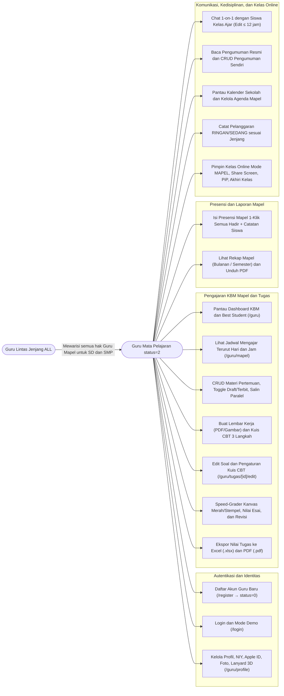

---

### 4.2 Class Diagram (Model Domain Pengajaran Mapel)

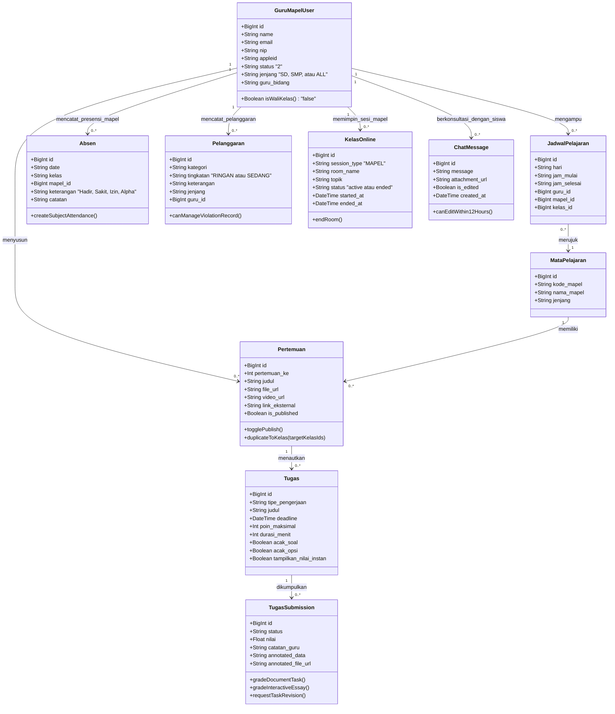

---

### 4.3 Entity Relationship Diagram (ERD)

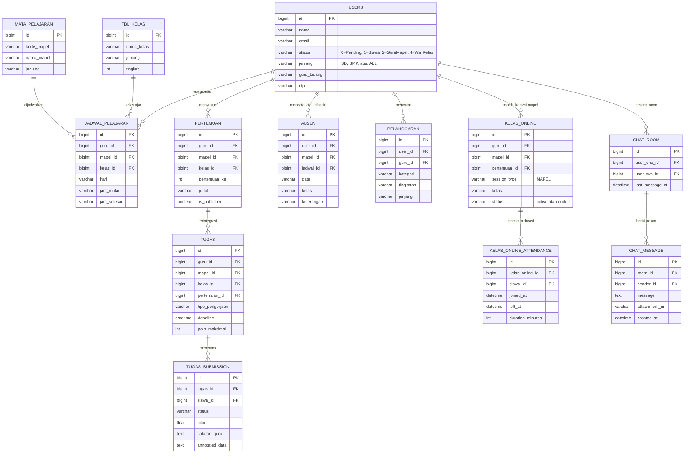

---

### 4.4 Sequence Diagram Alur Utama

#### 1. Alur Registrasi Guru, Verifikasi Status `"2"`, & Login

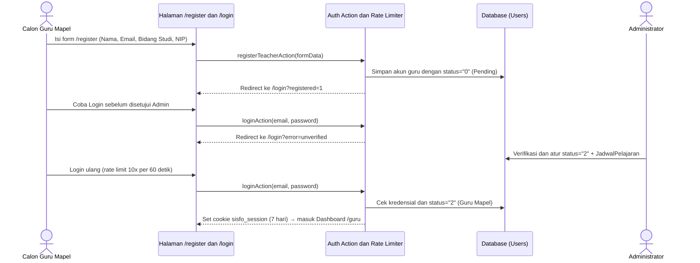

#### 2. Alur Penyusunan Materi Pertemuan, Toggle Publikasi, & Salin ke Kelas Paralel

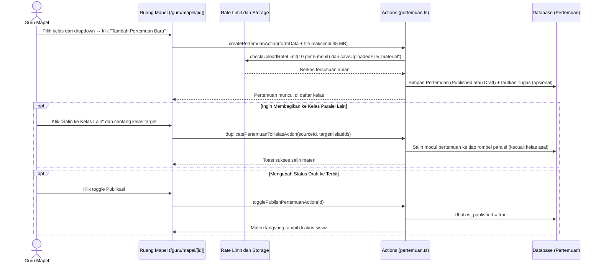

#### 3. Alur Pembuatan Tugas, Penilaian Speed-Grader, Permintaan Revisi, & Ekspor Nilai

```mermaid
sequenceDiagram
    actor GM as Guru Mapel
    participant Create as Buat Tugas (/guru/tugas/create)
    participant Detail as Rekap Tugas (/guru/tugas/[id])
    participant SG as Speed-Grader (/review/[subId])
    participant Act as Actions (assignment.ts)
    participant DB as Database (Tugas)

    GM->>Create: Pilih "Lembar Kerja (PDF/Gambar)" maks 25 MB atau "Kuis CBT Online" (3 Langkah)
    Create->>Act: Simpan dan terbitkan tugas ke kelas ajar
    Act->>DB: Simpan Tugas, Soal, Opsi, Timer (5-180m), dan opsi acak

    GM->>Detail: Pantau daftar pengumpulan seluruh siswa kelas
    GM->>SG: Klik baris siswa → masuk Speed-Grader (navigasi Prev/Next)

    alt Lembar Kerja Berkas
        GM->>SG: Coret kanvas merah/stabilo/stempel ✓/✗/★ (+ mode Fullscreen)
        alt Beri Nilai Final
            GM->>Act: gradeDocumentTaskAction(nilai, catatan, annotatedData, teacherImageData)
            Act->>DB: Simpan hasil koreksi dan status="sudah_dinilai"
        else Minta Revisi
            GM->>Act: requestTaskRevisionAction(catatan wajib)
            Act->>DB: Ubah status="perlu_revisi" agar siswa perbaiki
        end
    else Kuis CBT Online
        GM->>SG: Nilai butir Esai manual (poin + catatan)
        GM->>Act: gradeInteractiveEssayAction(submissionId, soalId, poinDidapat)
        Act->>DB: Hitung ulang total nilai final siswa
    end

    GM->>Detail: Klik "Excel (.xlsx)" atau "PDF (.pdf)" → unduh rekap nilai kelas
```

#### 4. Alur Presensi Mengajar Mapel & Rekap KBM PDF

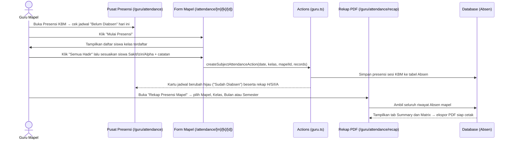

#### 5. Alur Kelas Online Mode `MAPEL`, Mode PiP, & Akhiri Room

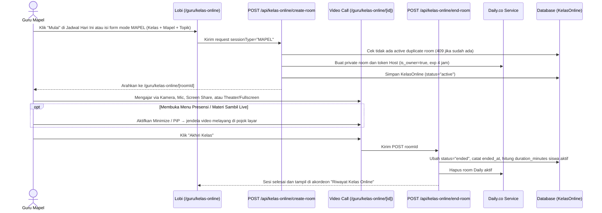

---

### 4.5 State Machine Diagram (Siklus Status Akun, Materi, Tugas, & Kelas Online)

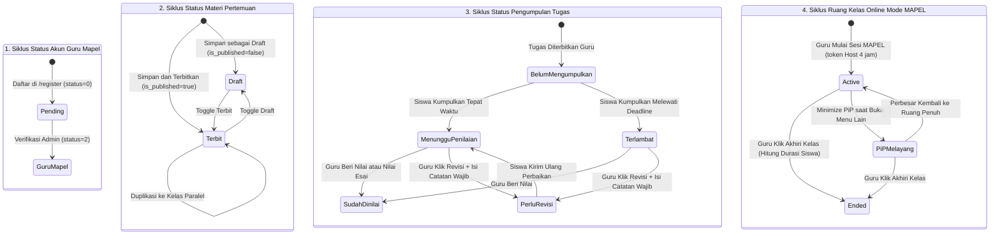

---

## 5. Flowchart (Diagram Alir) Cara Penggunaan

### 5.1 Flowchart Utama Aktivitas Mengajar Harian Guru Mapel

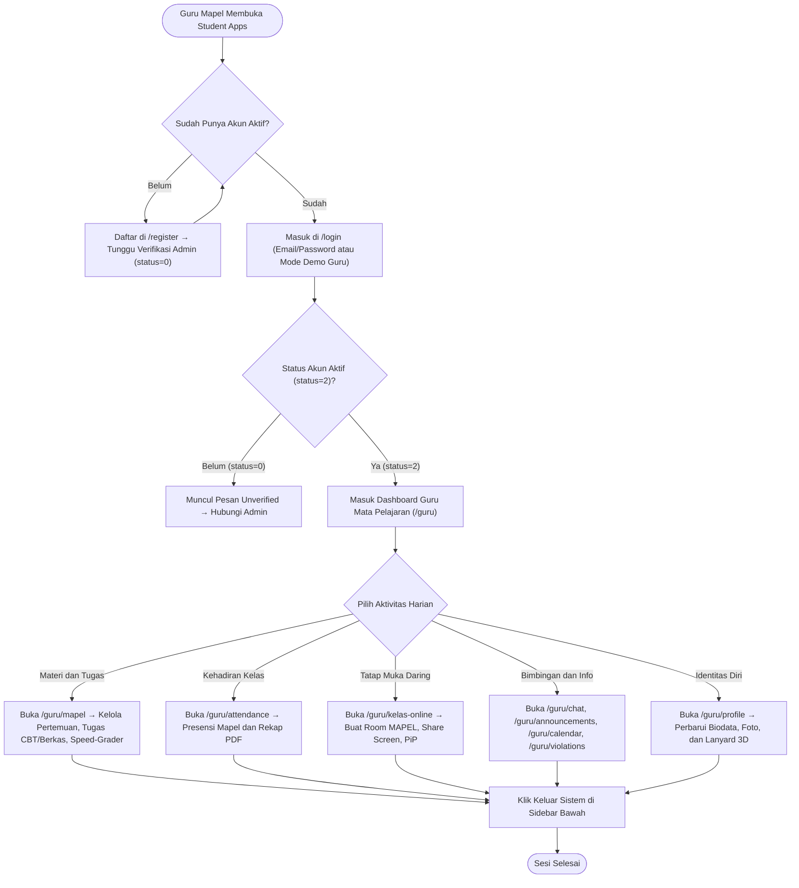

---

### 5.2 Flowchart Penyusunan Materi, Tugas, & Koreksi Speed-Grader

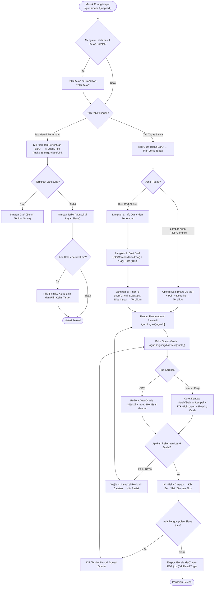

---

### 5.3 Flowchart Pengisian Presensi Mapel & Rekap KBM PDF

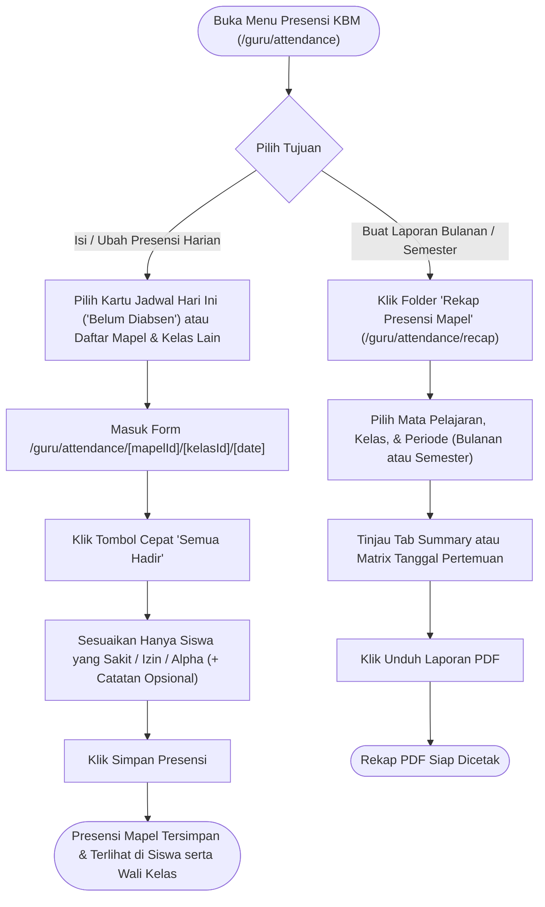

---

### 5.4 Flowchart Kelas Online Mode Mapel & Picture-in-Picture

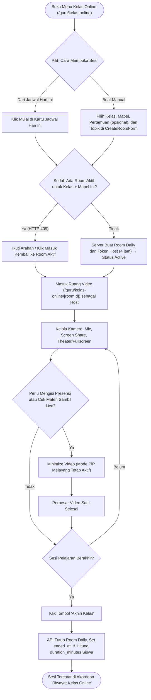

---

## 6. Ringkasan Batasan Teknis, Keamanan RBAC, & FAQ Troubleshooting

### 6.1 Tabel Batasan Teknis, Unggahan Berkas, & Rate Limit

| Fitur / Parameter | Batasan Resmi di Sistem | Detail & Keterangan |
|---|---|---|
| **Login Rate Limit** | Maks **10 percobaan per 60 detik** per email | Menunggu sesuai sisa detik jika melebihi batas |
| **Masa Sesi Login** | **7 hari** (`sisfo_session` JWT HTTP-only) | Wajib login ulang otomatis setelah sesi berakhir |
| **Foto Profil (`avatar`)** | UI membatasi **5 MB** (batas server **10 MB**) | Format gambar; disimpan sebagai WebP teroptimasi |
| **Lampiran Chat & Pengumuman (`chat` / `attachment`)** | Maks **10 MB** per berkas | Rate limit upload umum: **10 berkas per 5 menit** per akun |
| **Bahan Ajar Pertemuan (`material`)** | Maks **35 MB** per berkas | Format: `PDF`, `PPT`/`PPTX`, `DOC`/`DOCX`, `XLS`/`XLSX`, `TXT`, Gambar, `MP4`/`WebM` |
| **Soal Lembar Kerja (`task_worksheet`)** | Maks **25 MB** per berkas | Format: `PDF` atau Gambar (`JPG`/`PNG`/`WEBP`) |
| **Gambar Stimulus / Opsi CBT (`task_media`)** | Maks **10 MB** per gambar | Rate limit khusus media soal: **60 berkas per 5 menit** |
| **Timer Kuis CBT Online** | Opsional **5 – 180 menit** | Preset cepat: `15m`, `30m`, `45m`, `60m`, `90m` |
| **Batas Edit Pesan Chat** | Maks **12 jam** sejak dikirim | Pesan teks melewati 12 jam tetap bisa dihapus, tidak dapat diedit |
| **Token Host Kelas Online** | **4 jam** per sesi room | Dibuat saat membuka `/guru/kelas-online/[roomId]` |

---

### 6.2 FAQ & Pemecahan Masalah (Troubleshooting)

1. **Mengapa saat membuka `/guru/my-class`, `/guru/achievements`, atau `/guru/attendance/matrix` saya melihat pesan pembatasan akses atau langsung dialihkan?**  
   Akun **Guru Mata Pelajaran (`status = "2"`)** secara sengaja tidak memiliki akses manajemen rombel perwalian, input prestasi binaan, atau supervisi matriks kelas. Fitur-fitur tersebut eksklusif untuk akun berstatus **Wali Kelas (`status = "4"`)**. Jika Anda ditugaskan menjadi Wali Kelas, hubungi **Administrator** untuk memperbarui status akun Anda.

2. **Di `/guru/mapel`, muncul pesan `Jadwal Mengajar Belum Ditetapkan`. Apa yang harus dilakukan?**  
   Artinya Administrator belum memetakan jadwal mengajar (`JadwalPelajaran`) ke akun Anda untuk semester berjalan. Silakan hubungi Kurikulum/Administrator sekolah agar jadwal mapel dan kelas ajar Anda dimasukkan ke sistem.

3. **Saya mengajar mata pelajaran yang sama di 4 kelas paralel (misal `7A`, `7B`, `7C`, `7D`). Apakah harus mengunggah ulang file materi 4 kali?**  
   Tidak perlu. Buat pertemuan lengkap di satu kelas (misal `7A`), lalu klik aksi **Salin ke Kelas Lain** dan pilih `7B`, `7C`, serta `7D` sekaligus (`duplicatePertemuanToKelasAction`).

4. **Mengapa saya tidak bisa mengubah `Bidang Studi / Mata Pelajaran` atau status `Bukan Wali Kelas` di halaman `/guru/profile`?**  
   Kedua kolom tersebut sengaja **dikunci** di antarmuka dan server agar penugasan bidang studi serta kewenangan wali kelas selalu terpusat pada kendali Administrator. Anda dapat memperbarui Nama & Gelar, NIY, Jenis Kelamin, Apple ID, Alamat, dan Foto Profil secara mandiri.

5. **Mengapa daftar siswa di `Chat Siswa` hanya menampilkan kelas tertentu, padahal di sekolah ada banyak kelas?**  
   Sistem memfilter kontak di `/guru/chat` agar Guru Mata Pelajaran hanya melihat **siswa dari kelas yang memang Anda ajar** berdasarkan jadwal pelajaran aktif (sehingga daftar kontak tetap relevan dan tertarget).

6. **Mengapa saya tidak bisa mencatat pelanggaran untuk siswa SMP (atau sebaliknya), dan tidak bisa mengedit sebuah catatan pelanggaran?**  
   - **Isolasi Jenjang**: Guru dengan `jenjang = "SD"` hanya boleh mencatat pelanggaran siswa `SD` (begitu pula `SMP`), kecuali akun Anda disetel Administrator sebagai **Guru Lintas Jenjang (`jenjang = "ALL"`)**.
   - **Kepemilikan Catatan**: Anda hanya dapat mengubah atau menghapus catatan pelanggaran yang Anda buat sendiri (`canManageViolationRecord`).

7. **Mengapa tombol `Revisi` pada Speed-Grader menolak menyimpan saat saya klik?**  
   Sistem mewajibkan kolom **Catatan Bimbingan Guru** diisi sebelum mengirim status `perlu_revisi`, agar siswa mengetahui bagian mana yang harus diperbaiki.

8. **Mengapa saat membuat Kelas Online muncul pemberitahuan bahwa kelas sudah aktif (`HTTP 409`)?**  
   Untuk kombinasi kelas dan mata pelajaran yang sama, tidak diizinkan membuka dua room aktif secara bersamaan. Klik tautan masuk ke room aktif tersebut, lalu pastikan menekan **`Akhiri Kelas`** jika sesi sebelumnya sudah selesai sebelum membuat sesi baru.

---

> **Catatan Akhir**: Untuk penambahan jadwal pelajaran baru, perubahan bidang studi, pengaktifan akses lintas jenjang (`ALL`), atau promosi status menjadi Wali Kelas (`status = "4"`), silakan berkoordinasi dengan **Administrator / Operator Sekolah**.
