# 📘 Panduan Lengkap Penggunaan Student Apps — Role **Siswa**

> **Aplikasi**: Student Apps — Portal Sistem Sekolah Terpadu (SD – SMP Islam Al-Azhar Cairo Palembang)  
> **Sasaran Pengguna**: Siswa Aktif (Jenjang SD & SMP) serta Orang Tua/Wali Pendamping  
> **Cakupan Dokumen**: Penjelasan seluruh fitur role **Siswa**, panduan langkah demi langkah cara penggunaan, aturan & batasan sistem, **Diagram UML** (Use Case Map, Class Diagram, ERD, Sequence Diagram, State Diagram), serta **Flowchart** alur kerja lengkap.

---

## 📑 Daftar Isi

1. [Gambaran Umum & Arsitektur Antarmuka](#1-gambaran-umum--arsitektur-antarmuka)
2. [Peta Rute & Fitur Lengkap Siswa](#2-peta-rute--fitur-lengkap-siswa)
3. [Panduan Penggunaan Setiap Fitur](#3-panduan-penggunaan-setiap-fitur)
   - [3.1 Masuk Akun (Login) & Keluar Sistem](#31-masuk-akun-login--keluar-sistem)
   - [3.2 Antarmuka Utama (Sidebar, Navbar, Tema, & Mode Offline)](#32-antarmuka-utama-sidebar-navbar-tema--mode-offline)
   - [3.3 Dashboard Siswa](#33-dashboard-siswa)
   - [3.4 Jadwal & Mata Pelajaran serta Materi Pertemuan](#34-jadwal--mata-pelajaran-serta-materi-pertemuan)
   - [3.5 Pengerjaan Tugas (CBT Interaktif & Lembar Kerja Berkas) & Hasil Nilai](#35-pengerjaan-tugas-cbt-interaktif--lembar-kerja-berkas--hasil-nilai)
   - [3.6 Prestasi & Papan Peringkat (Leaderboard)](#36-prestasi--papan-peringkat-leaderboard)
   - [3.7 Chat Guru Real-Time](#37-chat-guru-real-time)
   - [3.8 Kalender Kegiatan Sekolah](#38-kalender-kegiatan-sekolah)
   - [3.9 Riwayat Presensi Siswa](#39-riwayat-presensi-siswa)
   - [3.10 Data Pelanggaran & Pembinaan Karakter](#310-data-pelanggaran--pembinaan-karakter)
   - [3.11 Kelas Online (Live Video & Picture-in-Picture)](#311-kelas-online-live-video--picture-in-picture)
   - [3.12 Profil Saya & Kartu Pelajar Digital 3D](#312-profil-saya--kartu-pelajar-digital-3d)
4. [Diagram UML (Unified Modeling Language)](#4-diagram-uml-unified-modeling-language)
   - [4.1 Use Case Diagram (Peta Hak Akses Siswa)](#41-use-case-diagram-peta-hak-akses-siswa)
   - [4.2 Class Diagram (Model Domain Perspektif Siswa)](#42-class-diagram-model-domain-perspektif-siswa)
   - [4.3 Entity Relationship Diagram (ERD)](#43-entity-relationship-diagram-erd)
   - [4.4 Sequence Diagram Alur Utama](#44-sequence-diagram-alur-utama)
   - [4.5 State Machine Diagram (Siklus Status Tugas)](#45-state-machine-diagram-siklus-status-tugas)
5. [Flowchart (Diagram Alir) Cara Penggunaan](#5-flowchart-diagram-alir-cara-penggunaan)
   - [5.1 Flowchart Utama Aktivitas Harian Siswa](#51-flowchart-utama-aktivitas-harian-siswa)
   - [5.2 Flowchart Pengerjaan Tugas (CBT & Lembar Kerja Berkas)](#52-flowchart-pengerjaan-tugas-cbt--lembar-kerja-berkas)
   - [5.3 Flowchart Mengikuti Kelas Online](#53-flowchart-mengikuti-kelas-online)
6. [Ringkasan Batasan Sistem, Keamanan, & FAQ Troubleshooting](#6-ringkasan-batasan-sistem-keamanan--faq-troubleshooting)

---

## 1. Gambaran Umum & Arsitektur Antarmuka

**Student Apps** adalah portal pembelajaran dan layanan akademik terpadu untuk **SD dan SMP Islam Al-Azhar Cairo Palembang**. Pengguna dengan role **Siswa** mendapatkan ruang kerja khusus di bawah jalur `/siswa/*` yang dipisahkan secara ketat dari akses **Guru** (`/guru/*`) dan **Admin** (`/admin/*`).

### Karakteristik Utama Role Siswa
- **Akun Dikelola Sekolah**: Akun siswa (nama, email, NIS, kelas, jenjang SD/SMP, jenis kelamin) didaftarkan dan diverifikasi oleh **Administrator/Tim IT**. Halaman registrasi publik (`/register`) hanya diperuntukkan bagi pendaftaran **Guru/Pendidik baru**, bukan siswa.
- **Personalisasi Otomatis**: Seluruh jadwal pelajaran, daftar materi pertemuan, tugas, pengumuman kelas, leaderboard jenjang, kalender kegiatan, ruang kelas online, hingga kontak guru otomatis disaring sesuai **kelas** dan **jenjang (SD/SMP)** siswa yang sedang login.
- **Keamanan Role-Based Access Control (RBAC)**:
  - Siswa yang status akunnya belum aktif/belum diverifikasi (`status = "0"`) otomatis ditolak masuk dan diarahkan ke `/login?error=unverified`.
  - Siswa tidak dapat mengakses halaman Admin atau Guru; percobaan akses langsung akan dialihkan otomatis kembali ke `/siswa`.
  - Di fitur **Chat Guru**, siswa hanya dapat mengirim pesan kepada **Wali Kelas** dan **Guru Mata Pelajaran** yang mengajar di kelasnya (komunikasi antar sesama siswa dibatasi oleh sistem).

---

## 2. Peta Rute & Fitur Lengkap Siswa

Berikut daftar seluruh halaman/rute yang tersedia untuk akun **Siswa**:

| No | Menu / Nama Fitur | Rute URL | Fungsi Utama |
|---|---|---|---|
| 1 | **Masuk Akun** | `/login` | Autentikasi email/username dan password (+ Mode Demo jika diaktifkan Admin) |
| 2 | **Dashboard** | `/siswa` | Beranda sambutan, 6 kartu pintasan fitur, pengumuman sekolah/kelas, & sertifikat *Best Student* |
| 3 | **Mata Pelajaran** | `/siswa/mapel` | Daftar jadwal & mata pelajaran kelas dalam tampilan Kartu atau Tabel |
| 4 | **Materi & Pertemuan** | `/siswa/mapel/[mapelId]` | Modul ajar terstruktur per pertemuan (baca PDF in-app, unduh, video YouTube, tautan referensi) |
| 5 | **Daftar Tugas Mapel** | `/siswa/mapel/[mapelId]/tugas` | Daftar semua tugas/latihan untuk satu mata pelajaran tertentu |
| 6 | **Detail / Lobby Tugas** | `/siswa/tugas/[tugasId]` | Informasi lengkap tugas sebelum mengerjakan (Lobby CBT atau Kartu Lembar Kerja Berkas) |
| 7 | **Kerjakan Tugas (CBT)** | `/siswa/tugas/[tugasId]/kerjakan` | Ruang ujian/kuis interaktif (PG, Pilihan Gambar, Isian Singkat, Esai) + timer & auto-save |
| 8 | **Kanvas Lembar Kerja** | `/siswa/tugas/[tugasId]/kerjakan-berkas` | Editor coret/ketik langsung di atas soal PDF/Gambar (pena, stabilo, teks, penghapus, zoom) |
| 9 | **Hasil & Pembahasan** | `/siswa/tugas/[tugasId]/hasil` | Skor akhir, statistik benar/salah, durasi, catatan guru, & pembahasan tiap soal CBT |
| 10 | **Prestasi** | `/siswa/achievements` (atau `/siswa/prestasi`) | Papan peringkat (*Leaderboard*) podium & daftar siswa berprestasi + modal riwayat kejuaraan |
| 11 | **Chat Guru** | `/siswa/chat` | Konsultasi langsung 1-on-1 secara real-time dengan Wali Kelas & Guru Mapel |
| 12 | **Kalender Kegiatan** | `/siswa/calendar` | Agenda resmi sekolah, ujian, keagamaan, libur, & ekstrakurikuler (mode Kalender/Daftar) |
| 13 | **Riwayat Presensi** | `/siswa/attendance` | Rekap kehadiran per mapel, kalender presensi warna, & riwayat sesi KBM lengkap |
| 14 | **Data Pelanggaran** | `/siswa/violations` | Catatan kedisiplinan/pembinaan karakter siswa dengan filter kelas, semester, kategori, & tingkat |
| 15 | **Kelas Online** | `/siswa/kelas-online` | Daftar ruang kelas video yang sedang aktif (*live*) & riwayat kelas sebelumnya |
| 16 | **Ruang Video Kelas** | `/siswa/kelas-online/[roomId]` | Ruang tatap muka video live dengan mode Layar Penuh, Fokus, dan *Picture-in-Picture* (PiP) |
| 17 | **Profil Saya** | `/siswa/profile` | Ubah foto profil, alamat, bakat/keterampilan, catatan diri, & Kartu Pelajar Digital 3D (*Lanyard*) |

---

## 3. Panduan Penggunaan Setiap Fitur

### 3.1 Masuk Akun (Login) & Keluar Sistem

#### Cara Masuk ke Aplikasi (`/login`)
1. Buka alamat portal Student Apps di browser (iPad, tablet, laptop, atau HP). Jika belum login, sistem otomatis mengarahkan ke halaman `/login`.
2. Masukkan **Email / Username** akun siswa yang diberikan oleh sekolah pada kolom pertama.
3. Masukkan **Password** pada kolom kedua.
   - Tekan ikon **Mata** di sebelah kanan kolom password jika ingin menampilkan atau menyembunyikan karakter password.
4. Klik tombol **Masuk**.
5. Setelah berhasil, sistem langsung mengarahkan ke halaman utama `/siswa`.

#### Fitur Mode Demo (Jika Diaktifkan Admin)
- Apabila Administrator mengaktifkan **Mode Demo**, di bawah tombol Masuk akan muncul bagian **Mode Demo** dengan filter kategori (*Semua*, *Admin*, *Guru*, *Siswa*).
- Pilih kategori **Siswa**, lalu klik **Siswa SD** (Kelas 4 - Mehmed Al Fatih) atau **Siswa SMP** (Kelas 7 - Ibnu Sina) untuk mencoba aplikasi tanpa mengetik kredensial manual.

#### Proteksi & Ketentuan Login
- **Rate Limiting**: Sistem membatasi percobaan login maksimal **10 kali per menit** per email. Jika melebihi batas, muncul pesan tunggu beberapa detik sebelum dapat mencoba kembali.
- **Akun Belum Terverifikasi**: Jika muncul peringatan bahwa akun belum diverifikasi (`status = "0"`), hubungi Wali Kelas atau Tim IT Sekolah untuk aktivasi akun.
- **Sesi Login**: Sesi login berlaku selama **7 hari** sebelum perlu masuk kembali.

#### Cara Keluar Sistem (Logout)
1. Buka **Sidebar** di sisi kiri (pada layar HP/mobile, tekan tombol ikon **Garis Tiga / Menu** di pojok kanan atas terlebih dahulu).
2. Gulir ke bagian paling bawah sidebar, lalu klik tombol **Keluar Sistem** berwarna merah.
3. Sesi akan dihapus dan layar kembali ke `/login`.

---

### 3.2 Antarmuka Utama (Sidebar, Navbar, Tema, & Mode Offline)

Setelah masuk ke `/siswa`, seluruh halaman siswa dibungkus dalam tata letak terpadu (*Dashboard Shell*):

#### A. Sidebar Navigasi (Sisi Kiri Desktop / Drawer Kanan di Mobile)
Berisi **8 menu utama** role Siswa:
1. **Dashboard** (`/siswa`)
2. **Mata Pelajaran** (`/siswa/mapel`)
3. **Prestasi** (`/siswa/achievements`)
4. **Chat Guru** (`/siswa/chat`)
5. **Kalender Kegiatan** (`/siswa/calendar`)
6. **Riwayat Presensi** (`/siswa/attendance`)
7. **Data Pelanggaran** (`/siswa/violations`)
8. **Kelas Online** (`/siswa/kelas-online`)

- Di layar **Desktop/Tablet**, pengguna dapat mengecilkan sidebar menjadi mode ikon saja (atau memperluasnya kembali) melalui tombol ikon lipat di sebelah kiri Navbar.
- Di layar **Mobile**, mengetuk ikon menu di pojok kanan atas akan membuka laci (*drawer*) yang juga menampilkan **Kartu Profil Cepat** di bagian atas menu.

#### B. Navbar Atas
Dari kiri ke kanan pada Navbar terdapat elemen berikut:
1. **Tombol Perkecil/Perluas Sidebar** (Desktop) atau **Logo Student Apps** (Mobile).
2. **Banner Tahun Pelajaran & Semester Berjalan** (Desktop): Menampilkan tahun ajaran aktif (misal `TP 2026/2027`) dan periode semester (`Semester 1 - Ganjil` atau `Semester 2 - Genap`).
3. **Tombol Tema (Matahari / Bulan)**: Klik untuk beralih antara **Mode Terang (Light Mode)** dan **Mode Gelap (Dark Mode)**.
4. **Tombol Layar Penuh (Fullscreen)**: Klik untuk masuk/keluar mode layar penuh agar lebih fokus belajar.
5. **Ikon Lonceng Notifikasi**: Mengarahkan siswa ke halaman utama pengumuman (`/siswa`).
6. **Avatar Foto Profil**: Klik foto/inisial di pojok kanan atas untuk langsung membuka halaman **Profil Saya** (`/siswa/profile`).

#### C. Pemantau Koneksi Offline (`OfflineModal`)
- Jika koneksi Wi-Fi atau internet terputus saat belajar, aplikasi otomatis memunculkan modal pemberitahuan **Mode Offline**.
- Siswa dapat menekan tombol **Perkecil** untuk mengubah modal menjadi pil kecil di bagian bawah layar bertuliskan *"Mode Offline — Data di layar tetap aman"*, dan menekan **Coba Sambung** saat jaringan kembali pulih.

---

### 3.3 Dashboard Siswa

Halaman `/siswa` adalah beranda utama setelah siswa berhasil masuk:

1. **Hero Banner Sambutan Islami**:
   - Menampilkan sapaan *"السَّلاَمُ عَلَيْكُمْ, [Nama Lengkap Siswa]"* dan pesan penyemangat belajar.
2. **6 Kartu Pintasan Cepat (*Folder Cards*)**:
   - Menyediakan akses satu ketukan ke menu paling sering digunakan:
     - **Mata Pelajaran** (Merah Muda/Rose) → `/siswa/mapel`
     - **Presensi** (Kuning/Amber) → `/siswa/attendance`
     - **Chat Guru** (Hijau/Emerald) → `/siswa/chat`
     - **Kalender Kegiatan** (Biru/Blue) → `/siswa/calendar`
     - **Pelanggaran** (Ungu/Purple) → `/siswa/violations`
     - **Kelas Online** (Teal) → `/siswa/kelas-online`
3. **Pengumuman Sekolah & Kelas**:
   - Menampilkan daftar pengumuman resmi yang relevan bagi siswa (pengumuman umum semua jenjang, khusus jenjang siswa SD/SMP, atau khusus kelas siswa).
   - Awalnya menampilkan **3 pengumuman terbaru**; klik tombol tampilkan semua jika ada lebih banyak pengumuman.
   - **Cara berinteraksi**:
     - Baca judul, isi pengumuman, pengirim resmi (*Kurikulum*, *Kepala Sekolah*, *Kesiswaan*, *Wali Kelas*, atau *Guru*), dan tanggal terbit.
     - Jika ada **lampiran file/gambar**, klik lampiran untuk melihat pratinjau atau mengunduhnya.
     - Klik tombol **Suka (Heart/Like)** untuk menyukai pengumuman; jumlah suka akan diperbarui secara langsung.
4. **Kartu Best Student (Carousel Sertifikat)**:
   - Menampilkan kartu penghargaan **Best Student** dengan animasi *paper-curl carousel* yang dapat digeser/diklik untuk melihat siswa peraih poin prestasi tertinggi di jenjang maupun kelas.

---

### 3.4 Jadwal & Mata Pelajaran serta Materi Pertemuan

#### A. Halaman Daftar Mata Pelajaran (`/siswa/mapel`)
1. **Mencari & Menyaring Jadwal**:
   - Gunakan kotak **Pencarian** untuk mengetik nama mata pelajaran, kode mapel, nama guru pengampu, atau nama hari.
   - Klik tab filter **Hari** (*Semua Hari*, *Senin*, *Selasa*, dst.) untuk melihat pelajaran pada hari tertentu saja.
   - Klik tombol **Reset** untuk mengembalikan semua tampilan.
2. **Mengubah Mode Tampilan (Kartu vs Tabel)**:
   - Di kanan atas daftar terdapat tombol pengalih **Tampilan Card** (ikon grid) dan **Tampilan Tabel** (ikon tabel). Pilihan Anda akan diingat otomatis oleh browser.
3. **Membaca Informasi di Setiap Kartu/Baris Mapel**:
   - **Kode Mapel** & **Nama Mata Pelajaran**.
   - **Hari & Jam Pelajaran** (misal `Senin, 07:30 - 09:00 WIB`).
   - **Foto & Nama Guru Pengampu**.
   - **Indikator Tugas Aktif**:
     - Badge kuning/amber *"Tugas Aktif — X Belum Dikumpulkan"* jika masih ada tugas yang belum dikerjakan.
     - Badge hijau *"Semua Tugas Selesai (X)"* jika seluruh tugas aktif sudah dikumpulkan.
4. **Tombol Aksi**:
   - Klik **Materi** untuk membuka modul pertemuan (`/siswa/mapel/[mapelId]`).
   - Klik **Tugas** untuk langsung melihat daftar tugas mapel tersebut (`/siswa/mapel/[mapelId]/tugas`).

#### B. Halaman Detail Mata Pelajaran & Pertemuan (`/siswa/mapel/[mapelId]`)
1. **Navigasi & Banner Kelas Live**:
   - Di bagian atas tersedia tombol **Kembali ke Daftar Mata Pelajaran** dan tombol pintasan **Buka Halaman Tugas (N)**.
   - Jika Ustadz/Ustadzah sedang membuka **Kelas Online** untuk mata pelajaran dan kelas Anda, akan muncul **Banner LIVE NOW** berwarna hijau. Klik tombol **Gabung Kelas** untuk langsung masuk ke ruang video.
2. **Kartu Guru Pengampu & Tanya Guru**:
   - Menampilkan foto profil guru (dapat diklik untuk memperbesar) dan bidang ajarnya.
   - Klik tombol **Tanya Ustadz / Chat Guru** untuk langsung membuka ruang obrolan pribadi dengan guru mata pelajaran tersebut.
3. **Daftar Modul & Pertemuan Materi**:
   - Gunakan kotak **Cari materi pertemuan...** untuk menemukan topik pertemuan tertentu.
   - Setiap pertemuan tampil sebagai kartu bernomor urut (`01`, `02`, `03`, dst.). Pertemuan paling akhir ditandai badge **Materi Pekan Ini**.
   - Di sisi kanan header pertemuan terdapat badge penanda kelengkapan isi: **Modul** (ada berkas ajar), **Video** (ada video YouTube), dan **N Tugas** (ada tugas terhubung).
   - Klik header kartu pertemuan untuk **membuka (expand)** atau **menutup (collapse)** rinciannya. Pertemuan pertama terbuka secara otomatis.
4. **Isi di Dalam Kartu Pertemuan yang Terbuka**:
   - **Pesan Ustadz / Ustadzah**: Catatan ringkas atau arahan belajar dari guru.
   - **Bahan Bacaan & Modul**:
     - Klik **Baca Materi** untuk membaca dokumen (PDF/Slide/Gambar) langsung di dalam aplikasi tanpa mengunduh.
     - Klik **Unduh** untuk menyimpan file modul ke perangkat Anda.
   - **Video Pembelajaran**: Pemutar video YouTube tersemat langsung yang dapat diputar di halaman tersebut.
   - **Tautan Referensi Tambahan**: Klik link eksternal (jika guru menyertakan sumber belajar web lain) untuk membukanya di tab baru.
   - **Tugas Pertemuan Ini**: Menampilkan tugas yang terikat ke pertemuan tersebut beserta statusnya (*Belum Dikerjakan*, *Sedang Dinilai*, atau *Nilai: X / Y*). Klik tombol **Kerjakan Tugas**, **Buka Jawaban**, atau **Lihat Nilai** untuk masuk ke halaman detail tugas.

---

### 3.5 Pengerjaan Tugas (CBT Interaktif & Lembar Kerja Berkas) & Hasil Nilai

Siswa dapat membuka tugas melalui tombol **Tugas** di halaman Mata Pelajaran (`/siswa/mapel/[mapelId]/tugas`) atau langsung dari bagian **Tugas Pertemuan Ini** di halaman Materi.

#### A. Daftar Tugas Mata Pelajaran (`/siswa/mapel/[mapelId]/tugas`)
Setiap kartu tugas menampilkan:
- **Badge Status**:
  - **Belum Dikerjakan** (Kuning) → tombol **Mulai Kerjakan**
  - **Terlambat** (Merah) → melewati batas deadline dan belum dikumpulkan
  - **Sedang Dinilai** (Biru) → tombol **Buka Jawaban**
  - **Nilai: X / Y** (Hijau) → tombol **Lihat Evaluasi & Nilai**
- **Tenggat Waktu (Deadline)** lengkap dengan tanggal dan jam.
- **Judul & Deskripsi Tugas**.

---

#### B. Alur 1 — Tugas Interaktif / CBT (`/siswa/tugas/[tugasId]` → `/kerjakan` → `/hasil`)

##### Langkah 1: Lobby Tugas (`/siswa/tugas/[tugasId]`)
1. Baca **Petunjuk Pengerjaan** dari guru.
2. Perhatikan 4 kartu informasi: **Jumlah Soal**, **Durasi** (misal `45 Menit` atau `Bebas` jika tanpa batas waktu), **Skor Maks**, dan **Deadline**.
3. Kondisi tombol aksi di bagian bawah kartu:
   - Jika belum pernah memulai dan belum melewati deadline → Klik **Mulai Kerjakan**.
   - Jika sudah pernah membuka tetapi belum selesai → Klik **Lanjutkan Pengerjaan** (draft jawaban sebelumnya otomatis dimuat kembali).
   - Jika guru mengembalikan tugas untuk diperbaiki (`perlu_revisi`) → Muncul catatan perbaikan guru dan tombol **Perbaiki Tugas**.
   - Jika sudah melewati deadline sebelum siswa memulai sesi → Muncul pemberitahuan bahwa batas waktu telah berakhir dan soal tidak dapat dimulai.
   - Jika sudah dikumpulkan → Klik **Lihat Hasil & Pembahasan**.

##### Langkah 2: Ruang Pengerjaan Soal (`/siswa/tugas/[tugasId]/kerjakan`)
1. **Header Atas (Sticky)**:
   - Menampilkan nama mapel, judul tugas, **Timer hitung mundur** (jika tugas memiliki batas durasi; berubah merah bila sisa waktu kurang dari 5 menit), progress jumlah soal terjawab (`X/N`), serta tombol **Kumpulkan** / **Kirim**.
2. **Navigasi Nomor Soal**:
   - Pada layar **Desktop/Tablet**, peta nomor soal berada di panel kanan dengan keterangan warna:
     - Hijau/Terisi = *Sudah Dijawab*
     - Garis bawah tegas = *Ditandai Ragu*
     - Abu-abu = *Belum Dijawab*
   - Pada layar **HP/Mobile**, deretan nomor soal dapat digeser secara horizontal di bagian atas, dan tombol **Sebelumnya** / **Selanjutnya** / **Kumpulkan** menempel di bagian bawah layar.
3. **Menjawab 4 Tipe Soal**:
   - **Pilihan Ganda** & **Pilihan Gambar**: Klik salah satu opsi (`A`, `B`, `C`, `D`, dst.). Jika guru mengaktifkan fitur acak, urutan soal dan/atau urutan opsi diacak secara unik per siswa.
   - **Isian Singkat**: Ketik jawaban singkat pada kotak teks yang tersedia.
   - **Esai**: Ketik uraian jawaban lengkap pada kotak teks panjang.
   - **Memperbesar Gambar**: Klik gambar stimulus soal atau ikon kaca pembesar pada gambar opsi untuk memperbesar gambar (*Lightbox*); tekan `Esc` atau tombol tutup untuk kembali.
4. **Menandai Ragu-Ragu**:
   - Klik tombol **Ragu-Ragu** di kanan atas kartu soal jika ingin menandai soal agar mudah diingat untuk dicek ulang sebelum dikumpulkan.
5. **Penyimpanan Otomatis (*Auto-Save*)**:
   - Setiap jawaban yang dipilih/diketik langsung disimpan sementara di browser (`localStorage`) dan dikirim otomatis ke server setelah jeda 400 milidetik.
6. **Mengumpulkan Jawaban**:
   - Klik tombol **Kumpulkan**.
   - Pada dialog konfirmasi (*"Kumpulkan Tugas?"*), periksa kembali jumlah **Total Soal**, **Sudah Dijawab**, dan peringatan **Belum Terjawab** (jika masih ada yang kosong).
   - Klik **Ya, Kumpulkan** (atau **Cek Kembali** untuk kembali ke soal).
   - **Catatan Timer**: Jika waktu hitung mundur mencapai `00:00`, sistem akan **otomatis mengumpulkan** jawaban Anda.

##### Langkah 3: Halaman Hasil & Pembahasan (`/siswa/tugas/[tugasId]/hasil`)
- **Penilaian Otomatis**: Jika seluruh soal berupa Pilihan Ganda, Pilihan Gambar, dan/atau Isian Singkat, nilai langsung dihitung otomatis oleh sistem saat itu juga.
- **Menunggu Penilaian Guru**: Jika terdapat soal **Esai**, status menjadi *Menunggu Penilaian* sampai guru memeriksa dan memberi skor manual untuk soal esai tersebut.
- **Tampilan Nilai & Pembahasan**:
  - Jika guru mengaktifkan opsi *Tampilkan Nilai Instan*, siswa akan melihat **Nilai Akhir**, kartu statistik (**Total Soal**, **Benar**, **Salah**, **Durasi Pengerjaan**), **Catatan Guru** (jika ada), serta **Pembahasan Soal** per nomor (jawaban siswa, kunci jawaban, bobot poin didapat, catatan koreksi, dan penjelasan guru). Jika nilai ≥ 75, muncul animasi perayaan konfeti.

---

#### C. Alur 2 — Tugas Lembar Kerja Berkas (`/siswa/tugas/[tugasId]` → `/kerjakan-berkas`)

Untuk tugas berbentuk **Lembar Kerja** (guru mengunggah berkas PDF atau gambar soal), halaman `/siswa/tugas/[tugasId]` menampilkan kartu **Lembar Kerja Berkas**:

1. **Banner Status di Bagian Atas**:
   - *Menunggu Penilaian*: Berkas sudah terkirim, tersedia tombol **Lihat Lembar Jawaban**.
   - *Perlu Revisi*: Muncul kotak kuning berisi **Catatan Guru**, tombol **Lihat Coretan Guru** (jika guru memberi coretan koreksi), dan tombol **Perbaiki Sekarang**.
   - *Sudah Dinilai*: Muncul kotak hijau menampilkan **Nilai Akhir** (`nilai / poinMaksimal`), **Catatan Guru**, dan tombol **Lihat Hasil Koreksi**.
2. **Unduh Berkas Soal**:
   - Klik tombol **Unduh Berkas Soal** bila ingin menyimpan atau mencetak lembar soal asli (PDF atau Gambar).
3. **Pilih Salah Satu dari 2 Cara Pengerjaan**:

   - **Pilihan 1 — Kerjakan Langsung di Kanvas Aplikasi (`/kerjakan-berkas`)**:
     1. Klik tombol **Buka Kanvas & Kerjakan** (atau **Perbaiki Lembar Tugas** jika revisi).
     2. Halaman editor kanvas digital (`DocumentCanvasEditor`) akan terbuka dengan toolbar lengkap di sisi kiri:
        - **Layar Penuh**: Memperbesar area kanvas agar nyaman menulis/menggambar (terutama di iPad/tablet).
        - **Alat Gambar & Tulis**:
          - **Pena**: Coret atau tulis jawaban dengan 6 pilihan warna tinta (*Hitam, Biru, Merah, Hijau, Ungu, Oranye*).
          - **Stabilo**: Sorot bagian teks/soal dengan 4 warna neon (*Kuning, Hijau Neon, Biru Muda, Merah Muda*).
          - **Teks**: Klik area lembar soal untuk mengetik jawaban teks yang rapi; tekan `Enter` atau ikon centang untuk menempatkan teks, `Esc` untuk batal.
          - **Hapus**: Penghapus coretan.
          - **Geser Lembar (Pan)**: Menggeser kertas soal tanpa mencoret saat sedang di-zoom.
        - **Ukuran Kuas**: Pilih ketebalan `2px`, `4px`, atau `8px`.
        - **Riwayat**: Tombol **Batal (Undo)** dan **Ulang (Redo)**.
        - **Halaman** (jika soal PDF lebih dari 1 halaman): Tombol panah kiri/kanan untuk berpindah halaman.
        - **Zoom**: Perkecil (`-`), Perbesar (`+`) dari 50% hingga 250%, dan tombol **Reset** ke posisi semula.
     3. Pekerjaan pada kanvas **tersimpan otomatis** sebagai draft (`Tersimpan Otomatis` dengan titik hijau).
     4. Jika sudah selesai seluruh halaman, klik tombol **Kumpulkan Tugas 🚀**.
     5. *(Catatan: Jika tugas sudah berstatus `sudah_dinilai`, kanvas otomatis masuk ke **Mode Pratinjau** read-only agar coretan nilai guru tidak tertimpa).*

   - **Pilihan 2 — Unggah Berkas / Foto Jawaban Manual**:
     1. Cocok jika siswa mengerjakan tugas di kertas cetak lalu memfotonya, atau mengerjakan di aplikasi lain.
     2. Klik kotak **Pilih foto atau berkas PDF...**, lalu pilih file jawaban (format yang didukung: `.pdf`, `.png`, `.jpg`, `.jpeg`, `.webp`; batas ukuran maksimal **25 MB**).
     3. *(Opsional)* Isi kolom **Catatan untuk Guru** (misalnya: *"Jawaban nomor 4 ada di lembar ke-2"*).
     4. Klik **Kumpulkan Berkas Jawaban**.

---

### 3.6 Prestasi & Papan Peringkat (Leaderboard)

Halaman `/siswa/achievements` (dapat juga diakses melalui `/siswa/prestasi`) menampilkan pencapaian kejuaraan siswa:

1. **Podium Top 3**:
   - Di bagian paling atas tampil podium juara 1, 2, dan 3 lengkap dengan foto, nama, kelas, dan total poin prestasi.
2. **Pencarian & Pengalih Cakupan (*Scope*)**:
   - Gunakan kotak **Pencarian** untuk mencari nama atau kelas siswa mana pun di jenjang Anda (termasuk siswa yang masih memiliki `0 Poin`).
   - Gunakan tombol pengalih di sebelah kanan untuk berpindah antara:
     - **Jenjang SD** / **Jenjang SMP** (peringkat seluruh rombel pada jenjang siswa), dan
     - **Kelas Saya** (peringkat khusus teman sekelas siswa).
3. **Daftar Peringkat Lengkap**:
   - Menampilkan urutan peringkat, foto, nama siswa, kelas asal, dan akumulasi poin.
4. **Melihat Rincian Prestasi Siswa (Modal Pinboard)**:
   - Klik kartu siswa pada Podium maupun baris pada Daftar Peringkat untuk membuka jendela **Riwayat Prestasi**.
   - Di dalamnya siswa dapat melihat daftar piala/kejuaraan yang pernah diraih (nama lomba, tahun ajaran, kelas saat prestasi, tingkat kompetisi, peringkat juara, poin, dan foto dokumentasi/piagam yang dapat diklik untuk diperbesar).

#### Matriks Perhitungan Poin Prestasi
Poin pada leaderboard dihitung otomatis berdasarkan tingkat kompetisi dan peringkat juara:

| Tingkat Kompetisi | Juara 1 | Juara 2 | Juara 3 | Harapan |
|---|---|---|---|---|
| **Internasional** | 16 Poin | 15 Poin | 14 Poin | 13 Poin |
| **Nasional** | 12 Poin | 11 Poin | 10 Poin | 9 Poin |
| **Daerah / Kota** | 8 Poin | 7 Poin | 6 Poin | 5 Poin |
| **Dalam Sekolah** | 4 Poin | 3 Poin | 2 Poin | 1 Poin |

---

### 3.7 Chat Guru Real-Time

Halaman `/siswa/chat` adalah ruang konsultasi akademik 1-on-1 antara Siswa dengan Wali Kelas maupun Guru Mata Pelajaran kelasnya.

#### Memulai & Memilih Percakapan
1. Buka menu **Chat Guru** di sidebar (atau klik **Tanya Ustadz / Chat Guru** dari halaman Mata Pelajaran).
2. Di panel kiri (daftar obrolan & kontak):
   - Gunakan kolom **Pencarian** untuk mencari nama guru atau bidang ajar.
   - Gunakan filter **Semua** atau **Belum Dibaca** untuk menyaring pesan baru.
   - Setiap kontak menampilkan badge peran (**Wali Kelas** atau **Guru Mapel**), status **Online** (jika sedang aktif), pratinjau pesan terakhir, dan lencana jumlah pesan belum dibaca.
3. Klik salah satu guru untuk membuka ruang percakapan. (Pada tampilan mobile, ketuk ikon panah kembali di kiri atas header chat untuk kembali ke daftar guru).

#### Mengirim Pesan & Lampiran
1. Ketik pesan di kotak **"Ketik pesan..."** di bagian bawah layar (tekan `Enter` untuk mengirim langsung, atau `Shift + Enter` untuk baris baru). Indikator *"... sedang mengetik..."* akan muncul secara real-time.
2. **Emoji / Stiker Cepat**: Klik ikon **Wajah Tersenyum (Smile)** di kiri kotak ketik untuk memilih emoji.
3. **Mengirim File atau Foto**:
   - Klik ikon **Klip Kertas (Paperclip)** untuk memilih salah satu sumber lampiran:
     - **Dokumen**: `.pdf`, `.doc`, `.docx`, `.xls`, `.xlsx` (serta format `.ppt`, `.pptx`, `.txt` yang diizinkan server).
     - **Galeri Foto**: Pilih gambar dari penyimpanan perangkat.
     - **Kamera**: Ambil foto langsung menggunakan kamera perangkat (juga tersedia tombol pintasan ikon **Kamera** di sebelah kanan kotak ketik).
   - Pratinjau file akan muncul di atas kotak ketik; Anda dapat menambahkan teks keterangan (*caption*) lalu menekan tombol **Kirim (ikon pesawat kertas hijau)** atau klik tombol `X` untuk membatalkan lampiran.
   - *(Batas ukuran file bawaan server: 10 MB per lampiran; batas upload: 10 file per 5 menit).*
4. **Status Pengiriman Pesan**:
   - Centang dua abu-abu (`✓✓`) = Pesan terkirim ke server.
   - Centang dua biru (`✓✓`) = Pesan sudah dibaca oleh guru.
   - Pada foto/dokumen yang diterima atau dikirim, klik tombol **Unduh** untuk menyimpan file ke perangkat.

#### Mengedit & Menghapus Pesan Sendiri
1. Arahkan kursor atau sentuh pesan milik Anda sendiri, lalu buka menu opsi (`⋮` / panah dropdown) di sudut gelembung pesan.
2. **Edit Pesan**:
   - Pilih **Edit**, ubah isi teks pada kotak input (akan muncul banner *"Mengedit Pesan"*), lalu tekan `Enter` atau tombol centang hijau.
   - **Batasan Penting**: Pesan hanya dapat diedit maksimal **12 jam** sejak waktu pengiriman. Pesan yang sudah diedit akan menampilkan tanda *(diedit)*.
3. **Hapus Pesan**:
   - Pilih **Hapus**, lalu konfirmasi pada dialog *"Hapus Pesan?"* dengan menekan **Hapus untuk Semua**.
   - Pesan dan lampirannya akan dihapus dan berubah menjadi *"Pesan ini telah dihapus"*.

---

### 3.8 Kalender Kegiatan Sekolah

Halaman `/siswa/calendar` menampilkan seluruh agenda sekolah yang berlaku untuk semua kelas, jenjang siswa (SD/SMP), maupun khusus kelas siswa:

1. **Memilih Mode Tampilan**:
   - Klik **Kalender** (ikon grid) untuk tampilan kalender bulanan (*Senin – Minggu*).
   - Klik **Daftar** (ikon list) untuk tampilan linimasa daftar kegiatan lengkap dengan fitur **Pencarian** judul atau kelas.
2. **Navigasi Bulan & Tanggal**:
   - Di mode Kalender, gunakan tombol panah kiri (`<`) dan kanan (`>`) untuk berpindah bulan, atau klik **Hari Ini** untuk langsung kembali ke tanggal hari ini.
   - Tanggal hari ini ditandai lingkaran hijau; tanggal yang memiliki agenda ditandai titik warna sesuai kategori.
   - **Klik tanggal mana saja** pada kalender untuk menampilkan rincian daftar acara hari tersebut di panel sebelah kanan/bawah.
3. **Menyaring Berdasarkan Kategori**:
   - Gunakan dropdown filter kategori di toolbar atas:
     - **Semua Kategori**
     - **Keagamaan** (Hijau Emerald)
     - **Akademik** (Biru Langit)
     - **Ujian** (Merah Rose)
     - **Libur** (Kuning Amber)
     - **Ekskul & Acara** (Ungu)
4. **Informasi yang Ditampilkan per Agenda**:
   - Judul kegiatan, kategori, rentang waktu/jam, target kelas/jenjang, pembuat (*Sekolah/Admin/Wali Kelas*), dan deskripsi lengkap. *(Catatan: Siswa hanya memiliki akses baca/lihat agenda).*

---

### 3.9 Riwayat Presensi Siswa

Halaman `/siswa/attendance` menyediakan pemantauan kehadiran belajar siswa secara transparan melalui **3 Tab Utama**:

#### Tab 1: Presensi per Mata Pelajaran
- Menampilkan seluruh mata pelajaran yang pernah memiliki catatan presensi.
- Pada setiap mata pelajaran tertera:
  - Total sesi pertemuan,
  - Rincian jumlah **Hadir**, **Sakit**, **Izin**, dan **Alpha**,
  - **Persentase Kehadiran** dengan indikator warna:
    - Hijau: ≥ 85% (Sangat Baik)
    - Kuning/Amber: 75% – 84% (Perlu Perhatian)
    - Merah: < 75% (Rendah)
- Gunakan kolom **Cari mata pelajaran...** untuk menyaring daftar.
- Klik tombol **Lihat Detail Sesi** (atau baris mata pelajaran) untuk membuka modal daftar setiap pertemuan pada mapel tersebut (tanggal, jam pelajaran ke-, nama guru pengabsen, status, dan catatan dispensasi jika ada).

#### Tab 2: Kalender Presensi
- Menampilkan kalender bulanan khusus presensi siswa.
- Tanggal yang memiliki rekaman presensi menampilkan **titik berwarna** sesuai legenda di bawah kalender:
  - 🟢 **Hadir** (Emerald)
  - 🔵 **Sakit** (Sky Blue)
  - 🟡 **Izin** (Amber)
  - 🔴 **Alpha** (Rose)
- **Klik tanggal tertentu** di kalender untuk melihat kartu **Detail Presensi Harian** di bagian bawah (menampilkan kode mapel, nama mapel, jam ke-, nama guru, status kehadiran, dan catatan guru).

#### Tab 3: Riwayat Presensi (Log Kronologis)
- Menampilkan seluruh catatan presensi dari yang paling baru.
- **Filter Status Cepat**: Klik tombol pil **Semua**, **Hadir**, **Sakit**, **Izin**, atau **Alpha**.
- **Pencarian Log**: Cari berdasarkan nama mapel, tanggal format `YYYY-MM-DD`, nama guru, atau catatan keterangan.
- Daftar menampilkan **25 catatan** pertama; klik tombol **Tampilkan Lebih Banyak** di bagian bawah untuk memuat 25 catatan berikutnya.

---

### 3.10 Data Pelanggaran & Pembinaan Karakter

Halaman `/siswa/violations` menampilkan catatan kedisiplinan dan adab siswa (*Buku Pembinaan Karakter*).

#### Kondisi 1: Tidak Ada Catatan Pelanggaran (Rekam Jejak Bersih)
- Sistem menampilkan kartu apresiasi *"Alhamdulillah, Rekam Jejak Bersih!"* bersama **3 kartu panduan pembiasaan**:
  1. *Ibadah & Sholat Berjamaah*
  2. *Kedisiplinan iPad Edukasi*
  3. *Kerapian Atribut & Seragam*

#### Kondisi 2: Terdapat Catatan Kedisiplinan
1. **Menyaring & Mencari Catatan**:
   - Ketik kata kunci pada kolom **Cari catatan pelanggaran...** (mencari isi keterangan, tindakan, kategori, atau nama guru).
   - Gunakan 4 dropdown filter:
     - **Kelas** (*Semua Kelas* atau histori kelas sebelumnya)
     - **Semester** (*Semua Semester* atau semester tertentu)
     - **Kategori** (*Ibadah & Karakter Islami*, *Kedisiplinan iPad & Digital*, *Seragam & Kerapian Atribut*, *Ketertiban & Kehadiran Kelas*, *Adab, Sikap & Etika Siswa*)
     - **Tingkat** (*Semua Tingkat*, *Ringan*, *Sedang*)
   - Klik tombol **Reset** untuk menghapus semua filter.
2. **Melihat Rincian Catatan**:
   - Setiap kartu menampilkan ringkasan catatan, nama guru pencatat, dan tanggal kejadian.
   - Klik **Lihat Detail** untuk membuka modal **Rincian Catatan Kedisiplinan** berisi:
     - Badge **Tingkat** (*Ringan* / *Sedang* / *Berat*), **Kategori**, dan **Status Pembinaan** (*Tercatat*, *Sedang Dibina*, atau *Selesai Dibina*).
     - Info lengkap: *Tanggal Kejadian*, *Semester*, *Kelas siswa*, *Dicatat Oleh*, dan *Deskripsi Pelanggaran*.

---

### 3.11 Kelas Online (Live Video & Picture-in-Picture)

Fitur tatap muka video terintegrasi berbasis Daily.co yang terhubung dengan pencatatan kehadiran kelas online otomatis.

#### A. Bergabung ke Kelas Online (`/siswa/kelas-online`)
Siswa dapat bergabung ke kelas online aktif melalui **2 cara**:
1. Dari menu **Kelas Online** (`/siswa/kelas-online`): Pada bagian **Kelas Sedang Berlangsung** (ditandai lampu hijau berkedip), klik tombol **Gabung Kelas** pada kartu kelas yang sesuai.
2. Dari halaman **Detail Mata Pelajaran** (`/siswa/mapel/[mapelId]`): Jika guru sedang membuka kelas untuk mapel tersebut, klik tombol **Gabung Kelas** pada **Banner LIVE NOW**.

*(Catatan: Jika belum ada kelas yang dibuka oleh guru, layar menampilkan pesan "Tidak ada kelas online saat ini — Tunggu Ustadz/Ustadzah memulai kelas ya!". Di bawahnya terdapat panel **Riwayat Kelas Sebelumnya** yang dapat diklik untuk melihat daftar kelas video yang pernah diikuti beserta durasinya dalam menit/jam).*

#### B. Mengontrol Ruang Kelas Video (`/siswa/kelas-online/[roomId]`)
Saat siswa masuk ke ruang video, sistem otomatis menerbitkan token peserta dan mencatat waktu bergabung (`joined_at`) ke sistem kehadiran kelas online.

Di dalam ruang video, siswa memiliki **bilah alat atas (*ClassroomTopBar*)** dan **jendela video interaktif**:
1. **Langkah di Dalam Frame Video**:
   - Izinkan browser mengakses **Kamera** dan **Mikrofon** jika diminta.
   - Cek pratinjau kamera dan suara, lalu klik tombol **Join** di dalam frame video untuk masuk ke panggilan.
2. **Tombol Toolbar Atas (dari kiri ke kanan)**:
   - **Panah Kembali / Keluar Kelas**: Memunculkan dialog konfirmasi keluar (dilengkapi opsi cepat **Perkecil** jika sebenarnya siswa hanya ingin berpindah halaman tanpa keluar kelas).
   - **Bagikan Layar (*Screen Share*)**: Memulai atau menghentikan berbagi layar presentasi ke guru dan teman sekelas (juga tersedia di toolbar mode Fullscreen/Theater pada mobile/tablet).
   - **Bantuan (`?`)**: Membuka **Panduan Kelas Online Mudah** berisi 4 tab petunjuk praktis (*Masuk Kelas*, *Kamera & Suara*, *Bagikan Layar*, dan *Adab Belajar*).
   - **Perkecil (*Minimize / Picture-in-Picture*)**: Mengubah tampilan video menjadi **jendela mini mengambang di pojok kanan bawah layar**.
     - **Keunggulan Mode PiP**: Jika siswa berpindah ke menu *Mata Pelajaran*, *Tugas*, atau *Chat Guru* selama kelas berlangsung, video dan suara kelas **tetap berjalan tanpa terputus** di jendela mini tersebut! Di jendela mini terdapat tombol **Perbesar ke Ruang Kelas**, **Layar Penuh**, dan **Keluar Kelas**.
   - **Mode Fokus (*Theater Mode*)**: Memperluas area video memenuhi viewport browser dengan bingkai gelap bebas gangguan.
   - **Layar Penuh (*Fullscreen*)**: Memenuhi seluruh layar perangkat (tekan `ESC` atau tombol *Keluar Layar Penuh* untuk kembali).
   - **Buka di Tab Terpisah**: Membuka ruangan kelas langsung di tab browser baru (sangat berguna apabila iPad/tablet membatasi fitur *screen share* di dalam iframe).
   - **Keluar Kelas**: Mengakhiri kehadiran siswa di sesi kelas online dan mencatat waktu keluar (`left_at`) serta durasi keikutsertaan (`duration_minutes`).

---

### 3.12 Profil Saya & Kartu Pelajar Digital 3D

Halaman `/siswa/profile` dapat dibuka dengan mengklik **Foto Avatar** di pojok kanan atas Navbar atau **Kartu Profil** di bagian atas menu mobile.

#### A. Kartu Pelajar Digital 3D (*Lanyard Badge*)
- Di sisi kanan halaman (atau di bagian bawah form pada layar mobile/HP) tampil **Kartu Identitas Siswa Interaktif** tergantung pada tali lanyard Al-Azhar yang dapat digerakkan/interaktif, lengkap dengan foto profil, nama, kelas, NIS, chip emas digital, kode barcode, dan stempel verifikasi resmi Al-Azhar.

#### B. Data Identitas Terkunci (*Read-Only*)
Kolom berikut dikelola oleh Administrator dan hanya dapat dilihat oleh siswa:
- **NIS (Nomor Induk Siswa)**
- **Nama Kelas**
- **Email Akun Siswa**
- **Jenis Kelamin**

#### C. Data yang Dapat Diubah oleh Siswa
1. **Foto Profil**:
   - Klik **Ganti Foto**, lalu pilih file gambar (format `PNG`, `JPG`, `JPEG`, `WebP`, `AVIF`, `GIF`, `BMP`; ukuran maksimal **5 MB** pada pemeriksaan form).
   - Pratinjau foto baru langsung tampil di avatar (klik **Batal** jika ingin membatalkan file yang baru dipilih).
   - Jika ingin menghapus foto dan kembali ke avatar default sekolah, klik **Hapus Foto** (atau klik **Batal Hapus** sebelum disimpan).
2. **Alamat Tempat Tinggal**: Ketik alamat domisili lengkap.
3. **Bakat & Keterampilan Khusus**: Isi hobi/bakat atau capaian khusus (misal: *Tahfidz Juz 30, Panahan, Robotik, Desain Grafis*).
4. **Catatan Tambahan Diri**: Isi motivasi belajar atau cita-cita.
5. Klik tombol **Simpan Perubahan Profil** untuk menyimpan seluruh perubahan ke database dan memperbarui foto di Navbar serta Lanyard Badge.

---

## 4. Diagram UML (Unified Modeling Language)

### 4.1 Use Case Diagram (Peta Hak Akses Siswa)

Diagram berikut memetakan seluruh interaksi (*Use Case*) yang dapat dilakukan aktor **Siswa** terhadap modul-modul di dalam sistem Student Apps:

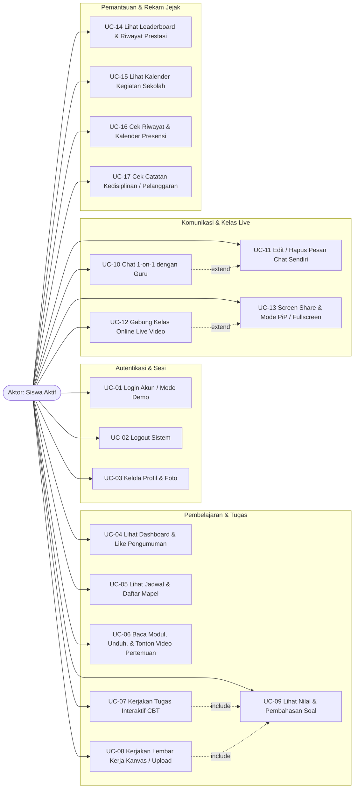

---

### 4.2 Class Diagram (Model Domain Perspektif Siswa)

Diagram kelas berikut merepresentasikan entitas utama beserta atribut kunci dan relasi sesuai skema database aplikasi (`prisma/schema.prisma`):

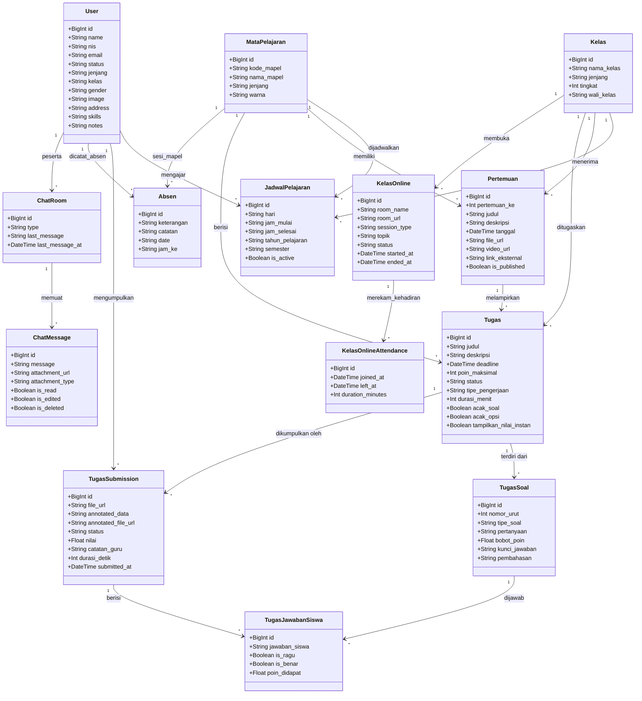

---

### 4.3 Entity Relationship Diagram (ERD)

Diagram ERD berikut menunjukkan keterhubungan tabel database yang diakses saat siswa menggunakan seluruh fiturnya:

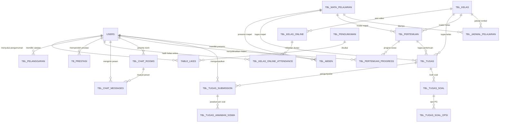

---

### 4.4 Sequence Diagram Alur Utama

#### Sequence 1: Login & Verifikasi Akses Role Siswa
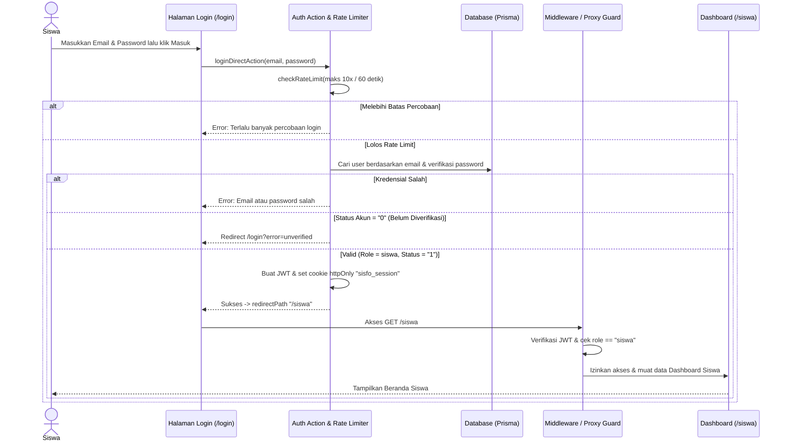

#### Sequence 2: Pengerjaan Tugas Interaktif CBT (Lobby → Auto-Save → Auto-Grading)
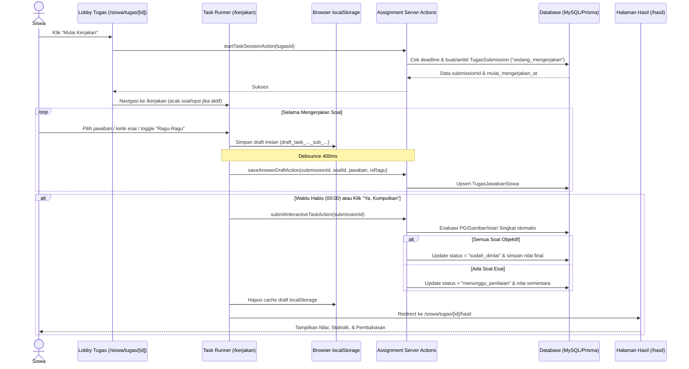

#### Sequence 3: Pengerjaan Tugas Lembar Kerja Berkas & Siklus Revisi
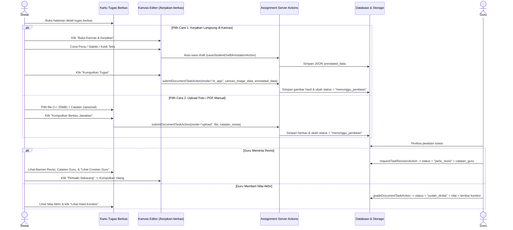

#### Sequence 4: Chat Guru Real-Time (Socket.IO)
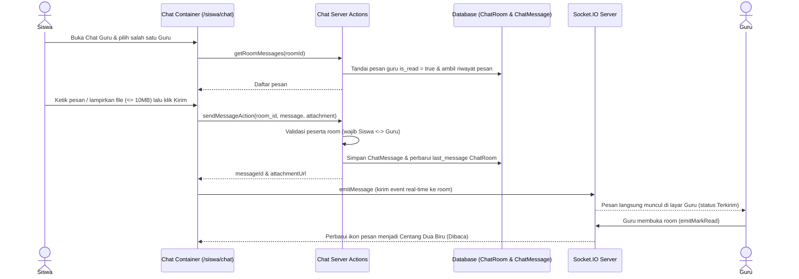

#### Sequence 5: Kelas Online & Pencatatan Kehadiran Otomatis
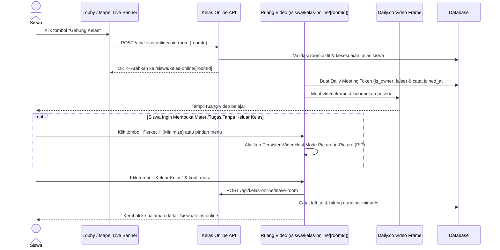

---

### 4.5 State Machine Diagram (Siklus Status Tugas)

Diagram ini menggambarkan perubahan status `TugasSubmission` sejak tugas dibuat hingga selesai dinilai:

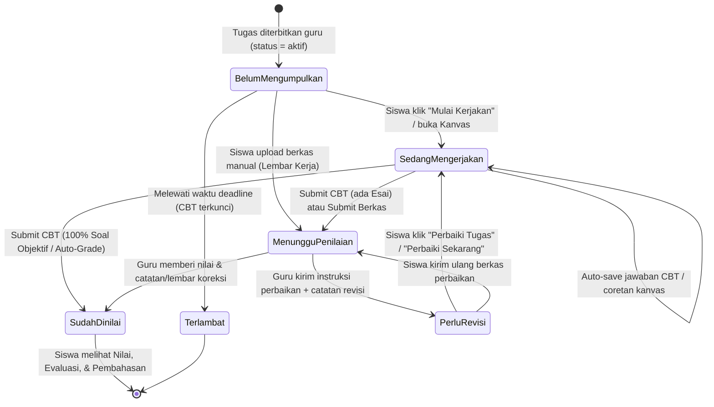

---

## 5. Flowchart (Diagram Alir) Cara Penggunaan

### 5.1 Flowchart Utama Aktivitas Harian Siswa

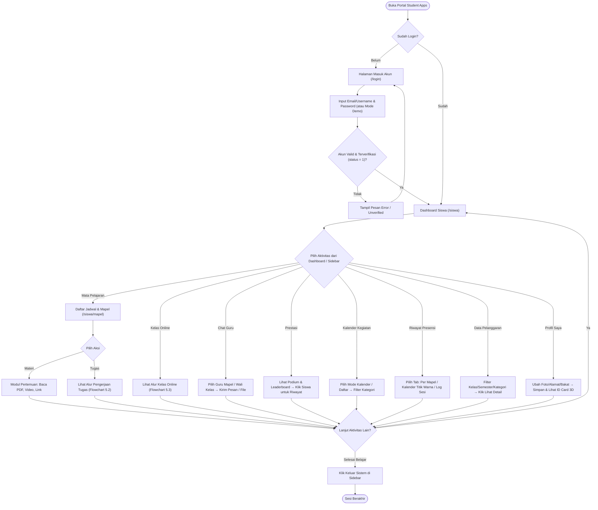

---

### 5.2 Flowchart Pengerjaan Tugas (CBT & Lembar Kerja Berkas)

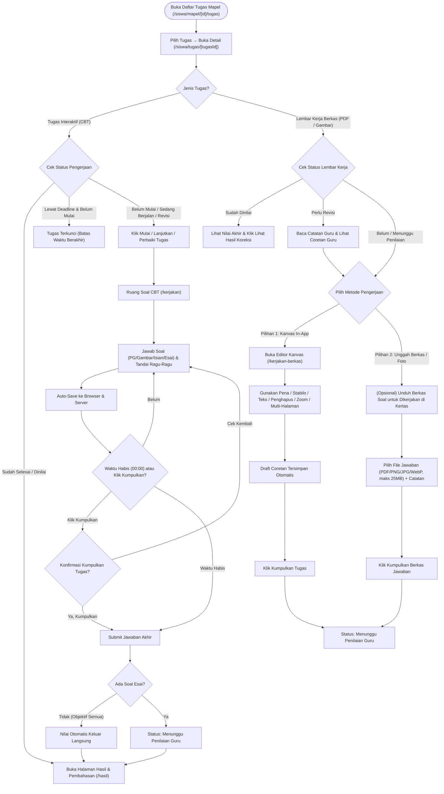

---

### 5.3 Flowchart Mengikuti Kelas Online

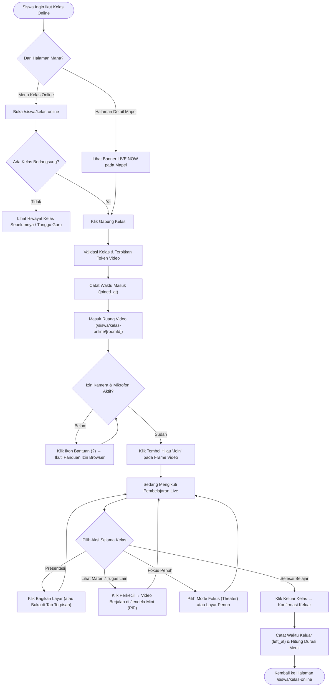

---

## 6. Ringkasan Batasan Sistem, Keamanan, & FAQ Troubleshooting

### 6.1 Tabel Ringkasan Aturan & Batasan Teknis Role Siswa

| Fitur / Aspek | Aturan & Batasan yang Berlaku di Sistem |
|---|---|
| **Pendaftaran Akun** | Akun siswa dibuat/dikelola Admin. Halaman `/register` hanya untuk registrasi Guru. |
| **Status Akun** | Harus terverifikasi (`status = "1"`). Akun berstatus `"0"` ditolak masuk ke dashboard. |
| **Batas Percobaan Login** | Maksimal **10 percobaan per 60 detik** per email pada aksi login. |
| **Chat Guru** | Siswa **hanya** bisa chat dengan **Wali Kelas** dan **Guru Mapel** kelasnya (tidak bisa antar siswa). |
| **Edit Pesan Chat** | Hanya pesan milik sendiri dan maksimal dalam batas waktu **12 jam** sejak dikirim. |
| **Ukuran & Format Foto Profil** | Maksimal **5 MB** pada form profil; format gambar (`PNG`, `JPG`, `JPEG`, `WebP`, `AVIF`, `GIF`, `BMP`). |
| **Ukuran & Format Lampiran Chat** | Batas default **10 MB**; mendukung gambar & dokumen (`.pdf`, `.doc`, `.docx`, `.xls`, `.xlsx`, `.ppt`, `.pptx`, `.txt`). |
| **Ukuran & Format Upload Tugas** | Maksimal **25 MB**; mendukung `.pdf`, `.png`, `.jpg`, `.jpeg`, `.webp`. |
| **Batas Frekuensi Upload File** | Rate limit unggahan maksimal **10 file per 5 menit** per pengguna. |
| **Kalender & Pelanggaran & Prestasi** | Bersifat *read-only* bagi siswa (pengelolaan data dilakukan oleh Guru / Wali Kelas / Admin). |

---

### 6.2 FAQ & Penanganan Kendala Umum (Troubleshooting)

1. **Q: Saya baru diberi akun, tetapi saat login diarahkan kembali dengan pesan akun belum diverifikasi. Bagaimana solusinya?**  
   **A:** Akun tersebut masih berstatus `"0"` (pending). Hubungi Wali Kelas atau Administrator/Tim IT sekolah untuk mengaktifkan status akun siswa Anda.

2. **Q: Tombol "Mulai Kerjakan" tidak muncul pada tugas CBT, yang tampil hanya tulisan batas waktu sudah berakhir.**  
   **A:** Tenggat waktu (*deadline*) tugas tersebut sudah lewat sebelum Anda memulai sesi. Silakan hubungi Guru Mata Pelajaran melalui fitur **Chat Guru** apabila terdapat kendala atau izin perpanjangan.

3. **Q: Koneksi internet tiba-tiba putus saat saya sedang mengerjakan tugas CBT atau menulis di kanvas.**  
   **A:** Jangan menutup browser. Untuk CBT, jawaban yang sudah dipilih tersimpan aman di `localStorage` perangkat dan server (*auto-save* tiap 400ms). Saat muncul jendela **Mode Offline**, klik **Perkecil** lalu tunggu Wi-Fi kembali aktif dan tekan **Coba Sambung** sebelum menekan tombol **Kumpulkan**.

4. **Q: Saat masuk Kelas Online, kamera atau mikrofon saya tidak muncul / suara tidak terdengar.**  
   **A:** Klik tombol ikon **Tanda Tanya (`?`)** pada toolbar atas ruang kelas, lalu buka tab **🔒 Kamera & Suara**. Pastikan izin **Camera** dan **Microphone** pada ikon gembok/pengaturan di bilah alamat browser diatur ke **Izinkan (Allow)**, serta volume perangkat tidak dalam mode bisu.

5. **Q: Bagaimana jika saya ingin melihat materi PDF atau mengerjakan soal di aplikasi sambil tetap menyimak penjelasan guru di Kelas Online?**  
   **A:** Jangan klik *Keluar Kelas*. Cukup tekan tombol **Perkecil (Minimize)** pada toolbar atas ruang video (atau langsung klik menu *Mata Pelajaran* di sidebar). Video kelas akan otomatis mengecil menjadi jendela **Picture-in-Picture (PiP)** di pojok kanan bawah layar tanpa memutus suara atau koneksi kelas.

6. **Q: Mengapa saya tidak bisa mengedit pesan chat yang sudah saya kirim kemarin?**  
   **A:** Demi menjaga integritas riwayat komunikasi belajar, sistem membatasi fitur edit pesan maksimal **12 jam** setelah pesan dikirim. Jika ingin membatalkan pesan lama, Anda tetap dapat menggunakan opsi **Hapus untuk Semua**.

7. **Q: Mengapa saya tidak bisa mengubah Nama Kelas, NIS, atau Email di halaman Profil?**  
   **A:** Data induk akademik (*NIS*, *Kelas*, *Email*, *Jenis Kelamin*) dikunci untuk menjaga keakuratan data rapor, presensi, dan tugas. Siswa dapat memperbarui *Foto Profil*, *Alamat Tempat Tinggal*, *Bakat & Keterampilan*, dan *Catatan Diri*. Jika ada kesalahan penulisan NIS atau kelas, laporkan ke Wali Kelas atau Admin Sekolah.
