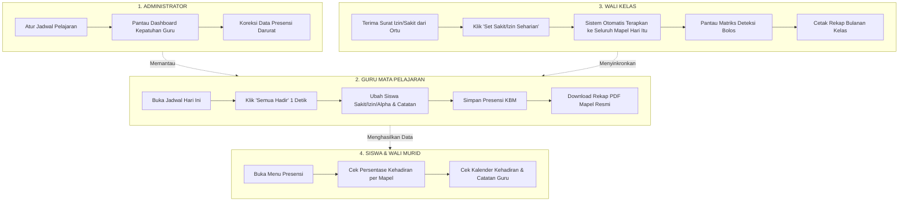

# Panduan Lengkap & Penjelasan Sistem Presensi Kehadiran Siswa
### SD - SMP Islam Al-Azhar Cairo Palembang
*Sistem Informasi Akademik & Portal Pembelajaran Digital (Student Apps)*

---

## 📌 1. Gambaran Umum & Konsep Dasar

Sistem Presensi Siswa di aplikasi **Student Apps Al-Azhar Cairo Palembang** adalah sistem absensi digital modern **berbasis Mata Pelajaran (Per-Mapel KBM)** yang terhubung langsung dengan **Jadwal Pelajaran Sekolah**.

Sebelumnya, absensi hanya dicatat sekali sehari di pagi hari oleh Wali Kelas. Sekarang, sistem telah diperbarui sehingga **setiap guru mata pelajaran mencatat kehadiran siswa di setiap jam pelajarannya**. Hal ini memastikan transparansi penuh, kedisiplinan belajar siswa, dan kemudahan rekapitulasi nilai rapor serta syarat kelayakan asesmen akhir.

### 4 Status Kehadiran Baku:
1. **Hadir (H)**: Siswa hadir dan mengikuti kegiatan belajar mengajar (KBM).
2. **Sakit (S)**: Siswa tidak hadir karena sakit (disertai surat dokter / kabar orang tua).
3. **Izin (I)**: Siswa tidak hadir karena alasan keluarga/syar'i yang telah disetujui.
4. **Alpha (A)**: Siswa tidak hadir tanpa keterangan yang jelas (*unexcused absence*).

---

## ⚙️ 2. Cara Kerja Sistem di Balik Layar (Sederhana & Mudah Dipahami)

1. **Terhubung Otomatis dengan Jadwal Pelajaran**:
   - Sistem membaca hari ini hari apa (*Senin, Selasa, dst.*).
   - Saat guru membuka menu presensi, sistem langsung menampilkan daftar kelas dan mata pelajaran yang **harus diajar guru tersebut hari ini** beserta jam mulainya.
2. **Kunci Data Anti Tumpang-Tindih (`[user_id, mapel_id, date]`)**:
   - Di database, satu siswa hanya memiliki **satu status kehadiran per mata pelajaran pada tanggal yang sama**.
   - Ini memungkinkan seorang siswa berstatus *"Hadir"* di jam Matematika pagi, namun tercatat *"Sakit/Izin ke UKS"* di jam IPA siang.
3. **Penyimpanan Cepat & Aman (Batch Transaksional)**:
   - Ketika guru menekan tombol **"Simpan Presensi"**, seluruh data 25–30 siswa di kelas tersebut disimpan sekaligus secara aman (*atomic transaction*). Jika koneksi internet terputus di tengah jalan, data tidak akan rusak atau tersimpan sebagian.

---

## 👥 3. Alur Kerja (Workflow) & Fitur di Masing-Masing Peran

---

### A. Siswa & Orang Tua (Role `siswa`)
Menu: `/siswa/attendance`  
*Fokus: Transparansi kehadiran mandiri dan pemantauan syarat ujian.*

#### Yang Bisa Dilakukan Siswa:
1. **Melihat Kartu Ringkasan Global**:
   - Menampilkan total hari **Hadir**, **Sakit**, **Izin**, **Alpha**, serta **Persentase Kehadiran Keseluruhan**.
2. **Tab Ringkasan Mata Pelajaran**:
   - Melihat daftar seluruh mata pelajaran yang diikuti.
   - Setiap mapel menampilkan jumlah pertemuan yang sudah berjalan dan persentase kehadiran khusus mapel tersebut.
   - **Klik Detail Sesi**: Siswa bisa mengklik kartu mata pelajaran untuk melihat tanggal pertemuan, jam ke berapa, nama guru pengajar, status kehadiran, dan catatan khusus dari guru.
3. **Tab Kalender Interaktif**:
   - Menampilkan kalender bulanan dengan tanda titik warna sesuai status (🟢 Hijau = Hadir, 🔵 Biru = Sakit, 🟡 Kuning = Izin, 🔴 Merah = Alpha).
   - Klik tanggal manapun untuk melihat daftar pelajaran apa saja yang diikuti pada tanggal tersebut.
4. **Tab Riwayat & Log Lengkap**:
   - Tabel riwayat catatan absensi kronologis.
   - Dilengkapi filter status (*Semua / Hadir / Sakit / Izin / Alpha*) dan kolom pencarian (*cari nama mapel, nama guru, atau catatan guru*).

---

### B. Guru Mata Pelajaran (Role `guru`, Status `"2"` atau `"4"`)
Menu: `/guru/attendance`  
*Fokus: Efisiensi pencatatan kehadiran saat KBM berlangsung tanpa membuang waktu mengajar.*

#### Yang Bisa Dilakukan Guru Mapel:
1. **Melihat Jadwal Mengajar Hari Ini**:
   - Begitu membuka halaman presensi, langsung terlihat kartu jadwal KBM hari ini (contoh: *Kelas 7A • 07.30 - 08.50 • Matematika*).
   - Jadwal yang **Belum Diabsen** ditandai badge oranye kedip.
   - Jadwal yang **Sudah Diabsen** ditandai badge hijau lengkap dengan ringkasan jumlah siswa Hadir, Sakit, Izin, dan Alpha.
2. **Form Presensi Cepat (Selesai dalam 15–20 Detik)**:
   - **Tombol Sakti "Semua Hadir"**: Cukup 1 klik, seluruh siswa rombel langsung tersetel berstatus Hadir.
   - **Penyesuaian Mudah**: Guru hanya perlu mengubah 1–2 siswa yang tidak masuk menjadi Sakit, Izin, atau Alpha.
   - **Kolom Catatan Guru**: Bisa menulis keterangan tambahan per siswa (misal: *"Terlambat 15 menit"*, *"Izin ke UKS pukul 08.15"*).
   - **Pencarian Siswa**: Memudahkan mencari nama atau NIS siswa di kelas berkapasitas besar.
   - **Hapus / Reset Absen**: Jika terjadi salah input tanggal atau kelas, catatan absensi sesi tersebut bisa dihapus kembali.
3. **Shortcut Kelas & Mapel Lain**:
   - Guru tetap bisa mengabsen kelas atau mapel lain di luar jadwal hari ini jika mengajar kelas pengganti (inval).
4. **Rekapitulasi Presensi & Export PDF Resmi (`/guru/attendance/recap`)**:
   - Memilih bulan, tahun, kelas, dan mata pelajaran.
   - Sistem otomatis menghitung total Hadir, Sakit, Izin, Alpha, dan persentase kehadiran setiap siswa.
   - **Tombol Cetak PDF Resmi (A4 Landscape)**: Menghasilkan berkas PDF siap cetak dengan kop surat resmi SD/SMP Islam Al-Azhar Cairo Palembang, tabel terstruktur, dan tanda tangan guru pengampu.

---

### C. Guru & Wali Kelas (Role `guru`, Status `"4"`)
Menu: `/guru/attendance` & `/guru/attendance/matrix`  
*Fokus: Pengawasan menyeluruh atas rombel binaan, penegakan adab disiplin, dan koordinasi dengan orang tua siswa.*

Wali Kelas memiliki semua hak akses Guru Mapel di atas, **ditambah menu khusus perwalian**:

#### Yang Bisa Dilakukan Wali Kelas:
1. **Supervisi Matriks Kelas Binaan (`/guru/attendance/matrix`)**:
   - Menampilkan tabel matriks yang membentang dari jam pelajaran pertama sampai jam terakhir pada hari tersebut untuk seluruh siswa di kelasnya.
   - Wali kelas bisa melihat status siswa di setiap mata pelajaran beserta nama guru yang mengabsen.
2. **Fitur Sakti "1-Click Set Izin / Sakit Seharian"**:
   - **Masalah nyata**: Orang tua siswa mengirimkan pesan WhatsApp / surat dokter di pagi hari bahwa anaknya sakit.
   - **Solusi sistem**: Wali Kelas cukup klik nama siswa di tabel supervisi, pilih status *Sakit/Izin*, tulis catatan (misal: *"Surat dokter dari orang tua"*), lalu klik Simpan.
   - **Hasil**: Sistem secara otomatis menyetel status *Sakit/Izin* ke **seluruh jadwal mata pelajaran** siswa tersebut pada hari itu! Guru mapel di jam-jam berikutnya tidak perlu bingung mencari tahu kenapa siswa tidak masuk.
3. **Deteksi Otomatis Siswa Bolos (*Truancy Detection*)**:
   - Sistem otomatis menganalisis baris kehadiran siswa:
     - Jika siswa berstatus **Hadir** di jam pagi tetapi **Alpha** di jam siang tanpa izin, status keseluruhan siswa otomatis ditandai badge merah: **"Bolos Terdeteksi"**.
     - Ini memudahkan Wali Kelas segera memanggil atau menindaklanjuti siswa bersangkutan.
4. **Tabel Spreadsheet Bulanan Tanggal 1 s.d. 31 (`/guru/attendance/table/[date]`)**:
   - Tampilan matriks satu bulan penuh dengan inisial **H** (Hadir), **S** (Sakit), **I** (Izin), dan **A** (Alpha).
   - Memudahkan melihat pola siswa yang sering izin di hari tertentu atau sering sakit berturut-turut.
5. **Cetak Rekap Presensi Rombel & Matriks Tanggal 1–31 (`/guru/attendance/recap`)**:
   - **Mode Khusus Wali Kelas**: Opsi `"⭐ Rekap Harian Kelas Rombel (Wali Kelas)"` yang secara otomatis mengonsolidasikan data kehadiran per hari masuk sekolah (*1 tanggal = 1 status*).
   - **Tombol Ekspor 1: "Export Rekap Rapor (A4)"**: Menghasilkan dokumen rekapitulasi kehadiran bulanan berisi kolom Hadir, Sakit, Izin, Alpha, Total Hari Masuk, dan % Kehadiran beserta tanda tangan resmi Nama & NIY Wali Kelas.
   - **Tombol Ekspor 2: "Export Matriks 1-31 (A4)"**: Menghasilkan lembar presensi bulanan lengkap dengan kotak tanggal 1 s.d. 31 format spreadsheet A4 Landscape untuk arsip yayasan dan pengawas sekolah.

---

### D. Administrator (Role `admin`)
Menu: `/admin/attendance`  
*Fokus: Audit kepatuhan dewan guru, kontrol operasional sekolah, dan integritas data.*

#### Yang Bisa Dilakukan Administrator:
1. **Dashboard Audit & Kepatuhan Presensi**:
   - **Metrik Utama (KPI Sekolah)**:
     - Total sesi jam KBM yang terjadwal hari ini di sekolah.
     - Berapa sesi KBM yang sudah diabsen oleh guru.
     - Berapa sesi KBM yang belum diabsen oleh guru.
     - **Tingkat Kepatuhan Guru (*Compliance Rate %*)**.
     - Total agregat siswa yang Hadir, Sakit, Izin, dan Alpha di seluruh sekolah pada hari ini.
2. **Filter Fleksibel**:
   - Memfilter pantauan berdasarkan **Jenjang (SD / SMP)**, **Tingkat Kelas (Kelas 1–9)**, dan **Tanggal**.
3. **Audit Sesi Mengajar Guru**:
   - Admin dapat melihat tabel detail: Nama Guru, NIY, Mata Pelajaran, Kelas, Jam Pelajaran, dan status pengisian absensinya.
   - Memudahkan Kepala Sekolah atau Tim Kurikulum menegur guru yang terlambat atau lupa mengisi absensi kelas.
4. **Koreksi Administratif Presensi Darurat**:
   - Admin dapat mengoreksi catatan presensi seorang siswa secara individual melalui sistem jika terjadi kesalahan input atau revisi surat izin resmi dari pihak yayasan.

---

## 🧮 4. Rumus & Cara Perhitungan di Sistem

### 1. Persentase Kehadiran per Mata Pelajaran (Syarat Ujian Siswa)
Dihitung berdasarkan jumlah sesi KBM mapel yang sudah dilaksanakan:
$$\text{Persentase Kehadiran Mapel} = \left( \frac{\text{Total Hadir}}{\text{Total Hadir} + \text{Sakit} + \text{Izin} + \text{Alpha}} \right) \times 100\%$$

> **Contoh**:
> Di mapel Matematika sudah berjalan 20 kali pertemuan. Seorang siswa hadir 18 kali, izin 1 kali, dan sakit 1 kali:
> $$\text{Persentase} = \left( \frac{18}{18 + 1 + 1 + 0} \right) \times 100\% = \left( \frac{18}{20} \right) \times 100\% = 90\%$$
> *(Siswa memenuhi syarat minimal kehadiran 80% untuk mengikuti ujian).*

---

### 2. Persentase Kehadiran Global Siswa (Rapor Semester)
Dihitung dari akumulasi seluruh jam pelajaran yang tercatat:
$$\text{Persentase Kehadiran Keseluruhan} = \left( \frac{\text{Total Seluruh Hadir}}{\text{Total Seluruh Record (H + S + I + A)}} \right) \times 100\%$$

---

### 3. Tingkat Kepatuhan Pengisian Guru (*Compliance Rate* untuk Admin)
Mengukur seberapa tertib dewan guru dalam mengisi jurnal/absensi setiap jam KBM hari ini:
$$\text{Compliance Rate} = \left( \frac{\text{Jumlah Sesi Jadwal yang Sudah Diabsen}}{\text{Total Sesi Jadwal KBM Terjadwal Hari Ini}} \right) \times 100\%$$

> **Contoh**:
> Hari Selasa terdapat total 40 sesi jam pelajaran di SD Al-Azhar. Hingga siang hari, guru telah mengabsen 36 sesi:
> $$\text{Compliance Rate} = \left( \frac{36}{40} \right) \times 100\% = 90\%$$

---

### 4. Logika Deteksi Disiplin Siswa (Supervisi Wali Kelas)
Sistem secara otomatis memberikan status harian per siswa:
* 🟢 **"Lengkap"**: Semua jam pelajaran siswa hari ini sudah diisi guru dan dihadiri dengan tertib.
* 🔴 **"Bolos Terdeteksi"**: Ditemukan siswa berstatus **Alpha** pada salah satu mapel, padahal di mapel lain pada hari yang sama ia berstatus **Hadir** atau **Izin**.
* 🔵 **"Sakit Seharian"**: Seluruh jam mapel hari ini berstatus Sakit.
* 🟡 **"Izin Seharian"**: Seluruh jam mapel hari ini berstatus Izin.
* ⚪ **"Belum Lengkap"**: Masih ada jam KBM di siang/sore hari yang belum selesai diabsen oleh guru mapel bersangkutan.

---

### 5. Aturan Konsolidasi Harian Rekap Rombel (Kehadiran Fisik Sekolah - Standar Rapor & Dinas)
Pada mode **Rekap Harian Kelas Rombel**, status harian siswa dihitung berdasarkan **kehadiran fisik di sekolah**:
1. **Alpha Mutlak (Prioritas Tertinggi)**: Jika ada **Alpha** pada salah satu jam pelajaran (membolos tanpa izin), siswa dicatat **Alpha (A)** pada hari tersebut.
2. **Kehadiran Fisik Masuk Sekolah**: Jika siswa sudah **Hadir** di KBM pagi lalu izin pulang karena Sakit/Izin resmi di tengah hari, hari tersebut tetap dicatat **Hadir (H)** di buku rekap kelas karena siswa terbukti masuk sekolah.
3. **Sakit Seharian**: Jika siswa tidak hadir di sekolah sejak pagi dan seluruh mapel berstatus Sakit &rarr; dicatat **Sakit (S)**.
4. **Izin Seharian**: Jika siswa tidak hadir di sekolah sejak pagi dan seluruh mapel berstatus Izin &rarr; dicatat **Izin (I)**.

---

## 📋 5. Tabel Perbandingan Hak Akses Pengguna

| Fitur / Kemampuan | Siswa | Guru Mapel | Wali Kelas | Admin |
| :--- | :---: | :---: | :---: | :---: |
| Memantau Statistik Kehadiran Pribadi | ✅ | ❌ | ❌ | ❌ |
| Membaca Catatan & Feedback Guru | ✅ | ❌ | ❌ | ❌ |
| Kalender Kehadiran Pribadi Bulanan | ✅ | ❌ | ❌ | ❌ |
| Mengisi Absen Jam Pelajaran yang Diajar | ❌ | ✅ | ✅ | ❌ |
| Tombol Cepat 1-Click "Semua Hadir" | ❌ | ✅ | ✅ | ❌ |
| Menulis Catatan Keterangan per Siswa | ❌ | ✅ | ✅ | ✅ |
| Cetak Rekapitulasi Presensi Mapel PDF (A4) | ❌ | ✅ | ✅ | ✅ |
| Memantau Matriks Supervisi Lintas Mapel | ❌ | ❌ | ✅ | ✅ |
| Fitur 1-Click Set Sakit/Izin Seharian | ❌ | ❌ | ✅ | ❌ |
| Tabel Spreadsheet Bulanan (Tgl 1–31) | ❌ | ❌ | ✅ | ❌ |
| Dashboard Audit Kepatuhan Guru Sekolah | ❌ | ❌ | ❌ | ✅ |
| Memfilter Data per Jenjang (SD / SMP) | ❌ | ❌ | ❌ | ✅ |
| Koreksi Administratif Data Presensi | ❌ | ❌ | ❌ | ✅ |

---

## 🎭 6. Contoh Skenario Nyata di Sekolah

### Skenario 1: Guru Masuk Mengajar di Kelas
1. Ustadz Ahmad masuk ke kelas 8A untuk jam pelajaran Bahasa Arab (pukul 08.50 WIB).
2. Beliau membuka HP, masuk ke `/guru/attendance`, lalu menekan tombol **"Mulai Presensi"** pada kartu jadwal Bahasa Arab 8A.
3. Beliau menekan tombol **"Semua Hadir"**. 28 siswa langsung otomatis tercentang Hadir.
4. Terlihat ananda Farhan tidak ada di kelas dan temannya mengabarkan Farhan sedang di UKS. Ustadz Ahmad mengubah status Farhan menjadi **Sakit** dan menulis catatan *"Istirahat di UKS"*.
5. Ustadz Ahmad menekan **"Simpan Presensi"**. Proses absensi selesai dalam waktu **15 detik**.

### Skenario 2: Orang Tua Siswa Mengabari Izin Sakit di Pagi Hari
1. Pukul 06.45 WIB, orang tua ananda Aisyah menghubungi Wali Kelas via WhatsApp bahwa Aisyah demam dan beristirahat di rumah.
2. Wali Kelas membuka menu **Supervisi Kelas** (`/guru/attendance/matrix`).
3. Wali Kelas mengklik nama Aisyah, memilih opsi **"Sakit"**, lalu menyimpan keterangan *"Izin sakit dari orang tua"*.
4. Seketika itu juga, status ananda Aisyah di seluruh jam pelajaran hari itu (Tahfidz, Matematika, IPA, PAI) langsung tercatat **Sakit**. Guru-guru mapel yang masuk di kelas tidak perlu lagi menanyakan keberadaan Aisyah.

### Skenario 3: Siswa Membolos Jam Terakhir
1. Siswa bernama Budi hadir di kelas dari jam ke-1 sampai jam ke-4.
2. Saat jam pelajaran terakhir (Bahasa Inggris), Budi tidak masuk tanpa kabar. Guru Bahasa Inggris mencatat Budi berstatus **Alpha**.
3. Di dashboard Supervisi Wali Kelas, baris nama Budi langsung memicu badge merah **"Bolos Terdeteksi"**.
4. Wali Kelas langsung mengetahui adanya pelanggaran disiplin dan dapat segera mengonfirmasi ke bagian kesiswaan atau orang tua murid.

