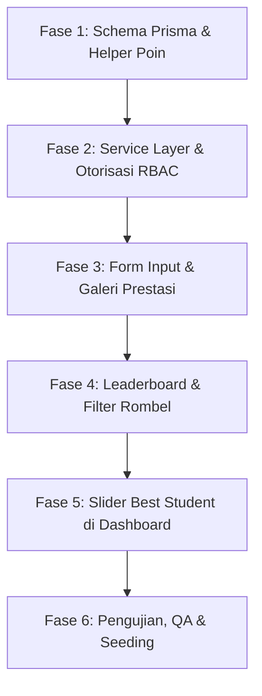

# 🏆 Master Plan — Perombakan Fitur Prestasi Siswa & Leaderboard Poin Al-Azhar Cairo

> **Target Aplikasi**: Student Apps Al-Azhar Cairo (SD & SMP)  
> **Dokumen Rencana**: `plan-update-prestasi.md`  
> **Status**: 📋 DRAFT FINAL SIAP EKSEKUSI  
> **Sistem Poin**: Skala 1–16 (4 Tingkatan × 4 Peringkat Juara)  
> **Database Stack**: Next.js 16 (App Router) + Prisma 7 + MariaDB/MySQL + Tailwind CSS v4 + Framer Motion  

---

## 📑 DAFTAR ISI
1. [Ringkasan Eksekutif & Latar Belakang Perombakan](#1-ringkasan-eksekutif--latar-belakang-perombakan)
2. [Sistem Poin Prestasi (Skala 1–16) & Logika Perhitungan](#2-sistem-poin-prestasi-skala-116--logika-perhitungan)
3. [Matriks Hak Akses & Otorisasi Ketat (RBAC)](#3-matriks-hak-akses--otorisasi-ketat-rbac)
4. [Siklus Hidup Prestasi & Histori Kelas Siswa](#4-siklus-hidup-prestasi--histori-kelas-siswa)
5. [Desain Skema Database & Strategi Migrasi Data](#5-desain-skema-database--strategi-migrasi-data)
6. [Arsitektur Backend, Validasi Zod & Server Actions](#6-arsitektur-backend-validasi-zod--server-actions)
7. [Fitur Leaderboard & Sistem Filter Peringkat](#7-fitur-leaderboard--sistem-filter-peringkat)
8. [Widget Slider Dashboard: Best Student Sekolah & Rombel](#8-widget-slider-dashboard-best-student-sekolah--rombel)
9. [Spesifikasi Tampilan UI/UX & Desain Komponen](#9-spesifikasi-tampilan-uiux--desain-komponen)
10. [Rencana Implementasi Bertahap (Fase 1 – 6)](#10-rencana-implementasi-bertahap-fase-1--6)
11. [Rencana Pengujian, Validasi & Data Seeding](#11-rencana-pengujian-validasi--data-seeding)

---

## 1. Ringkasan Eksekutif & Latar Belakang Perombakan

### 1.1 Masalah pada Sistem Prestasi Saat Ini
Saat ini fitur prestasi siswa di `student-app` memiliki beberapa keterbatasan struktural:
1. **Tidak Ada Standardisasi Poin**: Catatan prestasi hanya berupa teks bebas (`prestasi: string`) tanpa atribut tingkat kejuaraan, peringkat juara, maupun nilai poin terukur.
2. **Ketiadaan Leaderboard**: Belum ada mekanisme penilaian kumulatif yang memungkinkan pemeringkatan siswa berprestasi di tingkat kelas/rombel maupun sekolah.
3. **Pemberian Hak Akses Terlalu Longgar**: Saat ini semua guru (`session.role === "guru"`) termasuk guru mata pelajaran lepas dapat menambah atau mengedit catatan prestasi.
4. **Kehilangan Jejak Histori Kelas**: Ketika siswa naik tingkat kelas (misalnya dari Kelas 4 ke Kelas 5), data kelas pada prestasi lama berpotensi tertimpa atau tidak merefleksikan momen perolehan prestasi di masa lalu.
5. **Kurang Terekspos di Dashboard**: Dashboard siswa dan guru belum memiliki highlight prestasi unggulan (*Best Student*) yang interaktif dan memotivasi siswa.

### 1.2 Tujuan Utama Perombakan
- Mengimplementasikan **Sistem Poin Bertingkat Skala 1–16** yang proporsional, adil, dan transparan.
- Membatasi hak input data secara ketat: **hanya Super Admin, Admin Jenjang (SD/SMP), dan Wali Kelas yang bersangkutan**.
- Memastikan prestasi siswa bersifat **permanen dan kumulatif** sepanjang masa studi siswa di Al-Azhar (sejak masuk hingga lulus), lengkap dengan catatan **kelas saat prestasi diraih**.
- Menyediakan **Leaderboard Interaktif** dengan filter Top per Rombel dan Top Sekolah per Jenjang (SD/SMP).
- Menghadirkan **Dua Slider Modern di Dashboard Siswa & Guru**: *Best Student Sekolah* dan *Best Student Semua Rombel*.
- Menyelaraskan seluruh UI/UX dengan bahasa desain modern Al-Azhar (Dark/Light mode, Glassmorphism, Card Elevation, Islamic Patterns, Micro-interactions).

---

## 2. Sistem Poin Prestasi (Skala 1–16) & Logika Perhitungan

### 2.1 Matriks Poin (4 Tingkatan × 4 Peringkat)
Sistem menggunakan matriks Skala 1 sampai 16 dengan ketentuan bobot sebagai berikut:

| Tingkat Kompetisi | Juara 1 | Juara 2 | Juara 3 | Harapan (Semua Harapan 1/2/3) |
| :--- | :---: | :---: | :---: | :---: |
| **Internasional** | **16 Poin** | **15 Poin** | **14 Poin** | **13 Poin** |
| **Nasional** | **12 Poin** | **11 Poin** | **10 Poin** | **9 Poin** |
| **Daerah / Kota / Provinsi** | **8 Poin** | **7 Poin** | **6 Poin** | **5 Poin** |
| **Dalam Sekolah / Internal** | **4 Poin** | **3 Poin** | **2 Poin** | **1 Poin** |

> [!NOTE]
> **Aturan Juara Harapan**:  
> Seluruh tingkatan Juara Harapan (baik Harapan 1, Harapan 2, Harapan 3, maupun Honorable Mention/Apresiasi Khusus) disederhanakan dan dikelompokkan ke dalam satu kolom **"Harapan"** guna menjaga kesederhanaan operasional dan kepastian input.

### 2.2 Filosofi Keadilan Sistem Poin
1. **Hierarki Kompetisi Selalu Unggul**:
   Tingkat kompetisi yang lebih tinggi selalu memiliki apresiasi lebih besar dibandingkan kompetisi di bawahnya.
   - Siswa peraih *Juara Harapan tingkat Daerah/Kota* (**5 Poin**) memiliki poin lebih tinggi daripada *Juara 1 tingkat Dalam Sekolah* (**4 Poin**).
   - Siswa peraih *Juara Harapan tingkat Nasional* (**9 Poin**) memiliki poin lebih tinggi daripada *Juara 1 tingkat Daerah/Kota* (**8 Poin**).
   - Siswa peraih *Juara Harapan tingkat Internasional* (**13 Poin**) memiliki poin lebih tinggi daripada *Juara 1 tingkat Nasional* (**12 Poin**).
2. **Metode Akumulasi Sederhana (Additive Calculation)**:
   Total poin siswa dihitung murni dengan penjumlahan aritmatika dari seluruh prestasi yang diperoleh:
   $$\text{Total Poin Siswa} = \sum_{i=1}^{n} \text{Poin Prestasi}_i$$

**Contoh Simulasi Perhitungan**:
- Siswa **Ahmad** (Kelas 4):
  - Harapan 2 Olimpiade Sains Nasional (Nasional - Harapan) = **9 Poin**
  - Juara 2 Lomba Tahfidz Tingkat Kota (Daerah/Kota - Juara 2) = **7 Poin**
  - Juara 1 Cerdas Cermat Milad Sekolah (Dalam Sekolah - Juara 1) = **4 Poin**
  - **Total Poin Ahmad** = $9 + 7 + 4 =$ **20 Poin**

---

## 3. Matriks Hak Akses & Otorisasi Ketat (RBAC)

Sesuai arahan, hak istimewa untuk menginput dan mengelola prestasi dibatasi secara tegas di level server dan antarmuka.

### 3.1 Tabel Matriks Wewenang

| Peran Pengguna (Role) | Status User | Cakupan Akses Prestasi | Tambah Prestasi | Edit / Hapus Prestasi | Melihat Leaderboard |
| :--- | :---: | :--- | :---: | :---: | :---: |
| **Super Admin** | `3` (`jenjang = "ALL"`) | Seluruh Siswa (SD & SMP) | ✅ Ya (Semua) | ✅ Ya (Semua) | ✅ Ya (Semua Jenjang) |
| **Admin SD** | `3` (`jenjang = "SD"`) | Khusus Siswa Jenjang SD | ✅ Ya (SD Saja) | ✅ Ya (SD Saja) | ✅ Ya (SD Saja) |
| **Admin SMP** | `3` (`jenjang = "SMP"`) | Khusus Siswa Jenjang SMP | ✅ Ya (SMP Saja) | ✅ Ya (SMP Saja) | ✅ Ya (SMP Saja) |
| **Wali Kelas** | `4` (`kelas = "..."`) | **Hanya Siswa Rombel Binaan** | ✅ Ya (Kelas Sendiri) | ✅ Ya (Kelas Sendiri) | ✅ Ya (Rombel & Jenjang) |
| **Guru Biasa / Mapel** | `2` | Semua Siswa di Jenjang Terkait | ❌ Tidak | ❌ Tidak | ✅ Ya (Read-Only) |
| **Siswa / Siswa** | `1` | Diri Sendiri & Publik | ❌ Tidak | ❌ Tidak | ✅ Ya (Read-Only) |

### 3.2 Penegakan Aturan Keamanan (Security Enforcement)
1. **Validasi Server-Side**:
   Setiap Server Action (`createAchievementAction`, `updateAchievementAction`, `deleteAchievementAction`) wajib memanggil fungsi verifikasi otorisasi:
   - Jika pemanggil adalah Guru dengan status `2` (bukan `4` / bukan wali kelas): langsung lemparkan *Error 403: Akses ditolak*.
   - Jika pemanggil adalah Wali Kelas (status `4`): periksa apakah siswa target terdaftar di kelas binaan wali kelas tersebut (`siswa.kelas === session.kelas`).
   - Jika pemanggil adalah Admin Jenjang: periksa kesesuaian jenjang siswa (`siswa.jenjang === session.jenjang`).
2. **Kondisional UI**:
   - Tombol **"Catat Prestasi Baru"**, icon **Edit**, dan icon **Hapus** disembunyikan secara kondisional bagi pengguna yang tidak memiliki otorisasi.
   - Dropdown pemilihan siswa pada form input secara otomatis hanya menampilkan daftar siswa yang menjadi hak kelola user yang sedang aktif.

---

## 4. Siklus Hidup Prestasi & Histori Kelas Siswa

### 4.1 Prinsip Rekam Jejak Seumur Hidup Siswa
- Catatan prestasi **terikat langsung pada akun siswa** (`id_user` / NIS), bukan sekadar terikat pada nama kelas sementara.
- Ketika siswa mengalami kenaikan kelas (misal dari Kelas 4 ke Kelas 5, atau Kelas 7 ke Kelas 8):
  - Akumulasi total poin **tetap berlanjut dan tidak direset** dari awal masuk sekolah hingga siswa lulus.
  - Prestasi terdahulu tetap mengabadikan informasi historis: **"Diraih saat duduk di Kelas berapa"**.

### 4.2 Pelacakan Kelas Historis (`kelas_saat_prestasi`)
Pada form input prestasi, ditambahkan field khusus:
- **`kelas_saat_prestasi`**: Menyimpan tingkat kelas saat kompetisi dimenangkan (contoh: `"Kelas 4"`, `"Kelas 5"`, `"Kelas 7"`).
- **Default Value Otomatis**: Sistem secara cerdas mendeteksi rombel aktif siswa saat ini (misal: `"Kelas 4 - Mehmed Al Fatih"` $\rightarrow$ diekstrak menjadi `"Kelas 4"`), namun tetap memberikan keleluasaan bagi Wali Kelas/Admin untuk menyesuaikannya jika prestasi yang diinput merupakan prestasi masa lampau yang baru dilaporkan.
- **Tahun Ajaran**: Menyimpan konteks tahun akademik perolehan (contoh: `"2025/2026"`).

---

## 5. Desain Skema Database & Strategi Migrasi Data

### 5.1 Pembaruan Model Prisma (`prisma/schema.prisma`)
Tabel `tb_prestasi` diperluas dengan kolom-kolom baru tanpa merusak data lama yang telah tersimpan.

```prisma
model Prestasi {
  id                  BigInt    @id @default(autoincrement()) @db.UnsignedBigInt
  id_user             String    @db.VarChar(255) // Relasi ke ID akun siswa
  nama                String    @db.VarChar(255) // Nama lengkap siswa
  kelas               String    @db.VarChar(255) // Nama rombel aktif saat input
  kelas_saat_prestasi String?   @map("kelas_saat_prestasi") @db.VarChar(100) // Waktu perolehan (misal: "Kelas 4")
  tahun_ajaran        String?   @map("tahun_ajaran") @db.VarChar(30) // Contoh: "2025/2026"
  tingkat             String    @default("Dalam Sekolah") @db.VarChar(50) // "Internasional" | "Nasional" | "Daerah/Kota" | "Dalam Sekolah"
  peringkat           String    @default("Juara 1") @db.VarChar(50) // "Juara 1" | "Juara 2" | "Juara 3" | "Harapan"
  poin                Int       @default(1) // Skala 1 - 16
  fotoanak            String    @db.VarChar(255) // URL foto piagam / dokumentasi piala
  prestasi            String    @db.VarChar(255) // Nama perlombaan / bidang kejuaraan
  jenjang             String?   @default("SD") @db.VarChar(10) // "SD" | "SMP"
  tanggal_prestasi    DateTime? @map("tanggal_prestasi") @db.Date // Tanggal kejuaraan (opsional)
  created_at          DateTime? @db.Timestamp(0)
  updated_at          DateTime? @updatedAt @db.Timestamp(0)

  @@index([id_user])
  @@index([kelas])
  @@index([jenjang])
  @@index([tingkat])
  @@index([peringkat])
  @@index([poin])
  @@map("tb_prestasi")
}
```

### 5.2 Strategi Migrasi Data & Kompatibilitas Mundur (Backwards Compatibility)
1. **Nilai Default Aman**: Kolom baru diberikan `@default` atau nilai *nullable* sehingga tabel yang sudah memiliki data existing tidak akan mengalami error integritas schema.
2. **Skrip Migrasi Data Lama (`scripts/migrate-prestasi-data.ts`)**:
   - Membaca seluruh data prestasi lama yang belum memiliki nilai `poin` atau `tingkat`.
   - Menggunakan parser cerdas untuk mendeteksi kata kunci dari judul prestasi lama (misal: "Nasional", "Juara 1", "Kota", dll.) untuk mengisi `tingkat` dan `peringkat` awal.
   - Menghitung dan menyimpan nilai `poin` (1–16) secara otomatis.
   - Mengambil informasi jenjang dari kelas siswa terkait di `tbl_kelas` atau `users`.

---

## 6. Arsitektur Backend, Validasi Zod & Server Actions

### 6.1 Matriks Lookup Poin & Helper Utilitas (`src/lib/achievement-points.ts`)
```typescript
export const TINGKAT_PRESTASI = [
  "Internasional",
  "Nasional",
  "Daerah/Kota",
  "Dalam Sekolah",
] as const;

export type TingkatPrestasi = typeof TINGKAT_PRESTASI[number];

export const PERINGKAT_PRESTASI = [
  "Juara 1",
  "Juara 2",
  "Juara 3",
  "Harapan",
] as const;

export type PeringkatPrestasi = typeof PERINGKAT_PRESTASI[number];

export const ACHIEVEMENT_POINTS_MATRIX: Record<TingkatPrestasi, Record<PeringkatPrestasi, number>> = {
  "Internasional": {
    "Juara 1": 16,
    "Juara 2": 15,
    "Juara 3": 14,
    "Harapan": 13,
  },
  "Nasional": {
    "Juara 1": 12,
    "Juara 2": 11,
    "Juara 3": 10,
    "Harapan": 9,
  },
  "Daerah/Kota": {
    "Juara 1": 8,
    "Juara 2": 7,
    "Juara 3": 6,
    "Harapan": 5,
  },
  "Dalam Sekolah": {
    "Juara 1": 4,
    "Juara 2": 3,
    "Juara 3": 2,
    "Harapan": 1,
  },
};

export function getAchievementPoints(tingkat: TingkatPrestasi, peringkat: PeringkatPrestasi): number {
  return ACHIEVEMENT_POINTS_MATRIX[tingkat]?.[peringkat] ?? 1;
}
```

### 6.2 Skema Validasi Zod (`src/lib/validators/achievement.schema.ts`)
```typescript
import { z } from "zod";
import { TINGKAT_PRESTASI, PERINGKAT_PRESTASI } from "../achievement-points";

export const AchievementFormSchema = z.object({
  id_user: z.string().min(1, "Siswa wajib dipilih"),
  nama: z.string().min(2, "Nama siswa tidak boleh kosong"),
  kelas: z.string().min(1, "Kelas wajib diisi"),
  kelas_saat_prestasi: z.string().min(1, "Tingkat kelas saat juara wajib diisi"),
  tingkat: z.enum(TINGKAT_PRESTASI, { errorMap: () => ({ message: "Pilih tingkat kompetisi yang valid" }) }),
  peringkat: z.enum(PERINGKAT_PRESTASI, { errorMap: () => ({ message: "Pilih peringkat juara yang valid" }) }),
  prestasi: z.string().min(3, "Judul kejuaraan/prestasi minimal 3 karakter"),
  tahun_ajaran: z.string().optional(),
  tanggal_prestasi: z.string().optional(),
  fotoanak: z.string().optional(),
});
```

### 6.3 Layer Server Action dengan Guard Keamanan Terpadu
Dibuat helper guard otorisasi di `src/actions/achievement.ts`:
1. `checkCanManageAchievement(targetStudentId, targetStudentKelas, targetStudentJenjang)`:
   - Memastikan sesi valid.
   - Super Admin $\rightarrow$ lolos semua.
   - Admin SD / SMP $\rightarrow$ verifikasi jenjang siswa.
   - Wali Kelas $\rightarrow$ verifikasi kecocokan kelas siswa dengan kelas wali.
   - Peran lain $\rightarrow$ tolak eksekusi dengan pesan informatif.
2. `createAchievementAction(formData)`: Memvalidasi payload, menghitung poin otomatis di server, mengupload foto via `saveUploadedFile`, menyimpan record, dan melakukan revalidasi path cache (`/guru/achievements`, `/admin/achievements`, `/guru`, `/siswa`).
3. `updateAchievementAction(id, formData)`: Memverifikasi hak akses terhadap record lama dan data baru sebelum melakukan update.
4. `deleteAchievementAction(id)`: Memastikan record hanya bisa dihapus oleh pihak yang berwenang.

---

## 7. Fitur Leaderboard & Sistem Filter Peringkat

### 7.1 Konsep Leaderboard Kumulatif & Desain UI
Leaderboard mengagregasikan poin setiap siswa secara real-time / cached dengan arsitektur modular:
- **Metrik Utama**: Total Poin Kumulatif ($1 - 16$ per prestasi).
- **Format UI Modern**: Mengadopsi arsitektur **`LeaderboardCard`**, **`LeaderboardPodium`**, dan **`LeaderboardRankings`** dengan dukungan filter run option (*Top Sekolah* vs *Top per Rombel*), rentang tanggal/periode akademik, penyorotan siswa aktif (`currentUserId`), dan paginasi ranking.

### 7.2 Struktur Komponen UI Leaderboard (`src/components/ui/leaderboard-card.tsx`)

Berikut adalah komponen inti `LeaderboardCard` yang menjadi standar antarmuka leaderboard prestasi:

```tsx
// --- src/components/ui/leaderboard-card.tsx ---
"use client"

import * as React from "react"
import { cn } from "@/lib/utils"
import {
  LeaderboardPodium,
  type LeaderboardRanking as LeaderboardPodiumRanking,
} from "@/components/ui/leaderboard-podium"
import {
  LeaderboardRankings,
  type LeaderboardRankingItem,
} from "@/components/ui/leaderboard-rankings"

interface LeaderboardRunOption {
  id: string
  label: string
}

interface LeaderboardCardProps extends React.HTMLAttributes<HTMLDivElement> {
  title?: string
  fromDate: string | Date
  toDate: string | Date
  podiumRankings: LeaderboardPodiumRanking[]
  rankings: LeaderboardRankingItem[]
  currentUserId?: string
  runOptions?: LeaderboardRunOption[]
  selectedRunId?: string
  onRunChange?: (runId: string) => void
}

function formatRangeDate(date: string | Date) {
  const parsed = date instanceof Date ? date : new Date(date)
  if (Number.isNaN(parsed.getTime())) return ""

  return parsed.toLocaleDateString("id-ID", {
    month: "short",
    day: "numeric",
    year: "numeric",
  })
}

const LeaderboardCard = React.forwardRef<HTMLDivElement, LeaderboardCardProps>(
  (
    {
      className,
      title = "Leaderboard Siswa Berprestasi",
      fromDate,
      toDate,
      podiumRankings,
      rankings,
      currentUserId,
      runOptions,
      selectedRunId,
      onRunChange,
      ...props
    },
    ref
  ) => {
    const fromLabel = formatRangeDate(fromDate)
    const toLabel = formatRangeDate(toDate)
    const resolvedRunId = selectedRunId ?? runOptions?.[0]?.id ?? ""
    const hasOnRunChange = Boolean(onRunChange)
    const [localRunId, setLocalRunId] = React.useState(resolvedRunId)

    React.useEffect(() => {
      if (hasOnRunChange) return
      setLocalRunId(resolvedRunId)
    }, [hasOnRunChange, resolvedRunId])

    const activeRunId = hasOnRunChange ? resolvedRunId : localRunId

    return (
      <div
        ref={ref}
        className={cn("bg-card rounded-2xl border p-6 shadow-sm", className)}
        {...props}
      >
        <div className="mb-6 flex flex-col sm:flex-row sm:items-start sm:justify-between gap-4">
          <div className="space-y-1">
            <h3 className="text-xl font-bold tracking-tight text-foreground">{title}</h3>
            <p className="text-muted-foreground text-sm font-medium">
              Periode: {fromLabel} – {toLabel}
            </p>
          </div>

          {runOptions && runOptions.length > 0 ? (
            <div className="flex items-center gap-2">
              <span className="text-xs font-semibold text-muted-foreground hidden sm:inline">Filter:</span>
              <select
                aria-label="Select leaderboard run"
                value={activeRunId}
                onChange={(e) => {
                  if (onRunChange) {
                    onRunChange(e.target.value)
                    return
                  }
                  setLocalRunId(e.target.value)
                }}
                className="bg-background text-foreground rounded-lg border border-input px-3 py-1.5 text-sm font-medium shadow-xs focus:outline-none focus:ring-2 focus:ring-amber-500/20 cursor-pointer"
              >
                {runOptions.map((option) => (
                  <option key={option.id} value={option.id}>
                    {option.label}
                  </option>
                ))}
              </select>
            </div>
          ) : null}
        </div>

        {/* Podium Top 3 Siswa Juara */}
        <LeaderboardPodium rankings={podiumRankings} className="mb-6" />

        {/* Daftar Peringkat Lengkap dengan Highlight Siswa Aktif & Paginasi */}
        <LeaderboardRankings
          rankings={rankings}
          currentUserId={currentUserId}
          showPagination
          defaultPageSize={10}
        />
      </div>
    )
  }
)

LeaderboardCard.displayName = "LeaderboardCard"

export { LeaderboardCard }
export type { LeaderboardCardProps, LeaderboardRunOption }
```

### 7.3 Komponen Pendukung: `LeaderboardPodium` & `LeaderboardRankings`

1. **`src/components/ui/leaderboard-podium.tsx`**:
   - Menampilkan podium 3 pilar:
     - **Pilar Kiri**: Juara 2 (Perak / Silver 🥈) — tinggi pilar sedang.
     - **Pilar Tengah**: Juara 1 (Emas / Gold 🥇) — pilar tertinggi, mahkota/piala emas, efek kilau glowing.
     - **Pilar Kanan**: Juara 3 (Perunggu / Bronze 🥉) — tinggi pilar lebih rendah.
   - Setiap pilar memuat: Avatar siswa (dengan fallback avatar Al-Azhar), Nama Lengkap, Byline Rombel (misal: `"Kelas 4 - Mehmed Al Fatih"`), dan Total Poin besar (misal: `44 Poin`).
   - Tipe data `LeaderboardRanking`:
     ```typescript
     export interface LeaderboardRanking {
       userId: string;
       userName: string;
       rank: number;
       value: number | string;
       avatarUrl?: string | null;
       gender?: string | null;
       byline?: string;
     }
     ```

2. **`src/components/ui/leaderboard-rankings.tsx`**:
   - Menampilkan tabel list seluruh siswa:
     - Badge ranking angka (#1, #2, #3 bergaya medali; #4+ badge netral).
     - Avatar siswa, nama siswa, dan byline pencapaian (misal: `"Kelas 4 - Mehmed • 4 Prestasi"`).
     - Nilai akumulasi poin di sisi kanan (misal: `"44 Poin"`).
     - **Fitur Highlight `currentUserId`**: Jika siswa yang sedang login melihat leaderboard, baris miliknya disorot khusus dengan badge *"Anda"*, border aksen emerald/amber, dan efek latar lembut sehingga siswa langsung mengetahui peringkatnya.
     - **Paginasi Interaktif**: Mendukung `showPagination` dan `defaultPageSize={10}` untuk menjaga performa rendering jika terdapat puluhan hingga ratusan siswa.
   - Tipe data `LeaderboardRankingItem`:
     ```typescript
     export interface LeaderboardRankingItem {
       userId: string;
       rank: number;
       userName: string;
       byline?: string;
       value: number | string;
       avatarUrl?: string | null;
       gender?: string | null;
       displayed?: boolean;
     }
     ```

### 7.4 Pemetaan Data Nyata & Penggunaan Filter `runOptions`
Dropdown `runOptions` pada `LeaderboardCard` memetakan filter cakupan secara dinamis:
- **`all-school`**: Menampilkan Top Peringkat Sekolah (semua rombel dalam jenjang SD atau SMP).
- **`rombel-<id>`**: Menampilkan Top Peringkat khusus per rombel (misal: `Kelas 4 - Mehmed Al Fatih`, `Kelas 4 - Sayfuddin Al Quthuz`, `Kelas 5 - Al Bukhari`, dst.).

**Contoh Penerapan Nyata (Real Usage Implementation)**:
```tsx
// Contoh Pemanggilan di src/app/(dashboard)/guru/achievements atau admin
<LeaderboardCard
  title="Papan Peringkat Prestasi Siswa SD Al-Azhar"
  fromDate="2025-07-15"
  toDate="2026-06-20"
  currentUserId={session.id}
  selectedRunId={selectedFilterId}
  onRunChange={(runId) => setSelectedFilterId(runId)}
  runOptions={[
    { id: "all-school", label: "Top Sekolah (Semua Rombel SD)" },
    { id: "rombel-4-mehmed", label: "Kelas 4 - Mehmed Al Fatih" },
    { id: "rombel-4-sayfuddin", label: "Kelas 4 - Sayfuddin Al Quthuz" },
    { id: "rombel-5-bukhari", label: "Kelas 5 - Al Bukhari" },
  ]}
  podiumRankings={[
    { userId: "19", userName: "Muhammad Rayhan Al-Fatih", rank: 1, value: 44, byline: "Kelas 4 Mehmed" },
    { userId: "22", userName: "Zahra Amira Salsabila", rank: 2, value: 31, byline: "Kelas 4 Mehmed" },
    { userId: "25", userName: "Khalid bin Walid Al-Ghazi", rank: 3, value: 28, byline: "Kelas 4 Mehmed" },
  ]}
  rankings={[
    { userId: "19", rank: 1, userName: "Muhammad Rayhan Al-Fatih", byline: "Kelas 4 Mehmed • 4 Medali", value: 44, displayed: true },
    { userId: "22", rank: 2, userName: "Zahra Amira Salsabila", byline: "Kelas 4 Mehmed • 3 Medali", value: 31, displayed: true },
    { userId: "25", rank: 3, userName: "Khalid bin Walid Al-Ghazi", byline: "Kelas 4 Mehmed • 2 Medali", value: 28, displayed: true },
    { userId: "30", rank: 4, userName: "Umar Al-Faruq Pratama", byline: "Kelas 4 Mehmed • 2 Medali", value: 26, displayed: true },
    { userId: "5", rank: 5, userName: "Ahmad Siswa (Anda)", byline: "Kelas 4 Mehmed • 1 Medali", value: 16, displayed: true },
  ]}
/>
```

---

## 8. Widget Slider Dashboard: Best Student Sekolah & Rombel

Sesuai permintaan spesifik, pada **Dashboard Siswa** (`/siswa`) dan **Dashboard Guru** (`/guru`) akan ditambahkan **dua slider interaktif** untuk merayakan capaian para siswa:

### 8.1 Slider 1: *Best Student Sekolah* (Top Peringkat Jenjang)
- **Target Data**: 5–8 siswa dengan akumulasi poin prestasi tertinggi di seluruh jenjang yang bersangkutan (SD atau SMP).
- **Desain Kartu Slider**:
  - Gradient background mewah (*Emerald-Teal* untuk SD, *Indigo-Purple* untuk SMP).
  - Foto siswa berbingkai ornamen emas & badge mahkota/piala.
  - Tampilan Total Poin besar dan mencolok (misal: `"38 Poin Prestasi"`).
  - Cuplikan prestasi tertinggi yang pernah diraih.
  - Nama siswa dan rombel saat ini.

### 8.2 Slider 2: *Best Student Semua Rombel* (Jawara Setiap Kelas)
- **Target Data**: 1 siswa terbaik (pemilik poin prestasi tertinggi / juara kelas) dari **setiap rombel** yang ada di jenjang tersebut.
  - Contoh:
    - *Kelas 4 - Mehmed Al Fatih*: Muhammad Rayhan (44 Poin)
    - *Kelas 4 - Sayfuddin Al Quthuz*: Hamzah Asadullah (24 Poin)
    - *Kelas 5 - Al Bukhari*: Hafidz Al-Hasan (20 Poin)
    - *Kelas 7 - Ibnu Khaldun*: Fatih Rabbani (32 Poin)
- **Nilai Tambah**: Memberikan rasa bangga merata bagi setiap kelas; setiap rombel memiliki pahlawan prestasinya masing-masing!

### 8.3 Karakteristik & Interaksi Slider
- Menggunakan CSS scroll snap halus dan dukungan drag/touch-swipe mobile (*touch-friendly*).
- Indikator pagination dot dan tombol navigasi kiri-kanan (*Chevron buttons*).
- Responsif penuh:
  - Mobile: Menampilkan 1.15 kartu (*preview slide berikutnya*).
  - Tablet: Menampilkan 2.2 kartu.
  - Desktop: Menampilkan 3 hingga 4 kartu sejajar.
- Mendukung Dark Mode dan Light Mode secara elegan.

---

## 9. Spesifikasi Tampilan UI/UX & Desain Komponen

### 9.1 Halaman Baru & Refaktor Komponen

| Lokasi Berkas | Tujuan & Perubahan |
| :--- | :--- |
| `src/components/ui/leaderboard-card.tsx` | Komponen wrapper utama kartu leaderboard (Title, Periode Tanggal, Selector Filter `runOptions`, Podium, dan Rankings). |
| `src/components/ui/leaderboard-podium.tsx` | Komponen visual pilar podium Top 3 siswa (#2 Perak di kiri, #1 Emas di tengah, #3 Perunggu di kanan). |
| `src/components/ui/leaderboard-rankings.tsx` | Komponen list ranking siswa dengan paginasi, byline prestasi, dan penyorotan baris siswa aktif (`currentUserId`). |
| `src/app/(dashboard)/guru/achievements/page.tsx` | Ditata ulang dengan dua tab utama: **"Galeri Prestasi"** dan **"Papan Peringkat (Leaderboard)"**. |
| `src/app/(dashboard)/admin/achievements/page.tsx` | Halaman baru khusus Super Admin & Admin Jenjang untuk mengontrol seluruh prestasi & leaderboard. |
| `src/components/features/achievements/achievement-leaderboard-view.tsx` | Komponen penghubung data backend dengan `LeaderboardCard` untuk Guru & Admin. |
| `src/components/features/achievements/best-student-slider.tsx` | Komponen slider responsif untuk dashboard siswa & guru. |
| `src/components/features/achievements/add-achievement-modal.tsx` | Modal form baru dengan pemilih Tingkat (4 opsi), Peringkat (4 opsi), auto poin (1-16), dan field "Kelas saat diraih". |
| `src/app/(dashboard)/siswa/page.tsx` | Disisipkan widget Slider *Best Student Sekolah* & *Best Student Semua Rombel*. |
| `src/app/(dashboard)/guru/page.tsx` | Disisipkan widget Slider *Best Student Sekolah* & *Best Student Semua Rombel*. |
| `src/app/(dashboard)/siswa/profile/page.tsx` | Kartu "Prestasi Saya" dipercantik dengan menampilkan total poin akumulatif & badge waktu perolehan ("Diperoleh saat di Kelas 4"). |
| `src/app/(dashboard)/admin/students/[id]/page.tsx` | Form tambah prestasi disesuaikan dengan skema baru (tingkat, peringkat, poin otomatis). |

### 9.2 Desain Formulir Pencatatan Prestasi (Modal Form)
Formulir input dirancang agar tidak merepotkan guru/admin, namun menghasilkan data yang 100% presisi:
1. **Dropdown Siswa**: Pencarian nama siswa dengan info rombel & NIS.
2. **Pilihan Tingkat Kompetisi**: 4 kartu pill/radio button interaktif (Internasional, Nasional, Daerah/Kota, Dalam Sekolah).
3. **Pilihan Peringkat Juara**: 4 kartu pill/radio button (Juara 1, Juara 2, Juara 3, Harapan).
4. **Kalkulator Poin Real-Time**: Tampilan badge visual besar yang langsung menampilkan hasil perhitungan:
   $$\text{"Skor Prestasi: } \mathbf{12\text{ Poin}} \text{ (Nasional - Juara 1)"}$$
5. **Input Kelas Saat Diraih**: Menampilkan dropdown atau input teks otomatis terisi kelas siswa saat ini (dapat disesuaikan jika mencatat prestasi tahun lalu).
6. **Upload Foto Piagam / Medali**: Unggah foto dengan auto kompresi WebP & pratinjau langsung.

---

## 10. Rencana Implementasi Bertahap (Fase 1 – 6)



### 📋 Fase 1: Pembaruan Skema Database & Helper Poin
- [ ] Ubah `prisma/schema.prisma` pada `model Prestasi` dengan menambahkan:
  - `kelas_saat_prestasi`, `tahun_ajaran`, `tingkat`, `peringkat`, `poin`, `jenjang`, `tanggal_prestasi`.
- [ ] Buat berkas helper `src/lib/achievement-points.ts` berisi konstanta tingkat, peringkat, dan matriks skala 1–16.
- [ ] Jalankan `npx prisma db push` dan verifikasi migrasi database berjalan sukses tanpa menghapus tabel.
- [ ] Buat dan jalankan skrip normalisasi data lama jika ada data prestasi existing di database.

### 📋 Fase 2: Service Layer & Aturan Otorisasi (RBAC)
- [ ] Buat `src/services/achievement.service.ts` untuk menangani:
  - Query daftar prestasi dengan filter jenjang dan kelas.
  - Agregasi Leaderboard (grouping by `id_user`, kalkulasi `SUM(poin)`, penghitungan rincian medali).
  - Query data untuk Slider *Best Student Sekolah* dan *Best Student Semua Rombel*.
- [ ] Buat guard keamanan di Server Actions:
  - Validasi bahwa hanya Super Admin, Admin Jenjang yang cocok, dan Wali Kelas binaan yang dapat melakukan operasi CUD (Create, Update, Delete).

### 📋 Fase 3: Pembaruan Form Input & Galeri Prestasi
- [x] Perbarui `add-achievement-modal.tsx`:
  - Masukkan selector tingkat (4 tingkat) dan peringkat (4 peringkat).
  - Tampilkan display preview poin otomatis (1–16 poin).
  - Otomatisasi data: field `nama siswa`, `kelas_saat_prestasi`, dan `tahun_ajaran` diisi otomatis di latar belakang dari profil siswa tanpa input box manual.
- [x] Perbarui `achievement-card.tsx` dan `achievement-detail-modal.tsx` untuk menampilkan badge poin, tingkat kompetisi, dan waktu kelas saat diraih.
- [x] Hubungkan menu "Prestasi Siswa" pada Sidebar Admin (`src/components/layouts/sidebar.tsx`).
- [x] Sederhanakan UI Modal Input: Menghapus input manual `nama siswa`, `kelas_saat_prestasi`, dan `tahun_ajaran` dari form agar cepat dan tidak redundan.

### 📋 Fase 4: Implementasi Leaderboard & Sistem Filter
- [ ] Bangun komponen UI inti di `src/components/ui/`:
  - `src/components/ui/leaderboard-podium.tsx`: Pilar podium Juara 1, 2, 3 dengan ornamen mahkota emas & avatar Al-Azhar.
  - `src/components/ui/leaderboard-rankings.tsx`: Tabel daftar siswa berperingkat dengan paginasi, indikator nilai poin, dan highlight siswa aktif (`currentUserId`).
  - `src/components/ui/leaderboard-card.tsx`: Komponen kartu terpadu dengan rentang tanggal, selector dropdown `runOptions` (Top Sekolah vs Top per Rombel), podium, dan rankings.
- [ ] Bangun komponen wrapper `src/components/features/achievements/achievement-leaderboard-view.tsx` untuk menghubungkan state filter `onRunChange` ke query data server.
- [ ] Integrasikan Leaderboard ke dalam halaman Guru (`/guru/achievements`) dan Admin (`/admin/achievements`).

### 📋 Fase 5: Slider Best Student di Dashboard Siswa & Guru
- [ ] Bangun komponen `src/components/features/achievements/best-student-slider.tsx`.
- [ ] Integrasikan data slider ke dalam `DashboardService.getStudentDashboardData` dan `DashboardService.getTeacherDashboardData`.
- [ ] Letakkan widget slider pada:
  - `src/app/(dashboard)/siswa/page.tsx`
  - `src/app/(dashboard)/guru/page.tsx`
- [ ] Uji responsivitas slider pada resolusi mobile, tablet, dan desktop.

### 📋 Fase 6: Pengujian Menyeluruh & Seeding Demo
- [ ] Perbarui skrip seeding `prisma/seeds/seed_prestasi.ts` agar mengisi data contoh lengkap dengan tingkat, peringkat, poin skala 1–16, dan kelas saat diraih.
- [ ] Lakukan verifikasi login akun:
  - Login sebagai Super Admin $\rightarrow$ verifikasi bisa input siswa SD & SMP.
  - Login sebagai Admin SD $\rightarrow$ verifikasi hanya bisa input siswa SD.
  - Login sebagai Wali Kelas SD $\rightarrow$ verifikasi hanya bisa input siswa kelas binaannya.
  - Login sebagai Guru Biasa $\rightarrow$ verifikasi tombol input tidak muncul & action diblokir.
  - Login sebagai Siswa $\rightarrow$ verifikasi tampilan slider di dashboard & riwayat di profil.

---

## 11. Rencana Pengujian, Validasi & Data Seeding

### 11.1 Matriks Skenario Pengujian (Test Cases)

| No | Kasus Pengujian | Kondisi Awal | Langkah Tindakan | Hasil yang Diharapkan |
| :---: | :--- | :--- | :--- | :--- |
| **TC-01** | Kalkulasi Poin Otomatis | Buka modal tambah prestasi | Pilih Tingkat "Nasional" dan Peringkat "Juara 2" | Display menunjukkan **11 Poin**, tersimpan di DB bernilai 11 |
| **TC-02** | Otorisasi Guru Biasa | Login sebagai Guru non-walas (status 2) | Buka `/guru/achievements` | Tombol "Catat Prestasi Baru" tidak tampak, action tolak akses |
| **TC-03** | Otorisasi Wali Kelas | Login sebagai Wali Kelas 4 | Coba pilih siswa dari kelas lain | Siswa kelas lain tidak muncul di dropdown; jika bypass formData tolak 403 |
| **TC-04** | Otorisasi Admin Jenjang | Login sebagai Admin SD | Buka data siswa SMP | Ditampilkan pesan peringatan / tidak memiliki wewenang menginput |
| **TC-05** | Filter Leaderboard Rombel | Buka Leaderboard Prestasi | Pilih filter "Kelas 4 - Mehmed Al Fatih" | Tabel hanya menyajikan peringkat siswa rombel tersebut |
| **TC-06** | Slider Best Student Dashboard | Buka Dashboard Siswa / Guru | Periksa bagian slider Best Student | Menampilkan siswa pemegang poin tertinggi & jawara tiap rombel |
| **TC-07** | Kenaikan Kelas & Histori | Siswa kelas 4 berprestasi, lalu dinaikkan ke kelas 5 | Buka profil siswa | Prestasi lama tetap menampilkan "Didapat saat di Kelas 4", total poin tetap utuh |

### 11.2 Seeding Data Variatif untuk Demo
Skrip `prisma/seeds/seed_prestasi.ts` akan diperkaya dengan contoh riil:
1. **Muhammad Rayhan Al-Fatih** (Kelas 4):
   - Juara 1 Olimpiade Sains & Matematika Nasional (Nasional - Juara 1) = **12 Poin**
   - Medali Emas Islamic Science Olympiad (Internasional - Juara 1) = **16 Poin**
   - Juara 1 English Speech Contest Al-Azhar (Dalam Sekolah - Juara 1) = **4 Poin**
   - *Total = 32 Poin (Calon Kuat Rank #1 Sekolah)*
2. **Zahra Amira Salsabila** (Kelas 4):
   - Juara 1 Musabaqah Hifdzil Qur'an 3 Juz (Daerah/Kota - Juara 1) = **8 Poin**
   - Juara Harapan 1 MHQ Nasional (Nasional - Harapan) = **9 Poin**
   - *Total = 17 Poin*
3. **Khalid bin Walid Al-Ghazi** (Kelas 4):
   - Juara 1 Turnamen Panahan Sumbagsel (Daerah/Kota - Juara 1) = **8 Poin**
   - Juara 2 Panahan Sekolah (Dalam Sekolah - Juara 2) = **3 Poin**
   - *Total = 11 Poin*
4. Siswa-siswa perwakilan kelas lain (Kelas 5, Kelas 7, Kelas 8) untuk menguji keakuratan slider *Best Student Semua Rombel*.

---

## 12. Perlindungan Prestasi Historis & Otorisasi Ketat Wali Kelas (RBAC Granular)

### 12.1 Prinsip Integritas Data & Batas Wewenang
1. **Batas Teritorial Rombel (*Rombel Binaan Boundary*)**: Wali Kelas hanya memiliki hak manipulasi data (CUD) terhadap siswa yang saat ini terdaftar resmi di kelas binaannya. Wali Kelas tidak berhak mengedit atau menghapus prestasi siswa dari kelas lain.
2. **Kekebalan Arsip Historis (*Historical Immutability*)**: Prestasi yang diperoleh siswa di kelas sebelumnya (misal diraih saat di Kelas 1, 2, 3, atau 4) dikunci sebagai **Arsip Portofolio Sejarah Siswa (*Read-Only*)**. Wali kelas saat ini tidak dapat mengubah atau menghapus prestasi yang diraih di kelas masa lampau siswa.
3. **Wewenang Administratif Sekolah**: Hanya **Super Admin** dan **Admin Jenjang** yang berhak melakukan koreksi administratif terhadap arsip historis jika sewaktu-waktu diperlukan.

### 12.2 Matriks Otorisasi Granular
| Kasus Data Prestasi | Super Admin (`ALL`) | Admin Jenjang (`SD`/`SMP`) | Wali Kelas Binaan Saat Ini | Wali Kelas Lain / Guru Biasa | Siswa |
| :--- | :---: | :---: | :---: | :---: | :---: |
| **Input Prestasi Baru** (siswa kelas binaan aktif) | ✅ Diizinkan | ✅ Diizinkan (Jenjang Sama) | ✅ Diizinkan | ❌ Ditolak | ❌ Ditolak |
| **Edit/Hapus Prestasi** diraih di **kelas binaan saat ini** (`kelas_saat_prestasi == user.kelas`) | ✅ Diizinkan | ✅ Diizinkan (Jenjang Sama) | ✅ Diizinkan | ❌ Ditolak | ❌ Ditolak |
| **Edit/Hapus Prestasi** diraih di **kelas sebelumnya** (`kelas_saat_prestasi != user.kelas`) | ✅ Diizinkan | ✅ Diizinkan (Jenjang Sama) | ❌ **Ditolak (Arsip Historis)** | ❌ Ditolak | ❌ Ditolak |
| **Edit/Hapus Prestasi** siswa **kelas lain** | ✅ Diizinkan | ✅ Diizinkan (Jenjang Sama) | ❌ **Ditolak** | ❌ Ditolak | ❌ Ditolak |
| **Melihat Detail & Piagam Sertifikat** | ✅ Diizinkan | ✅ Diizinkan | ✅ Diizinkan | ✅ Diizinkan | ✅ Diizinkan |

### 12.3 Rencana Implementasi Bertahap
- [x] **Fase 1: Backend Security Service (`src/services/achievement.service.ts`)**
  - Perbarui `verifyManagePermission` dengan parameter `action: "CREATE" | "UPDATE" | "DELETE"` dan validasi `kelasSaatPrestasi`.
  - Tolak aksi `UPDATE` atau `DELETE` jika `existing.kelas_saat_prestasi !== user.kelas`.
- [x] **Fase 2: Server Actions Guard (`src/actions/achievement.ts`)**
  - Sertakan `existing.kelas_saat_prestasi` dan `studentUser.kelas` dalam pengecekan otorisasi pada `updateAchievementAction` dan `deleteAchievementAction`.
- [x] **Fase 3: Refactor UI Components (`achievement-card.tsx` & `achievements-client-view.tsx`)**
  - Evaluasi hak kelola per kartu (`getCardPermissions`).
  - Sembunyikan tombol Edit & Hapus untuk prestasi kelas lain atau kelas sebelumnya.
  - Tampilkan badge elegan **🔒 Arsip Historis** untuk prestasi siswa yang diraih di kelas lampau.
- [x] **Fase 4: Verifikasi & Uji Skenario**
  - Jalankan `npx tsc --noEmit` (0 error) dan `npm run build` (sukses).
  - Uji skenario Wali Kelas vs Rombel Lain dan Wali Kelas vs Prestasi Kelas Sebelumnya.

---

## 🏁 Kesimpulan & Langkah Eksekusi Selanjutnya
Rencana ini telah mencakup seluruh kebutuhan bisnis, formula penilaian skala 1–16, pembatasan RBAC berlapis, perancangan skema database, leaderboard per kelas & sekolah, serta widget slider di dashboard siswa dan guru.

**Siap untuk mulai dieksekusi?**  
Silakan konfirmasi jika Anda menyetujui plan ini, atau berikan catatan penyesuaian jika ada detail yang ingin diubah sebelum proses coding dimulai!

