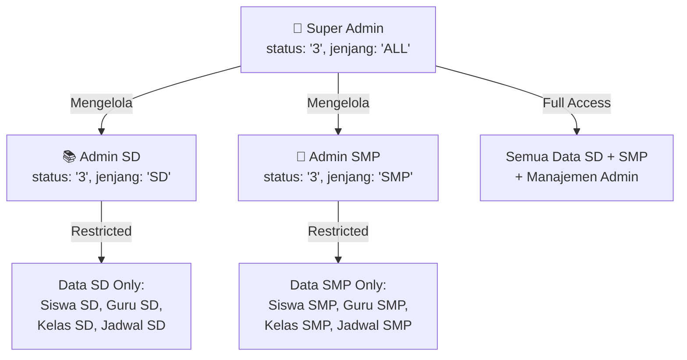
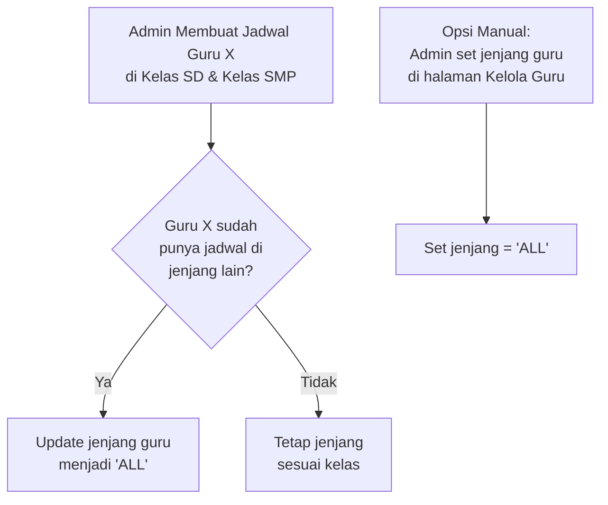

# 🏗️ Plan Update: Multi-Jenjang User Management & Admin Hierarchy

## SD - SMP Islam Al-Azhar Cairo Palembang — Student Apps

---

## 📌 Daftar Isi

1. [Ringkasan Masalah & Tujuan](#-1-ringkasan-masalah--tujuan)
2. [Arsitektur Baru: Peta Peran & Jenjang](#-2-arsitektur-baru-peta-peran--jenjang)
3. [Perubahan Database Schema (Prisma)](#-3-perubahan-database-schema-prisma)
4. [Perubahan Autentikasi & Sesi](#-4-perubahan-autentikasi--sesi)
5. [Perubahan Middleware (Proxy)](#-5-perubahan-middleware-proxy)
6. [Dashboard Guru: Filter Data per Jenjang](#-6-dashboard-guru-filter-data-per-jenjang)
7. [Dashboard Admin: Scope per Jenjang](#-7-dashboard-admin-scope-per-jenjang)
8. [Solusi Guru Lintas Jenjang (SD + SMP)](#-8-solusi-guru-lintas-jenjang-sd--smp)
9. [Akun Demo Baru di Halaman Login](#-9-akun-demo-baru-di-halaman-login)
10. [Fase Implementasi (Roadmap)](#-10-fase-implementasi-roadmap)
11. [File-File yang Terdampak](#-11-file-file-yang-terdampak)

---

## 📋 1. Ringkasan Masalah & Tujuan

### Masalah Saat Ini

| # | Masalah | Detail |
|---|---------|--------|
| 1 | **Tidak ada konsep jenjang pada user** | Tabel `users` tidak memiliki kolom `jenjang`. Guru SD dan SMP melihat data yang sama di dashboard. |
| 2 | **Admin = Super Admin tanpa granularitas** | Semua admin (`status: "3"`) memiliki akses penuh ke semua data SD + SMP tanpa pembatasan. |
| 3 | **Guru lintas jenjang tidak terakomodasi** | Tidak ada mekanisme bagi guru yang mengajar di kedua jenjang (SD & SMP) sekaligus. |
| 4 | **Demo account tidak mencakup semua skenario** | Halaman login hanya memiliki demo: Admin, Guru 1, Guru 2, dan beberapa Siswa. |

### Tujuan Update

1. **Guru/Wali Kelas per jenjang** — Dashboard yang sama, tapi data yang tampil sesuai jenjang (SD/SMP/keduanya).
2. **Hirarki Admin** — Super Admin (full access) + Admin Jenjang (hanya SD atau hanya SMP).
3. **Guru lintas jenjang** — Mekanisme bagi guru yang mengajar di SD dan SMP sekaligus, dengan jenjang switcher.
4. **Akun demo lengkap** — Super Admin, Admin SD, Admin SMP, Guru SD, Guru & Walas SD, Guru SMP, Guru & Walas SMP, Siswa SD, Siswa SMP.

---

## 🏛️ 2. Arsitektur Baru: Peta Peran & Jenjang

### Status Code Mapping (Tidak Berubah)

Kode status `users.status` tetap **tidak diubah** untuk menjaga kompatibilitas dengan data lama:

| Status | Role | Keterangan |
|--------|------|------------|
| `"0"` | Pending | Belum diverifikasi |
| `"1"` | Siswa | Peserta didik aktif |
| `"2"` | Guru Mapel | Pengampu mata pelajaran |
| `"3"` | Admin | Administrator (sekarang bisa Super Admin atau Admin Jenjang) |
| `"4"` | Guru & Wali Kelas | Guru + perwalian rombel |

### Kolom Baru: `jenjang` pada User

Menambahkan kolom `jenjang` pada tabel `users` untuk menentukan scope data per jenjang:

| Nilai `jenjang` | Deskripsi | Berlaku Untuk |
|-----------------|-----------|---------------|
| `"SD"` | Hanya akses data SD | Guru SD, Admin SD, Siswa SD |
| `"SMP"` | Hanya akses data SMP | Guru SMP, Admin SMP, Siswa SMP |
| `"ALL"` | Akses semua jenjang | Super Admin, Guru lintas jenjang |
| `null` | Default (backward compat) | Diperlakukan sebagai `"SD"` untuk guru/siswa, `"ALL"` untuk admin |

### Matriks Akses Lengkap

```
┌─────────────────────────┬──────────┬──────────┬──────────────────────────────┐
│ Peran                   │ Status   │ Jenjang  │ Data yang Dapat Diakses      │
├─────────────────────────┼──────────┼──────────┼──────────────────────────────┤
│ Super Admin             │ "3"      │ "ALL"    │ Semua data SD + SMP          │
│ Admin SD                │ "3"      │ "SD"     │ Hanya data kelas/siswa/      │
│                         │          │          │ guru/jadwal/tugas SD         │
│ Admin SMP               │ "3"      │ "SMP"    │ Hanya data kelas/siswa/      │
│                         │          │          │ guru/jadwal/tugas SMP        │
├─────────────────────────┼──────────┼──────────┼──────────────────────────────┤
│ Guru Mapel SD           │ "2"      │ "SD"     │ Kelas SD yang dia ajar       │
│ Guru Mapel SMP          │ "2"      │ "SMP"    │ Kelas SMP yang dia ajar      │
│ Guru Mapel Lintas       │ "2"      │ "ALL"    │ Kelas SD + SMP yang dia ajar │
├─────────────────────────┼──────────┼──────────┼──────────────────────────────┤
│ Guru & Walas SD         │ "4"      │ "SD"     │ Kelas SD binaan + jadwal SD  │
│ Guru & Walas SMP        │ "4"      │ "SMP"    │ Kelas SMP binaan + jadwal SMP│
│ Guru & Walas Lintas     │ "4"      │ "ALL"    │ Kelas binaan di kedua jenjang│
├─────────────────────────┼──────────┼──────────┼──────────────────────────────┤
│ Siswa SD                │ "1"      │ "SD"     │ Data kelas SD-nya sendiri    │
│ Siswa SMP               │ "1"      │ "SMP"    │ Data kelas SMP-nya sendiri   │
└─────────────────────────┴──────────┴──────────┴──────────────────────────────┘
```

---

## 🗄️ 3. Perubahan Database Schema (Prisma)

### 3.1 Tambah Kolom `jenjang` pada Model `User`

```prisma
model User {
  id                BigInt          @id @default(autoincrement()) @db.UnsignedBigInt
  name              String          @db.VarChar(255)
  nis               String?         @db.VarChar(255)
  nip               String?         @db.VarChar(255)
  guru_bidang       String?         @map("guru-bidang") @db.VarChar(255)
  email             String          @unique(map: "users_email_unique") @db.VarChar(255)
  // ... kolom existing tetap ...
  status            String          @default("0") @db.VarChar(255)
  jenjang           String?         @db.VarChar(20)  // ← BARU: "SD", "SMP", "ALL", null
  kelas             String?         @db.VarChar(255)
  // ... sisa kolom tetap ...

  @@index([kelas, status])
  @@index([status])
  @@index([jenjang, status])  // ← INDEX BARU untuk query per jenjang
  @@map("users")
}
```

### 3.2 Migrasi Data Existing

```sql
-- Migrasi: Set jenjang untuk user existing berdasarkan kelas mereka
-- Siswa: deteksi dari nama kelas
UPDATE users
SET jenjang = CASE
  WHEN kelas LIKE 'Kelas 7%' OR kelas LIKE 'Kelas 8%' OR kelas LIKE 'Kelas 9%' 
       OR kelas LIKE '%SMP%' THEN 'SMP'
  WHEN kelas IS NOT NULL THEN 'SD'
  ELSE NULL
END
WHERE status = '1';

-- Guru: deteksi dari kelas yang mereka ajar (via jadwal)
-- Guru yang mengajar di kedua jenjang → 'ALL'
-- Guru yang hanya di SD → 'SD'
-- Guru yang hanya di SMP → 'SMP'
UPDATE users u
SET u.jenjang = (
  SELECT
    CASE
      WHEN COUNT(DISTINCT k.jenjang) > 1 THEN 'ALL'
      WHEN MAX(k.jenjang) = 'SMP' THEN 'SMP'
      ELSE 'SD'
    END
  FROM tbl_jadwal_pelajaran jp
  JOIN tbl_kelas k ON jp.kelas_id = k.id
  WHERE jp.guru_id = u.id
)
WHERE u.status IN ('2', '4');

-- Admin existing: set sebagai Super Admin (ALL)
UPDATE users SET jenjang = 'ALL' WHERE status = '3';
```

### 3.3 Hubungan Jenjang dengan Tabel Lain

Tabel-tabel berikut sudah memiliki konsep jenjang secara implisit melalui relasi ke `Kelas` (yang sudah punya kolom `jenjang`):

| Tabel | Cara Deteksi Jenjang |
|-------|---------------------|
| `tbl_kelas` | Kolom `jenjang` langsung (`"SD"` / `"SMP"`) |
| `tbl_jadwal_pelajaran` | Via `kelas_id` → `Kelas.jenjang` |
| `tbl_tugas` | Via `kelas_id` → `Kelas.jenjang` |
| `tbl_pertemuan` | Via `kelas_id` → `Kelas.jenjang` |
| `tbl_absen` | Via `kelas` nama kelas + `kelas_id` → `Kelas.jenjang` |
| `tbl_mata_pelajaran` | Kolom `jenjang` langsung (`"SD"` / `"SMP"` / `"SEMUA"`) |

> **Tidak perlu menambah kolom `jenjang` baru ke tabel-tabel ini** — cukup filter via relasi ke `Kelas` yang sudah ada.

---

## 🔐 4. Perubahan Autentikasi & Sesi

### 4.1 Tambah `jenjang` dan `activeJenjang` ke `SessionUser`

**File:** `src/lib/auth.ts`

```typescript
export interface SessionUser {
  id: string;
  name: string;
  email: string;
  role: "admin" | "guru" | "siswa";
  status: string;
  jenjang: "SD" | "SMP" | "ALL";        // ← BARU
  activeJenjang?: "SD" | "SMP" | "ALL";  // ← BARU: jenjang yang sedang aktif dilihat
  kelas?: string | null;
  nis?: string | null;
  nip?: string | null;
  appleid?: string | null;
  gender?: string | null;
  image?: string | null;
}
```

### 4.2 Update `authenticateUser()` — Muat Jenjang ke Sesi

```typescript
// Di dalam authenticateUser(), setelah user berhasil login:
const jenjang = resolveUserJenjang(user.jenjang, user.status, user.kelas);

const sessionUser: SessionUser = {
  id: user.id.toString(),
  name: user.name,
  email: user.email,
  role,
  status: user.status,
  jenjang,                         // ← BARU
  activeJenjang: jenjang,          // ← Default = jenjang utama
  kelas: user.kelas || null,
  // ... sisa field sama ...
};
```

### 4.3 Helper `resolveUserJenjang()`

```typescript
// src/lib/utils.ts
export function resolveUserJenjang(
  dbJenjang: string | null | undefined,
  status: string,
  kelas: string | null | undefined
): "SD" | "SMP" | "ALL" {
  // Jika sudah di-set di DB, pakai langsung
  if (dbJenjang === "ALL" || dbJenjang === "SD" || dbJenjang === "SMP") {
    return dbJenjang;
  }

  // Admin tanpa jenjang → Super Admin (ALL)
  if (status === "3") return "ALL";

  // Deteksi dari kelas untuk siswa/guru
  if (kelas) {
    if (/^Kelas (7|8|9)/i.test(kelas) || /SMP/i.test(kelas)) return "SMP";
    return "SD";
  }

  // Default fallback
  return "SD";
}
```

### 4.4 Update `getRoleFromStatus()` — Tambah Label Admin

```typescript
export function getAdminTypeLabel(jenjang: string): string {
  if (jenjang === "ALL") return "Super Administrator";
  if (jenjang === "SD") return "Admin SD";
  if (jenjang === "SMP") return "Admin SMP";
  return "Administrator";
}
```

---

## 🛡️ 5. Perubahan Middleware (Proxy)

### 5.1 Admin Jenjang: Restrict Route Access

**File:** `src/proxy.ts`

Untuk Admin SD/SMP, tidak perlu membuat rute terpisah `/admin-sd` atau `/admin-smp`. Semua admin tetap menggunakan rute `/admin/*`. Pembatasan data dilakukan di **level query** (server-side), bukan di level routing.

```typescript
// proxy.ts — Tidak ada perubahan besar di routing
// Kontrol akses jenjang dilakukan di:
// 1. Server Components (page.tsx) → filter query berdasarkan session.jenjang
// 2. Server Actions → validasi jenjang sebelum mutasi
```

> **Keputusan Desain:** Rute tetap `/admin/*` untuk semua admin. Pembatasan scope terjadi di level data query, bukan URL. Ini lebih sederhana, menghindari duplikasi halaman, dan lebih maintainable.

---

## 📊 6. Dashboard Guru: Filter Data per Jenjang

### 6.1 Prinsip Utama

> **Dashboard guru tampilannya 100% sama** untuk semua jenjang. Yang berbeda hanyalah **data yang di-query** berdasarkan `session.jenjang` dan `session.activeJenjang`.

### 6.2 Jenjang-Aware Query Pattern

Setiap halaman guru yang melakukan query ke database harus memfilter berdasarkan jenjang. Contoh di `GuruDashboardPage`:

```typescript
// src/app/(dashboard)/guru/page.tsx

export default async function GuruDashboardPage() {
  const session = await getSession();
  // ...
  
  const activeJenjang = session.activeJenjang || session.jenjang; // "SD" | "SMP" | "ALL"
  
  // Bangun filter jenjang untuk kelas
  const jenjangFilter = activeJenjang === "ALL"
    ? {}  // Tidak filter → tampilkan semua
    : { jenjang: activeJenjang };  // Filter berdasarkan jenjang aktif

  // Query jadwal guru hanya di kelas yang sesuai jenjang
  const jadwal = await prisma.jadwalPelajaran.findMany({
    where: {
      guru_id: guruIdBigInt,
      kelas: { ...jenjangFilter },  // ← FILTER JENJANG
    },
    include: { kelas: true, mapel: true },
  });

  // Query tugas guru hanya di kelas yang sesuai jenjang
  const tugas = await prisma.tugas.findMany({
    where: {
      guru_id: guruIdBigInt,
      kelas: { ...jenjangFilter },  // ← FILTER JENJANG
    },
  });

  // ... dan seterusnya untuk setiap query
}
```

### 6.3 Halaman-Halaman Guru yang Terdampak

| Halaman | File | Perubahan |
|---------|------|-----------|
| Dashboard | `guru/page.tsx` | Filter kelas rombel, jadwal, tugas, presensi berdasarkan jenjang |
| Mata Pelajaran | `guru/mapel/page.tsx` | Filter mapel yang tampil sesuai jenjang (SD/SMP/SEMUA) |
| Presensi KBM | `guru/attendance/page.tsx` | Filter jadwal & kelas per jenjang |
| Rekap Presensi | `guru/attendance/recap/page.tsx` | Filter rekap per jenjang |
| Kelas Saya (Walas) | `guru/my-class/page.tsx` | Filter siswa rombel per jenjang |
| Tugas | `guru/tugas/page.tsx` | Filter tugas per jenjang |
| Prestasi Siswa | `guru/achievements/page.tsx` | Filter prestasi per jenjang |
| Kedisiplinan | `guru/violations/page.tsx` | Filter pelanggaran per jenjang |
| Kelas Online | `guru/kelas-online/page.tsx` | Filter sesi online per jenjang |
| Chat | `guru/chat/page.tsx` | Filter daftar siswa chat per jenjang |

### 6.4 Jenjang Switcher Component (untuk Guru Lintas Jenjang)

Guru dengan `jenjang: "ALL"` akan mendapatkan komponen switcher di header/topbar:

```
┌─────────────────────────────────────────────────────────┐
│  🏫 SD Islam Al-Azhar  │  🏫 SMP Islam Al-Azhar  │ ALL │   ← Jenjang Tabs
├─────────────────────────────────────────────────────────┤
│  [Dashboard Content filtered by active jenjang]         │
└─────────────────────────────────────────────────────────┘
```

Implementasi:

```typescript
// src/components/shared/jenjang-switcher.tsx

"use client";

interface JenjangSwitcherProps {
  userJenjang: "SD" | "SMP" | "ALL";
  activeJenjang: "SD" | "SMP" | "ALL";
}

export function JenjangSwitcher({ userJenjang, activeJenjang }: JenjangSwitcherProps) {
  // Hanya tampil jika user punya akses ke lebih dari 1 jenjang
  if (userJenjang !== "ALL") return null;

  return (
    <div className="flex items-center gap-1 bg-muted/50 rounded-lg p-1">
      <JenjangTab value="SD" label="SD" active={activeJenjang === "SD"} />
      <JenjangTab value="SMP" label="SMP" active={activeJenjang === "SMP"} />
      <JenjangTab value="ALL" label="Semua" active={activeJenjang === "ALL"} />
    </div>
  );
}
```

Mekanisme penyimpanan `activeJenjang`:
- Menggunakan **cookie** (`alazhar_active_jenjang`), bukan session JWT, agar bisa di-switch tanpa re-login.
- Server Component membaca cookie ini lalu mem-filter query sesuai jenjang aktif.
- Server Action `switchJenjangAction(jenjang)` mengubah cookie.

---

## 🛠️ 7. Dashboard Admin: Scope per Jenjang

### 7.1 Hierarki Admin



### 7.2 Fitur Khusus Super Admin

Super Admin (`status: "3"`, `jenjang: "ALL"`) mendapatkan menu tambahan:

| Fitur | Deskripsi |
|-------|-----------|
| **Kelola Admin** (`/admin/manage-admins`) | CRUD admin SD & admin SMP. Hanya Super Admin yang bisa membuat/menghapus admin lain. |
| **Jenjang Switcher** | Sama seperti guru, Super Admin bisa switch view antara SD / SMP / Semua. |
| **Lihat Semua Data** | Akses ke semua kelas, siswa, guru di kedua jenjang. |

### 7.3 Fitur Admin Jenjang (Admin SD / Admin SMP)

Admin jenjang **tidak bisa**:
- ❌ Membuat/menghapus admin lain
- ❌ Melihat data jenjang di luar scope-nya
- ❌ Mengubah jenjang akun guru/siswa ke jenjang lain

Admin jenjang **bisa**:
- ✅ Kelola siswa, guru, kelas, jadwal, presensi **di jenjang-nya**
- ✅ Verifikasi guru baru **di jenjang-nya**
- ✅ Buat pengumuman, kalender, kelas online **di jenjang-nya**

### 7.4 Query Pattern untuk Admin

```typescript
// Pattern umum di setiap halaman admin
export default async function AdminStudentsPage() {
  const session = await getSession();
  const activeJenjang = getActiveJenjang(session); // dari cookie atau session

  // Admin SD hanya lihat siswa SD, Super Admin lihat semua
  const students = await prisma.user.findMany({
    where: {
      status: { in: ["0", "1"] },
      jenjang: activeJenjang === "ALL" ? undefined : activeJenjang,
    },
  });
}
```

### 7.5 Proteksi Server Action untuk Admin

```typescript
// src/lib/auth-guard.ts

export async function requireAdminAccess(requiredJenjang?: "SD" | "SMP"): Promise<SessionUser> {
  const session = await getSession();
  if (!session || session.role !== "admin") {
    throw new Error("Unauthorized: Hanya admin yang dapat mengakses.");
  }

  // Jika admin jenjang mencoba akses data di luar scope-nya
  if (requiredJenjang && session.jenjang !== "ALL" && session.jenjang !== requiredJenjang) {
    throw new Error("Unauthorized: Anda tidak memiliki akses ke data jenjang ini.");
  }

  return session;
}

export async function requireSuperAdmin(): Promise<SessionUser> {
  const session = await getSession();
  if (!session || session.role !== "admin" || session.jenjang !== "ALL") {
    throw new Error("Unauthorized: Hanya Super Admin yang dapat mengakses fitur ini.");
  }
  return session;
}
```

### 7.6 Sidebar Admin — Menu Kondisional

```typescript
// src/components/layouts/sidebar.tsx

const adminMenu: MenuItemType[] = [
  { label: "Dashboard", href: "/admin", icon: LayoutDashboardIcon },
  { label: "Kelola Siswa", href: "/admin/students", icon: GraduationCap },
  { label: "Kelola Guru", href: "/admin/teachers", icon: Users },
  { label: "Kelola Kelas", href: "/admin/classes", icon: BuildingLibraryIcon },
  { label: "Mata Pelajaran", href: "/admin/subjects", icon: BookOpenCheckIcon },
  { label: "Jadwal Pelajaran", href: "/admin/schedules", icon: CalendarClock },
  { label: "Presensi Siswa", href: "/admin/attendance", icon: ClipboardListIcon },
  { label: "Buat Pengumuman", href: "/admin/announcements", icon: MegaphoneIcon },
  { label: "Kalender Kegiatan", href: "/admin/calendar", icon: CalendarDaysIcon },
  { label: "Monitor Kelas Online", href: "/admin/kelas-online", icon: VideoIcon },
  // ↓ BARU: Hanya tampil untuk Super Admin
  ...(jenjang === "ALL" ? [
    { label: "Kelola Admin", href: "/admin/manage-admins", icon: ShieldCheck },
  ] : []),
];
```

---

## 🔄 8. Solusi Guru Lintas Jenjang (SD + SMP)

### 8.1 Masalah

Beberapa guru mengajar di **kedua jenjang** — misalnya Ustadz Ahmad mengajar Bahasa Arab di SD dan SMP. Mereka memerlukan:
- Satu akun tunggal (tidak boleh 2 akun).
- Bisa melihat data SD atau SMP secara terpisah.
- Dashboard yang menampilkan data sesuai jenjang yang sedang aktif.

### 8.2 Solusi: `jenjang: "ALL"` + Jenjang Switcher

```
┌──────────────────────────────────────────────────────────────────┐
│ Header Topbar                                                    │
│ ┌─────────────────────────────┐                                  │
│ │ [SD] [SMP] [Semua]          │  ← Hanya muncul jika jenjang=ALL │
│ └─────────────────────────────┘                                  │
├──────────────────────────────────────────────────────────────────┤
│                                                                  │
│  Saat "SD" dipilih:                                              │
│  - Jadwal mengajar: hanya kelas SD                               │
│  - Tugas: hanya tugas di kelas SD                                │
│  - Presensi: hanya presensi kelas SD                             │
│  - Mata Pelajaran: hanya mapel SD + SEMUA                        │
│  - Kelas Saya (walas): hanya rombel SD                           │
│                                                                  │
│  Saat "SMP" dipilih:                                             │
│  - Semua data yang tampil adalah SMP                             │
│                                                                  │
│  Saat "Semua" dipilih:                                           │
│  - Gabungan data SD + SMP (diberi badge label jenjang)           │
│                                                                  │
└──────────────────────────────────────────────────────────────────┘
```

### 8.3 Alur Deteksi Guru Lintas Jenjang



Ada dua mekanisme untuk set guru lintas jenjang:

1. **Otomatis**: Saat admin membuat jadwal di kelas jenjang berbeda, sistem mendeteksi dan auto-update `jenjang` guru menjadi `"ALL"`.
2. **Manual**: Admin bisa langsung set `jenjang` guru di halaman `/admin/teachers` saat verifikasi atau edit.

### 8.4 Guru & Wali Kelas Lintas Jenjang

Skenario khusus: Guru yang menjadi **wali kelas di SD** sekaligus **mengajar di SMP**.

- Kolom `kelas` tetap menyimpan **satu** nama kelas rombel binaan (perwalian utama).
- Jenjang diset `"ALL"`.
- Di sidebar, menu "Kelas Saya" menampilkan kelas perwaliannya.
- Jadwal mengajar & tugas di-filter berdasarkan `activeJenjang`.

> **Catatan**: Jika guru harus menjadi wali kelas di 2 rombel berbeda jenjang (misal wali kelas 4A SD dan kelas 7B SMP), itu skenario yang sangat jarang. Untuk saat ini, satu guru = satu rombel perwalian. Jika dibutuhkan, bisa ditambahkan tabel relasi `guru_kelas_wali` di fase berikutnya.

---

## 🎭 9. Akun Demo Baru di Halaman Login

### 9.1 Daftar Akun Demo

| # | Label Tombol | Email | Password | Status | Jenjang | Kelas | Deskripsi |
|---|-------------|-------|----------|--------|---------|-------|-----------|
| 1 | **Super Admin** | `superadmin@gmail.com` | `admin123` | `"3"` | `"ALL"` | — | Full akses SD + SMP + kelola admin |
| 2 | **Admin SD** | `admin.sd@gmail.com` | `admin123` | `"3"` | `"SD"` | — | Kelola data SD saja |
| 3 | **Admin SMP** | `admin.smp@gmail.com` | `admin123` | `"3"` | `"SMP"` | — | Kelola data SMP saja |
| 4 | **Guru SD** | `guru.sd@gmail.com` | `guru123` | `"2"` | `"SD"` | — | Guru mapel SD |
| 5 | **Guru & Walas SD** | `walas.sd@gmail.com` | `guru123` | `"4"` | `"SD"` | `Kelas 4 - Mehmed Al Fatih` | Wali kelas SD |
| 6 | **Guru SMP** | `guru.smp@gmail.com` | `guru123` | `"2"` | `"SMP"` | — | Guru mapel SMP |
| 7 | **Guru & Walas SMP** | `walas.smp@gmail.com` | `guru123` | `"4"` | `"SMP"` | `Kelas 7 - Ibnu Sina` | Wali kelas SMP |
| 8 | **Guru SD & SMP** | `guru.lintas@gmail.com` | `guru123` | `"2"` | `"ALL"` | — | Guru mapel lintas jenjang |
| 9 | **Siswa SD** | `siswa.sd@gmail.com` | `siswa123` | `"1"` | `"SD"` | `Kelas 4 - Mehmed Al Fatih` | Siswa SD |
| 10 | **Siswa SMP** | `siswa.smp@gmail.com` | `siswa123` | `"1"` | `"SMP"` | `Kelas 7 - Ibnu Sina` | Siswa SMP |

### 9.2 Layout Demo Login di Halaman Login

```
┌─────────────────────────────────────────────────────────┐
│                    Mode Demo                            │
│                                                         │
│  👑 Admin                                               │
│  ┌──────────────┐ ┌──────────────┐ ┌──────────────┐    │
│  │ Super Admin  │ │  Admin SD    │ │  Admin SMP   │    │
│  └──────────────┘ └──────────────┘ └──────────────┘    │
│                                                         │
│  👨‍🏫 Guru SD                                            │
│  ┌──────────────┐ ┌──────────────┐                      │
│  │  Guru SD     │ │ Walas SD     │                      │
│  └──────────────┘ └──────────────┘                      │
│                                                         │
│  👨‍🏫 Guru SMP                                           │
│  ┌──────────────┐ ┌──────────────┐                      │
│  │  Guru SMP    │ │ Walas SMP    │                      │
│  └──────────────┘ └──────────────┘                      │
│                                                         │
│  🔄 Guru Lintas Jenjang                                 │
│  ┌──────────────────────────┐                           │
│  │  Guru SD & SMP           │                           │
│  └──────────────────────────┘                           │
│                                                         │
│  🎒 Siswa                                               │
│  ┌──────────────┐ ┌──────────────┐                      │
│  │  Siswa SD    │ │  Siswa SMP   │                      │
│  └──────────────┘ └──────────────┘                      │
└─────────────────────────────────────────────────────────┘
```

### 9.3 Update DemoRole Type & Credentials

```typescript
// src/lib/auth.ts

export type DemoRole =
  | "superadmin"
  | "admin_sd"
  | "admin_smp"
  | "guru_sd"
  | "walas_sd"
  | "guru_smp"
  | "walas_smp"
  | "guru_lintas"
  | "siswa_sd"
  | "siswa_smp";

const demoCredentials: Record<DemoRole, { email: string; pw: string }> = {
  superadmin:   { email: "superadmin@gmail.com",  pw: "admin123" },
  admin_sd:     { email: "admin.sd@gmail.com",    pw: "admin123" },
  admin_smp:    { email: "admin.smp@gmail.com",   pw: "admin123" },
  guru_sd:      { email: "guru.sd@gmail.com",     pw: "guru123" },
  walas_sd:     { email: "walas.sd@gmail.com",     pw: "guru123" },
  guru_smp:     { email: "guru.smp@gmail.com",    pw: "guru123" },
  walas_smp:    { email: "walas.smp@gmail.com",    pw: "guru123" },
  guru_lintas:  { email: "guru.lintas@gmail.com",  pw: "guru123" },
  siswa_sd:     { email: "siswa.sd@gmail.com",    pw: "siswa123" },
  siswa_smp:    { email: "siswa.smp@gmail.com",   pw: "siswa123" },
};
```

---

## 📅 10. Fase Implementasi (Roadmap)

### Fase 1: Foundation — Schema & Auth (Estimasi: 2-3 hari)

> **Tujuan**: Menambahkan infrastruktur jenjang tanpa merusak fitur existing.

| # | Task | File Terdampak | Prioritas |
|---|------|---------------|-----------|
| 1.1 | Tambah kolom `jenjang` ke model `User` di Prisma | `prisma/schema.prisma` | 🔴 Critical |
| 1.2 | Buat & jalankan migration + seed data migrasi | `prisma/seed.ts` + migration SQL | 🔴 Critical |
| 1.3 | Update `SessionUser` interface → tambah `jenjang` & `activeJenjang` | `src/lib/auth.ts` | 🔴 Critical |
| 1.4 | Tambah helper `resolveUserJenjang()` | `src/lib/utils.ts` | 🔴 Critical |
| 1.5 | Update `authenticateUser()` → muat `jenjang` ke sesi | `src/lib/auth.ts` | 🔴 Critical |
| 1.6 | Buat `requireAdminAccess()` & `requireSuperAdmin()` guards | `src/lib/auth-guard.ts` (baru) | 🟡 High |
| 1.7 | Update `DemoRole` type + demo accounts + seed demo users | `src/lib/auth.ts`, `prisma/seed.ts` | 🟡 High |

### Fase 2: Admin Hierarchy (Estimasi: 3-4 hari)

> **Tujuan**: Implementasi Super Admin + Admin SD/SMP.

| # | Task | File Terdampak | Prioritas |
|---|------|---------------|-----------|
| 2.1 | Buat halaman `/admin/manage-admins` (CRUD admin) | `src/app/(dashboard)/admin/manage-admins/` (baru) | 🔴 Critical |
| 2.2 | Update sidebar admin → tambah menu "Kelola Admin" kondisional | `src/components/layouts/sidebar.tsx` | 🟡 High |
| 2.3 | Update halaman `/admin/students` → filter by jenjang | `src/app/(dashboard)/admin/students/page.tsx` | 🟡 High |
| 2.4 | Update halaman `/admin/teachers` → filter by jenjang | `src/app/(dashboard)/admin/teachers/page.tsx` | 🟡 High |
| 2.5 | Update halaman `/admin/classes` → filter by jenjang | `src/app/(dashboard)/admin/classes/page.tsx` | 🟡 High |
| 2.6 | Update halaman `/admin/schedules` → filter by jenjang | `src/app/(dashboard)/admin/schedules/page.tsx` | 🟡 High |
| 2.7 | Update halaman `/admin/subjects` → filter by jenjang | `src/app/(dashboard)/admin/subjects/page.tsx` | 🟡 High |
| 2.8 | Update halaman `/admin/attendance` → filter by jenjang | `src/app/(dashboard)/admin/attendance/page.tsx` | 🟢 Medium |
| 2.9 | Update admin dashboard → statistik per jenjang | `src/app/(dashboard)/admin/page.tsx` | 🟢 Medium |
| 2.10 | Proteksi server actions admin → cek jenjang scope | Semua file `src/actions/admin*.ts` | 🟡 High |

### Fase 3: Guru Jenjang-Aware Dashboard (Estimasi: 3-4 hari)

> **Tujuan**: Dashboard guru menampilkan data sesuai jenjang.

| # | Task | File Terdampak | Prioritas |
|---|------|---------------|-----------|
| 3.1 | Buat `JenjangSwitcher` component | `src/components/shared/jenjang-switcher.tsx` (baru) | 🔴 Critical |
| 3.2 | Buat server action `switchJenjangAction()` → set cookie | `src/actions/jenjang.ts` (baru) | 🔴 Critical |
| 3.3 | Buat helper `getActiveJenjang(session)` → baca cookie | `src/lib/jenjang.ts` (baru) | 🔴 Critical |
| 3.4 | Integrasikan JenjangSwitcher ke topbar/header | `src/components/layouts/dashboard-shell.tsx` | 🟡 High |
| 3.5 | Update guru dashboard → filter data per jenjang | `src/app/(dashboard)/guru/page.tsx` | 🟡 High |
| 3.6 | Update guru mapel → filter mapel per jenjang | `src/app/(dashboard)/guru/mapel/page.tsx` | 🟡 High |
| 3.7 | Update guru presensi → filter per jenjang | `src/app/(dashboard)/guru/attendance/**` | 🟡 High |
| 3.8 | Update guru tugas → filter per jenjang | `src/app/(dashboard)/guru/tugas/**` | 🟡 High |
| 3.9 | Update guru my-class → filter per jenjang | `src/app/(dashboard)/guru/my-class/**` | 🟡 High |
| 3.10 | Update guru achievements → filter per jenjang | `src/app/(dashboard)/guru/achievements/**` | 🟢 Medium |
| 3.11 | Update guru violations → filter per jenjang | `src/app/(dashboard)/guru/violations/**` | 🟢 Medium |
| 3.12 | Update guru kelas-online → filter per jenjang | `src/app/(dashboard)/guru/kelas-online/**` | 🟢 Medium |
| 3.13 | Update guru chat → filter siswa per jenjang | `src/app/(dashboard)/guru/chat/**` | 🟢 Medium |

### Fase 4: Login & Demo Accounts (Estimasi: 1-2 hari)

> **Tujuan**: Update halaman login dengan demo accounts baru.

| # | Task | File Terdampak | Prioritas |
|---|------|---------------|-----------|
| 4.1 | Update UI demo login buttons sesuai layout baru | `src/components/features/auth/auth-switch.tsx` | 🟡 High |
| 4.2 | Update `loginAsDemoRole()` dengan credentials baru | `src/lib/auth.ts` | 🟡 High |
| 4.3 | Update `demoLoginDirectAction()` | `src/actions/auth.ts` | 🟡 High |
| 4.4 | Update seed data demo users dengan jenjang | `prisma/seed.ts` | 🟡 High |
| 4.5 | Backward compat: akun demo lama tetap bisa login | `src/lib/auth.ts` | 🟢 Medium |

### Fase 5: Polish & Testing (Estimasi: 2-3 hari)

| # | Task | Prioritas |
|---|------|-----------|
| 5.1 | Label jenjang di header/sidebar (badge "SD" / "SMP" / "Super Admin") | 🟢 Medium |
| 5.2 | Auto-detect jenjang saat admin buat jadwal lintas jenjang | 🟢 Medium |
| 5.3 | Testing end-to-end: login semua demo role | 🔴 Critical |
| 5.4 | Testing: Admin SD tidak bisa akses data SMP | 🔴 Critical |
| 5.5 | Testing: Guru lintas jenjang bisa switch view | 🔴 Critical |
| 5.6 | Migrasi data production (jika ada) | 🔴 Critical |

---

## 📁 11. File-File yang Terdampak

### File Baru yang Perlu Dibuat

| File | Deskripsi |
|------|-----------|
| `src/lib/auth-guard.ts` | Guard functions: `requireAdminAccess()`, `requireSuperAdmin()` |
| `src/lib/jenjang.ts` | Helper: `getActiveJenjang()`, `buildJenjangFilter()` |
| `src/components/shared/jenjang-switcher.tsx` | Komponen UI switcher jenjang SD/SMP/Semua |
| `src/actions/jenjang.ts` | Server action: `switchJenjangAction()` |
| `src/app/(dashboard)/admin/manage-admins/page.tsx` | Halaman kelola admin (Super Admin only) |
| `src/app/(dashboard)/admin/manage-admins/_components/` | Komponen CRUD admin |

### File Existing yang Dimodifikasi

| File | Jenis Perubahan |
|------|-----------------|
| `prisma/schema.prisma` | Tambah kolom `jenjang` + index |
| `prisma/seed.ts` | Tambah seed demo users baru |
| `src/lib/auth.ts` | Update `SessionUser`, `authenticateUser()`, `DemoRole`, demo accounts |
| `src/lib/utils.ts` | Tambah `resolveUserJenjang()`, `getAdminTypeLabel()` |
| `src/proxy.ts` | Minor: update `SessionPayload` interface |
| `src/components/layouts/sidebar.tsx` | Menu "Kelola Admin" kondisional + badge jenjang |
| `src/components/layouts/dashboard-shell.tsx` | Integrasikan JenjangSwitcher di topbar |
| `src/components/features/auth/auth-switch.tsx` | UI demo login buttons baru |
| `src/actions/auth.ts` | Update `demoLoginDirectAction()`, `registerTeacherAction()` |
| `src/services/user.service.ts` | Update `createUser()`, `updateUser()`, `verifyUser()` + jenjang |
| `src/app/(dashboard)/layout.tsx` | Muat `jenjang` dari DB ke sesi |
| `src/app/(dashboard)/admin/page.tsx` | Statistik per jenjang |
| `src/app/(dashboard)/admin/students/page.tsx` | Filter siswa per jenjang |
| `src/app/(dashboard)/admin/teachers/page.tsx` | Filter guru per jenjang |
| `src/app/(dashboard)/admin/classes/page.tsx` | Filter kelas per jenjang |
| `src/app/(dashboard)/admin/schedules/page.tsx` | Filter jadwal per jenjang |
| `src/app/(dashboard)/admin/subjects/page.tsx` | Filter mapel per jenjang |
| `src/app/(dashboard)/admin/attendance/page.tsx` | Filter presensi per jenjang |
| `src/app/(dashboard)/guru/page.tsx` | Dashboard guru jenjang-aware |
| `src/app/(dashboard)/guru/mapel/page.tsx` | Mapel per jenjang |
| `src/app/(dashboard)/guru/attendance/**` | Presensi per jenjang |
| `src/app/(dashboard)/guru/tugas/**` | Tugas per jenjang |
| `src/app/(dashboard)/guru/my-class/**` | Kelas wali per jenjang |
| `src/app/(dashboard)/guru/achievements/**` | Prestasi per jenjang |
| `src/app/(dashboard)/guru/violations/**` | Pelanggaran per jenjang |
| `src/app/(dashboard)/guru/kelas-online/**` | Kelas online per jenjang |
| `src/app/(dashboard)/guru/chat/**` | Chat per jenjang |

---

## ⚠️ Catatan Penting & Keputusan Desain

### 1. Backward Compatibility
- Kolom `jenjang` bersifat **nullable** → data lama tetap berfungsi.
- Jika `jenjang = null`, sistem menggunakan fallback: admin → `"ALL"`, guru/siswa → deteksi dari nama kelas.
- Akun demo lama (`admin@gmail.com`, `guru@gmail.com`, dll) **tetap bisa login** dan diperlakukan sebagai `jenjang: "ALL"`.

### 2. Tidak Membuat Rute Terpisah per Jenjang
- **TIDAK** membuat `/admin-sd/` dan `/admin-smp/` → terlalu banyak duplikasi.
- Semua admin menggunakan `/admin/*`, pembatasan via **data query** di server.

### 3. Jenjang Switcher via Cookie (Bukan JWT)
- `activeJenjang` disimpan di cookie biasa, bukan di JWT session.
- Alasan: Agar user bisa switch jenjang tanpa re-login (JWT immutable selama sesi).

### 4. Siswa Tidak Perlu Jenjang Switcher
- Siswa selalu melihat data kelasnya sendiri.
- `jenjang` pada siswa hanya untuk keperluan admin filtering.

### 5. Guru Lintas Jenjang: Skenario Wali Kelas
- Satu guru hanya bisa menjadi wali kelas di **satu rombel**.
- Jika guru `jenjang: "ALL"` dan `status: "4"` (wali kelas), rombel binaannya tetap satu (`kelas` field).
- Menu "Kelas Saya" menampilkan rombel binaan tersebut, terlepas dari `activeJenjang`.

---

> **Dokumen ini adalah blueprint teknis. Setelah disetujui, implementasi akan dilakukan secara bertahap sesuai fase di atas.**
